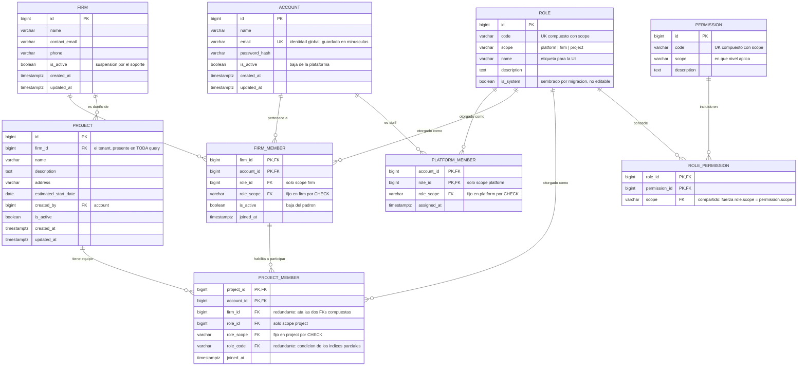

# ADR-002: Modelo de autorización — RBAC con permisos y alcance

**Estado:** Aceptada
**Fecha:** 2026-09-06 (aceptada 2026-09-07, al implementarse T-02)
**Contexto:** Modelo de usuarios, roles y permisos de la plataforma. Afecta a HU-1, HU-2 y HU-3 del Sprint 1, y a todo módulo posterior que lea o escriba datos de una obra.

---

## Contexto

### Qué producto estamos construyendo

La plataforma no es un sistema para *un* estudio de arquitectura: es un producto que **varios estudios usan en paralelo** para manejar sus obras. Esa sola frase determina la forma del modelo de autorización, porque introduce un requisito que ningún esquema de "columna `role` en la tabla usuario" puede cumplir: los datos de un estudio tienen que ser invisibles para los demás, y eso incluye los mails de sus usuarios.

Sobre esa base, el dominio impone siete requisitos concretos:

| | Requisito | Origen |
|---|---|---|
| R1 | Varios estudios conviven en la misma instalación y **jamás** ven datos ajenos | Producto multi-tenant |
| R2 | Una persona puede trabajar con **más de un estudio** con la misma cuenta (el arquitecto freelance, el cliente de dos estudios) | Realidad del rubro |
| R3 | Dentro de un estudio, cada persona ve **solo las obras en las que participa** | HU-3 |
| R4 | En una misma obra hay gente con capacidades distintas: quien la lidera, quien colabora, quien solo mira | Dominio |
| R5 | El **cliente** entra al sistema, ve su obra y **no** ve los costos internos del estudio | Decisión de producto |
| R6 | Existe un **dueño del estudio** con autoridad sobre su estudio, y un **soporte del sistema** que administra las cuentas | Decisión de producto |
| R7 | El catálogo de roles es **cerrado** por ahora, pero el producto va a crecer en funcionalidades (presupuestos, planificación, proveedores) y cada una trae capacidades nuevas | Roadmap |

### Por qué hay que decidir ahora

Un modelo de autorización no es una capa que se agregue después: define la forma de la tabla `account`, de `project`, y de **toda query de lectura del sistema**. Empezar HU-1 sin esto cerrado significa escribir el login, el listado de obras y sus filtros dos veces.

Además, hay un requisito irreversible: **R1 y R2 juntos determinan que `account` sea una identidad global sin `firm_id`**. Pasar de "un usuario pertenece a un estudio" a "un usuario pertenece a varios" con datos cargados obliga a partir la tabla de usuarios y reescribir la autenticación. Es la migración más cara del proyecto y la única que conviene evitar por anticipado.

### Qué reemplaza

Esta ADR **deja sin efecto** lo que dicen sobre usuarios y roles los documentos previos, que fueron escritos suponiendo un único estudio:

- `docs/modelo-datos-sprint-1.md`, §3.1 (roles globales N:M) y §3.2 (`project.client_id` + `project_member` con `role_in_project` como texto).
- `docs/historias/sprint-1.md`, decisiones de alcance: "el cliente de una obra es un usuario con rol `client`" y "existe un rol `admin`".

Ninguno de los dos es una ADR aceptada, así que no hay ADR que superar; sí hay que actualizarlos para que no contradigan esto.

No afecta a [ADR-001](0001-stack.md): el modelo se implementa con el mismo stack (PostgreSQL, SQLAlchemy 2.0, Alembic, FastAPI).

---

## Decisión

Adoptamos **RBAC con permisos y con alcance** (*scoped RBAC*): los roles agrupan permisos, y un rol se asigna a una persona **dentro de un ámbito concreto**. Es el modelo formalizado por el estándar NIST/ANSI INCITS 359 en su nivel base (RBAC0, sin jerarquía de roles), extendido con alcance de recurso, tal como lo implementan GitHub (organización + repositorio), Google Cloud IAM y Azure RBAC.

### 1. La regla central

> **El código chequea permisos, nunca roles.**

```python
# Sí
if account.can("project.edit", project_id=7): ...

# No
if account.role == "architect": ...
```

Esta regla es lo que hace que todo lo demás escale, y es la parte de la decisión que **no es negociable** aunque se simplifique el resto. Con chequeos por rol, mover una capacidad de un rol a otro obliga a buscar y editar condicionales repartidos por todo el backend, y siempre queda uno sin cambiar. Con chequeos por permiso, **los roles son datos**: agregar un rol es una fila, mover una capacidad es otra fila, y ningún endpoint se entera.

### 2. Tres ámbitos, que se apilan

```
platform   → staff del producto. No pertenece a ningún estudio
  firm     → el tenant: dueño, arquitectos, clientes
    project → el equipo de cada obra
```

Los ámbitos **no clasifican usuarios**: se acumulan sobre una misma identidad. La misma persona tiene, al mismo tiempo, como máximo un rol de plataforma, un rol en cada estudio del que es miembro, y un rol en cada obra en la que participa. Los permisos de un request son la **unión** de las capas que apliquen a ese request.

Y no son independientes: **la capa de estudio es la puerta de la capa de obra**. Una fila en `project_member` no otorga nada si la fila de padrón de esa persona en ese estudio está inactiva.

### 3. Esquema

**Todos los identificadores van en inglés.** Tablas, columnas, clases, códigos de permisos, códigos de roles y valores de `scope`. La documentación y la conversación del equipo siguen en español; el código, no. Esto alinea el modelo con lo que ya pedía `CLAUDE.md` y elimina la frontera difusa de "dominio en español, infraestructura en inglés", que obligaba a decidir columna por columna de qué lado caía cada una (`fecha_alta` era dominio o auditoría?) y ya había producido pares como `es_sistema` junto a `is_active`.

Dos consecuencias que conviene tener a mano al leer el resto:

- `usuario` es **`account`**, no `user`: `user` es palabra reservada en PostgreSQL y obligaría a entrecomillarla en toda query cruda. Además es literal a lo que dice esta ADR — una persona tiene una sola cuenta.
- `ambito` es **`scope`**, que además es el término del estándar: esta ADR adopta *scoped RBAC*.



El modelo son **seis tablas**, en dos grupos de tres:

- **Catálogo** (`permission`, `role`, `role_permission`) — define *qué existe*. No sabe nada de usuarios. Se siembra por migración y no se toca en runtime.
- **Asignaciones** (`platform_member`, `firm_member`, `project_member`) — definen *quién tiene qué, y dónde*. Cambian todo el tiempo.

### 4. Las tablas de catálogo

**`permission`** — el verbo atómico. `code` con formato `recurso.accion` es **lo único que aparece en el código**; el `id` existe solo para que las FKs sean chicas. La columna `scope` dice en qué nivel tiene sentido el permiso, y es lo que impide cablear `project.edit` al rol `support`: sin ella, una fila mal sembrada rompe el aislamiento entre estudios sin que nadie escriba una línea de código.

La unicidad es `UNIQUE (code, scope)` y no `UNIQUE (code)`, por la misma razón que en `role`: hay códigos que existen en dos ámbitos. En la tabla de la §7, `firm.view` y `firm.edit` los tienen a la vez el `support` (ámbito plataforma) y el `owner` (ámbito estudio), y **no son el mismo permiso**: el del soporte es "ver cualquier estudio de la plataforma", el del propietario es "ver el estudio en el que estoy actuando". Con un solo ámbito por código habría que elegir uno de los dos, y la regla de que un rol solo recibe permisos de su propio ámbito dejaría de poder escribirse. El código nunca ve esta duplicación: el chequeo siempre ocurre dentro de un ámbito concreto (`requires("firm.view", firm_id=...)`), así que el par `(code, scope)` está determinado por el sitio de la llamada.

**`role`** — un paquete con nombre. No tiene ninguna capacidad propia: todo lo que "puede un responsable" está en `role_permission`. `code` es el identificador estable (nunca se traduce, nunca se muestra crudo) y `name` es la etiqueta de la UI. La unicidad es `UNIQUE (code, scope)` y no `UNIQUE (code)`, porque `client` existe en dos ámbitos: como rol de estudio (estás en el padrón) y como rol de obra (ves esa obra). `is_system` hoy es siempre `TRUE`; existe para que el día que haya roles a medida, la distinción entre los roles que el producto necesita y los que inventó un estudio ya esté hecha y no requiera una migración sobre datos vivos.

**`role_permission`** — el cableado. Sin `id` propio ni timestamps: una fila significa exactamente "este rol concede este permiso". Lleva una columna `scope` que **no es un dato nuevo**, es el mecanismo: las dos FKs son compuestas —`(role_id, scope)` contra `role (id, scope)` y `(permission_id, scope)` contra `permission (id, scope)`— y al compartir la misma columna obligan a que el rol y el permiso sean del mismo ámbito. Así, "el `support` no puede recibir `project.edit`" no es una validación que alguien tenga que acordarse de escribir: es una fila que Postgres rechaza.

**Deliberadamente no tiene una columna `otorga/deniega`**: la regla es *deny by default*, la ausencia de fila es la negación. Con permisos negativos, saber si alguien puede hacer algo deja de ser una consulta y pasa a ser una resolución de precedencias entre roles, y nadie en el equipo puede explicar por qué un botón está deshabilitado. (AWS IAM sí tiene deny explícito; su tabla de precedencias es exactamente la complejidad que estamos eligiendo no comprar.)

Por la misma razón los conjuntos de permisos son **planos**: `lead` no hereda de `collaborator`, tiene sus filas escritas. Son unas decenas de filas más en el seed, a cambio de que "¿qué puede hacer un colaborador?" sea siempre un `SELECT` que no cambia solo cuando alguien toca otro rol. En términos del estándar, es RBAC0 y no RBAC1.

### 5. Las tablas de asignación

Las tres son la misma tupla `(account, role, ámbito)`. Lo que cambia es dónde aplica, y ese "dónde" no es una columna: **es en qué tabla estás**. Por eso son tres tablas explícitas y no una sola polimórfica con `scope_type`/`scope_id`: cada una puede tener FKs reales contra su recurso, cosa que una columna polimórfica no permite.

Las tres llevan una columna `role_scope` con un `CHECK` que la fija a un valor constante (`'platform'`, `'firm'`, `'project'` respectivamente) y una FK compuesta `(role_id, role_scope)` contra `role (id, scope)`. No aporta información —siempre vale lo mismo en toda la tabla—: es puramente el mecanismo con el que la base cumple lo que dice la §11, que en el padrón de un estudio no se pueda meter un rol de obra. Sin esa columna, la única forma de escribir esa regla sería un trigger o una validación en Python.

**`platform_member`** — el staff. En producción va a tener dos o tres filas para siempre. Quien está acá normalmente no está en ningún `firm_member`: son poblaciones separadas. `role_id` va dentro de la PK, así que soporta varios roles de plataforma el día que haya más de uno. **Ningún endpoint escribe en esta tabla**: el primer soporte entra por seed y los siguientes por migración. Es la tabla con más poder del sistema y ninguna historia pide administrarla por pantalla.

**`firm_member`** — el padrón. Acá vive el multi-tenant: una fila por (estudio, persona), y varias filas de la misma persona significan que pertenece a varios estudios, con rol posiblemente distinto en cada uno. `role_id` **no** está en la PK, y eso fuerza un solo rol por persona por estudio: `owner`, `architect` y `client` son categorías mutuamente excluyentes, y si alguien pudiera acumularlas, la regla "el cliente solo puede ser cliente en las obras" se volvería indecidible.

Los dos `is_active` significan cosas distintas y conviene no confundirlos nunca:

- `account.is_active = FALSE` → no puede loguearse **en ningún lado**. Baja de la plataforma.
- `firm_member.is_active = FALSE` → se loguea normal, pero **ese estudio dejó de existir para esa persona**. Es "el arquitecto renunció al estudio A y sigue trabajando en el B".

**`project_member`** — el equipo de cada obra. PK `(project_id, account_id)`: un rol por persona por obra. Es la tabla más consultada del sistema, porque de ella sale "mis obras", la primera pantalla después del login; necesita índice por `account_id`. Dos índices parciales expresan reglas del dominio directamente en el esquema: **un solo `lead` por obra** y **un solo `client` por obra**.

Para que esos dos índices se puedan escribir, la tabla lleva también `role_code`, y la FK contra `role` se extiende a `(role_id, role_scope, role_code)` → `role (id, scope, code)`. La razón es que un índice parcial de Postgres necesita una **condición literal**, y lo único que hay en la fila es `role_id`: un número que sale del seed y del que el esquema no puede hablar. Con el código denormalizado, la regla se escribe tal como se lee —`UNIQUE (project_id) WHERE role_code = 'lead'`— y la FK compuesta impide que ese código se desincronice del rol al que apunta. Es la misma técnica que ya se usa dos veces en esta tabla, aplicada una tercera.

La columna **`firm_id` es redundante a propósito**. Con ella, dos FKs compuestas convierten una regla de negocio en una imposibilidad física:

```
(project_id, firm_id)     → project (id, firm_id)
(firm_id, account_id)     → firm_member (firm_id, account_id)
```

La primera garantiza que la fila apunta a una obra que efectivamente es de ese estudio; la segunda, que la persona está en el padrón de ese mismo estudio. Juntas hacen **estructuralmente imposible** meter a alguien de otro estudio en una obra, sin una sola validación en Python. El costo es mantener la columna consistente al insertar; la ganancia es que el error de aislamiento más grave que puede tener un producto multi-tenant no depende de que nadie se olvide de una validación.

### 6. No hay `project.client_id`

El cliente de una obra es su fila en `project_member` con rol `client`, y el índice parcial garantiza que haya uno solo. Tener además una FK directa significaría la misma verdad en dos lugares, que tarde o temprano se contradicen: una obra cuyo `client_id` apunta a alguien que ya no es miembro.

### 7. Catálogo cerrado de roles

| Ámbito | Rol | Permisos |
|---|---|---|
| `platform` | `support` | `firm.create`, `firm.view`, `firm.edit`, `firm.suspend`, `account.create`, `account.view`, `account.edit`, `account.deactivate`, `account.reset_password` |
| `firm` | `owner` | `firm.view`, `firm.edit`, `member.view`, `member.add`, `member.edit_role`, `member.remove`, `project.create`, `project.view_all` |
| `firm` | `architect` | `firm.view`, `member.view`, `project.create` |
| `firm` | `client` | `firm.view` |
| `project` | `lead` | `project.view`, `project.edit`, `project.archive`, `project.member.view`, `project.member.manage` |
| `project` | `collaborator` | `project.view`, `project.edit`, `project.member.view` |
| `project` | `viewer` | `project.view`, `project.member.view` |
| `project` | `client` | `project.view` |

Cuatro cosas que la tabla dice y conviene leer explícitamente:

**El `support` no tiene ni un solo permiso de contenido.** No aparece `project.*` en su fila y no debe aparecer nunca. El soporte administra *cuentas* (crear un estudio, suspenderlo, resetear una contraseña), no *contenido* (obras, cómputos, presupuestos). Si algún día necesita ver una obra para diagnosticar un problema, la respuesta correcta es **impersonación con registro** — el soporte pide acceso, queda asentado quién, cuándo y a qué — y no un superusuario silencioso. Hoy no se implementa; lo que importa es no cerrarse esa puerta dándole permisos de contenido desde el principio.

**`project.view_all` es de ámbito estudio y lo tiene el `owner`.** Así, "el dueño ve todas las obras de su estudio" es una fila de seed y no un `if is_owner` escondido en el repositorio — y sigue siendo imposible que vea las de otro estudio, porque el permiso se resuelve dentro de su estudio.

**El permiso de *crear* vive siempre en el ámbito del padre.** `project.create` es de ámbito estudio, no de obra: todavía no hay obra a la cual referirlo. Es la misma lógica de IAM y es lo que evita el bug clásico de "creé algo y ahora no lo puedo ver".

**`client` de obra hoy tiene lo mismo que `viewer`.** Existen separados porque la diferencia aparece cuando entren presupuestos: `viewer` va a tener `budget.view_costs` y `client` no. Un cliente no es "ve menos": **ve otra cosa**. Tenerlos separados desde ahora hace que ese día sea una fila y no una migración.

### 8. El aislamiento entre estudios no es un permiso

Que un arquitecto del estudio A no vea las obras del B **no lo resuelve el sistema de roles**. Los permisos responden "¿qué podés hacer?"; el tenant responde "¿sobre qué universo de filas?". Un permiso no salva de un `WHERE` olvidado.

Se garantiza con dos cosas, y las dos son obligatorias:

1. **Repositorio base**: toda lectura pasa por una capa que inyecta `firm_id`. Ningún servicio arma queries a mano.
2. **Tests de aislamiento**: un test por endpoint que intenta acceder con un usuario de otro estudio y espera 404.

Queda documentado que **Row-Level Security de PostgreSQL** es el blindaje fuerte de esto (la base filtra sola y un `WHERE` olvidado no alcanza para ver nada ajeno) y que se evalúa cuando el equipo crezca o entren datos reales de clientes. Hoy el costo —setear la variable de sesión por transacción con pool de conexiones, y debuggear a través de la política— no se justifica.

### 9. Resolución en cada request

Ejemplo: `PATCH /firms/1/projects/7`.

1. **Identidad** — el JWT dice `account_id = 42`. Se **carga de la base** y se verifica `account.is_active`.
2. **Tenant** — el estudio activo sale de la URL. Se busca la fila de padrón; si no existe o está inactiva → **404**.
3. **Permisos** — unión de los que dan su rol de plataforma (ninguno), su rol en el estudio 1 y su rol en la obra 7.
4. **Chequeo** — ¿está `project.edit` en ese conjunto?

Dos definiciones que salen de acá:

- **Los permisos NO viajan en el JWT.** El token dice *quién sos*; los permisos se resuelven contra la base en cada request. Un token con permisos adentro es un permiso congelado: se revoca un rol o se da de baja a alguien y la persona sigue operando hasta que expire el token. El costo es una consulta indexada por request, contra un objeto usuario que casi todos los endpoints necesitan igual.
- **El estudio activo va explícito en la URL** (`/firms/{id}/projects`), no en un "estudio actual" guardado en la sesión. Sin estado oculto, imposible de confundir entre pestañas.

Y dos niveles de enforcement, ambos necesarios:

- **Autorización de la acción**, en el borde de la API: una dependencia de FastAPI `requires("project.edit", project_id)`. *Deny by default*: si el endpoint no declara permiso, no entra nadie.
- **Scoping de datos**, en el repositorio: `list_projects(account, firm)` filtra por membresía. Un `GET /projects` sin filtro no lo salva ningún decorador, porque el chequeo de acción dice "podés listar obras", no "podés listar *estas* obras".

Recurso al que no se tiene acceso → **404, no 403**. Un 403 confirma que el recurso existe.

### 10. Alta de un estudio

La crea el **soporte**, en una sola transacción: estudio + su primer `owner`. Un estudio sin dueño es un estudio al que nadie puede entrar, así que no puede existir ni por un instante; si el dueño todavía no tiene cuenta, el soporte la crea en el mismo paso. De ahí en adelante el soporte no vuelve a tocar el estudio: el propietario da de alta a sus arquitectos y a sus clientes.

No hay autoregistro público.

### 11. Reglas que la base no puede garantizar

Van en la capa de servicio, **cada una con su test**:

1. Todo estudio activo tiene **exactamente un** `owner` activo. El dueño no puede salir del padrón sin transferir la propiedad.
2. Un miembro con rol de estudio `client` solo puede recibir el rol de obra `client`.
3. Si la fila de padrón está inactiva, las filas de `project_member` de ese estudio quedan **inertes** — no se borran. Si la persona se reincorpora, sus obras vuelven solas. Borrarlas obligaría a reasignar obra por obra a alguien que se tomó tres semanas de licencia.
4. El `support` no puede asignarse roles de estudio ni de obra.
5. Un usuario no puede quitarse a sí mismo el último rol que le da acceso, ni desactivarse a sí mismo.
6. Un usuario sin ninguna asignación es un **estado válido**: se loguea bien y no tiene nada que ver. La UI necesita una pantalla de "todavía no perteneces a ningún estudio", no un listado vacío ni un error.

Lo que la base **sí** garantiza sola, con `UNIQUE (id, scope)` en `role` más una FK compuesta desde cada tabla de asignación: que no se pueda meter un rol de obra en el padrón de un estudio, ni un rol de plataforma en una obra.

---

## Justificación: por qué no algo más simple

Es un modelo de seis tablas para un sistema que en el Sprint 1 tiene tres pantallas. La objeción es legítima y merece respuesta concreta.

### El modelo simple no es más simple: mueve la complejidad a un lugar peor

La alternativa obvia es `account.role` como enum (`admin`, `architect`, `client`) y chequeos directos en el código. Veamos qué pasa con cuatro escenarios que **ya están en los requisitos**, no en el futuro hipotético:

**Escenario 1 — Mati es arquitecto en el Estudio Norte y cliente en el Estudio Sur.**
Con enum: `account.role` es un solo valor. Necesita dos cuentas, dos contraseñas, dos mails. Y `email` deja de poder ser único.
Con este modelo: dos filas en `firm_member`. Una sola cuenta.

**Escenario 2 — Ana es arquitecta del estudio y responsable de la obra 7, pero solo lectora de la obra 9, que lleva un colega.**
Con enum: `account.role = 'architect'` no dice nada sobre las obras. Hace falta una tabla de membresía igual, con una columna de rol adentro, y ahí ya empezaste a construir este modelo pero a mano y sin catálogo.
Con este modelo: dos filas en `project_member` con `role_id` distinto.

**Escenario 3 — El cliente entra y no debe ver los costos internos.**
Con enum: `if account.role == 'client'` repartido por cada endpoint y cada serializador que toque plata. La primera vez que se agregue un endpoint nuevo y alguien se olvide del `if`, el cliente ve el margen del estudio.
Con este modelo: el rol `client` de obra no tiene `budget.view_costs`, y el endpoint pide el permiso. Olvidarse no es posible, porque el endpoint sin permiso declarado no deja entrar a nadie.

**Escenario 4 — Entra el módulo de presupuestos con seis capacidades nuevas.**
Con enum: hay que revisar todos los `if` existentes y decidir en cada uno qué hace cada rol, en código, en un PR que toca veinte archivos.
Con este modelo: seis filas en `permission` y unas cuantas en `role_permission`. Cero archivos de lógica tocados.

El punto no es que el enum sea "peor". Es que **la complejidad de este dominio existe independientemente del esquema que elijamos**: hay tres estudios, hay obras compartidas, hay clientes que ven una parte. El modelo simple no la elimina, la reubica — la saca del esquema, donde es declarativa, inspeccionable con un `SELECT` y defendida por FKs, y la mete en condicionales repartidos por el backend, donde es invisible, no se puede testear en conjunto y crece sin techo con cada feature.

### La complejidad de este modelo está acotada y es de una sola vez

Es el argumento decisivo. El costo de las seis tablas se paga **una vez** y después no crece:

- Seis tablas y sus migraciones: se escriben una vez.
- El seed del catálogo: unas 50 filas, una migración de datos.
- La función de resolución de permisos: una función.
- La dependencia de FastAPI que la usa: una dependencia.

Y a partir de ahí, cada rol nuevo, cada permiso nuevo y cada reasignación de capacidades es **una fila**. La curva es plana. La del modelo con `if`s es lineal en la cantidad de features, y con pendiente creciente porque cada `if` nuevo tiene que ser consistente con todos los anteriores.

Para el Sprint 1 esto es todavía más marcado: lo que hay que construir es el esquema, el seed y una dependencia. **No hay UI de roles, no hay editor de permisos, no hay pantalla de administración del catálogo.** El modelo es la parte barata; lo caro sería la interfaz que deliberadamente no estamos haciendo.

### Es el modelo estándar, no una invención nuestra

Scoped RBAC es lo que usan GitHub (org + repo), Google Cloud IAM (organización → proyecto → recurso), Azure RBAC y Atlassian. La estructura `platform → firm → project` es la misma que `organización → proyecto → recurso`, con otros nombres. Eso importa por dos razones prácticas: hay documentación pública para consultar cuando aparezca un caso borde, y las decisiones de los bordes (qué puede un owner que no puede un admin, qué pasa cuando alguien sale de la organización) ya están tomadas por gente que las probó a escala.

### El costo real que estamos asumiendo

Para ser honestos, no es gratis:

- **Cada cambio de permisos es una migración**, no un commit. Con un diccionario en Python sería un diff revisable en el PR. Lo aceptamos porque queremos poder mostrar en pantalla qué puede cada rol sin duplicar la verdad en el front, y porque los roles a medida quedan como feature de datos.
- **Hay un JOIN de varias tablas por request.** A esta escala son microsegundos, pero es una consulta que el enum no necesitaría.
- **El equipo tiene que entender el modelo antes de escribir el primer endpoint.** Esta ADR es parte de pagar ese costo.
- **Hay más superficie para sembrar mal.** Una fila de `role_permission` equivocada otorga algo que no debía. Se mitiga con tests sobre el seed: el conjunto de permisos de cada rol se verifica contra la tabla de la §7.

### La salida de emergencia

Si algún día aparece un requisito que esto no expresa —compartir un componente suelto con un proveedor externo, o "puede aprobar solo si el monto es menor a X"— ahí entran ReBAC (estilo Zanzibar/OpenFGA) o condiciones ABAC. Y por haber puesto `account.can(permission, ámbito)` en todos lados, ese cambio toca **una función**, no los trescientos lugares que la llaman. Migrar de scoped RBAC a un motor de políticas es un refactor de implementación; migrar desde `if role == 'admin'` es reescribir el backend.

---

## Consecuencias

**Se desbloquea:**

- HU-1, HU-2 y HU-3 pueden escribirse sin volver sobre el modelo de acceso.
- El producto es multi-tenant desde la primera migración, sin la migración destructiva de partir `account`.
- Módulos futuros (presupuestos, planificación, proveedores) agregan permisos como filas.
- Roles a medida por estudio, si algún día se piden, son una feature de UI sobre un esquema que ya los soporta (`is_system` ya distingue).

**Compromisos que asumimos:**

- Todo endpoint declara el permiso que exige. Un endpoint sin permiso declarado no responde: *deny by default*.
- Toda lectura pasa por el repositorio base que inyecta `firm_id`. Ningún servicio arma queries a mano.
- Existe una suite de tests de aislamiento entre estudios, con al menos un caso por endpoint.
- El seed del catálogo tiene su propio test contra la tabla de la §7.
- Los permisos se resuelven contra la base en cada request, no desde el JWT.

**Queda pendiente de revisar, y bajo qué condición:**

| Tema | Se revisa cuando |
|---|---|
| Row-Level Security en PostgreSQL | Entren datos reales de clientes, o el equipo crezca más allá de las 3 personas |
| Impersonación registrada para soporte | Aparezca el primer caso real de diagnóstico que la necesite |
| Roles a medida por estudio | Un estudio pida un rol que el catálogo cerrado no cubre |
| Jerarquía de roles (RBAC1) | El seed de `role_permission` se vuelva difícil de mantener a mano |
| ReBAC / ABAC | Aparezca compartir objetos sueltos, o permisos condicionados por atributos |
| Rol `firm_admin` (gestiona gente pero no facturación) | Un estudio tenga suficiente gente como para que el propietario delegue |

**Documentos a actualizar** para que no contradigan esta ADR: `docs/modelo-datos-sprint-1.md` (§3.1 y §3.2) y `docs/historias/sprint-1.md` (decisiones de alcance sobre cliente y rol `admin`).

---

## Alternativas descartadas

**Enum `role` en la tabla `account`.** Una columna con `CHECK`. No puede expresar que la misma persona tenga roles distintos en estudios y obras distintos, que es el requisito R2/R3/R4 del dominio, no una necesidad futura. Además, pasar de 1 a N roles con datos cargados es una migración de datos, no una columna nueva.

**Roles globales N:M sin ámbito** (`account_role` con `role` global, como estaba en `modelo-datos-sprint-1.md` §3.1). Resuelve "varios roles por persona" pero no "roles distintos según dónde". Con este esquema, "arquitecto" es una propiedad de la persona y no de su relación con un estudio: no hay forma de decir que es arquitecto acá y cliente allá.

**Una sola tabla de asignación polimórfica** (`role_assignment(account_id, role_id, scope_type, scope_id)`). Un único camino de código y agregar un ámbito nuevo sale gratis. Descartada porque `scope_id` **no puede tener FK** —apunta a tablas distintas según la fila— y el aislamiento entre tenants pasaría a depender enteramente de la aplicación. Con tres ámbitos, el costo de mantener tres tablas es menor que el de perder la integridad referencial. Se reevalúa si llegamos a seis o más ámbitos.

**Definir el catálogo en código** (un diccionario `ROLES = {...}` en Python) en vez de en tablas. Más simple, revisable en el diff de un PR y sin migraciones. Descartada porque impide mostrar en pantalla qué puede cada rol sin duplicar la verdad en el front, porque los roles a medida pasarían a ser una reescritura en vez de una feature de datos, y porque perdemos las FKs que impiden asignar un rol inexistente. Es la alternativa más defendible de esta lista y la que revisaríamos primero si el seed se vuelve incómodo.

**Permisos negativos** (columna `otorga/deniega` en `role_permission`). Permite expresar "hace todo menos borrar" con menos filas. Descartada porque convierte cada chequeo en una resolución de precedencias entre roles: la pregunta "¿qué puede hacer esta persona?" deja de ser un `SELECT`, y el equipo pierde la capacidad de explicar por qué un botón está deshabilitado.

**Jerarquía de roles / RBAC1** (`lead` hereda de `collaborator`, que hereda de `viewer`). Ahorra filas en el seed. Descartada por ahora porque hace que los permisos efectivos de un rol se calculen en vez de consultarse, y porque cambian solos cuando alguien toca un rol padre. Se puede agregar después sin migración destructiva.

**Dar `project.view_all` al `support`.** Cómodo para diagnóstico. Descartada porque cualquier bug en la resolución de permisos dejaría de ser un bug y pasaría a ser una fuga de datos entre estudios competidores. El caso legítimo se cubre con impersonación registrada.

**Sacar al staff del modelo** (tabla, login y aplicación separados para el soporte, estilo panel interno). Es más seguro: el staff no comparte ni la tabla de usuarios con los clientes. Descartada por costo — es una segunda autenticación y una segunda app — y porque el mismo aislamiento se consigue mientras el rol `support` no tenga permisos de contenido.

**`account.firm_id`** (un usuario pertenece a un solo estudio, estilo Slack clásico). Más simple, pero rompe R2: el arquitecto freelance que trabaja con dos estudios necesitaría dos cuentas, y `email` dejaría de ser identidad única. El retrofit es la migración más cara del proyecto.

**Mantener `project.client_id` además de la membresía.** Cómodo para el listado de obras (un JOIN trivial) y hace evidente en el esquema que hay un solo cliente. Descartada porque sería la misma verdad en dos lugares: una obra cuyo `client_id` apunta a alguien que ya no es miembro es un estado inconsistente que ninguna constraint atrapa. El índice parcial sobre `project_member` da la misma garantía con una sola fuente.

**Permisos dentro del JWT.** Evita la consulta por request. Descartada porque congela la autorización hasta que expire el token: revocar un rol o dar de baja a una persona no tendría efecto inmediato, y HU-2 promete lo contrario. El token puede llevar los roles **solo** para que el front decida qué menú pintar, nunca para autorizar en el backend.

**"Estudio activo" en la sesión** en vez de explícito en la URL. URLs más cortas. Descartada porque es estado del servidor que se desincroniza entre pestañas, y el modo de falla es escribir en el estudio equivocado.

**Row-Level Security desde el día uno.** Es el blindaje correcto del aislamiento. Descartada por ahora por el costo operativo (variable de sesión por transacción con pool de conexiones, debugging a través de la política) frente a un equipo de 3 personas y datos de prueba. Queda como el próximo escalón explícito, no como una alternativa rechazada.

---

## Fuera de alcance de esta ADR

Materiales, componentes constructivos, presupuestos y planificación: sus permisos se agregan como filas cuando cada módulo se defina. Tampoco entran acá el autoregistro público, las invitaciones por email, la impersonación, los roles a medida, ni la auditoría de cambios de permisos.

---

## Referencias

- Sandhu, Coyne, Feinstein & Youman, *Role-Based Access Control Models*, IEEE Computer 29(2), 1996 — la familia RBAC0–RBAC3. Esta ADR implementa RBAC0 con alcance de recurso.
- ANSI/INCITS 359 (RBAC) y el proyecto RBAC del NIST — la versión normativa.
- NIST SP 800-162, *Guide to Attribute Based Access Control* — qué es ABAC y cuándo conviene.
- *Zanzibar: Google's Consistent, Global Authorization System*, USENIX ATC 2019 — ReBAC. Implementaciones abiertas: OpenFGA, SpiceDB.
- Documentación de permisos de GitHub (roles de organización y de repositorio) — el mismo modelo, con su matriz rol × permiso publicada.
- Google Cloud IAM, *Resource hierarchy* y *Policy inheritance* — roles con alcance sobre una jerarquía de recursos.
- OWASP Top 10 (2021) A01 *Broken Access Control*, y OWASP *Authorization Cheat Sheet* — de ahí vienen *deny by default* y el 404 en lugar de 403.
- Azure Architecture Center, *Architectural approaches for multitenancy*; AWS SaaS Lens (modelos silo / pool / bridge). Este proyecto usa el modelo *pool*.
- Documentación de PostgreSQL, *Row Level Security*.
- Oso, *Authorization Academy* — buena explicación de los dos niveles de enforcement (autorizar la acción vs. filtrar las filas).

> Las referencias se citaron de memoria durante el diseño: verificar números de norma y secciones antes de usarlas en la defensa.
