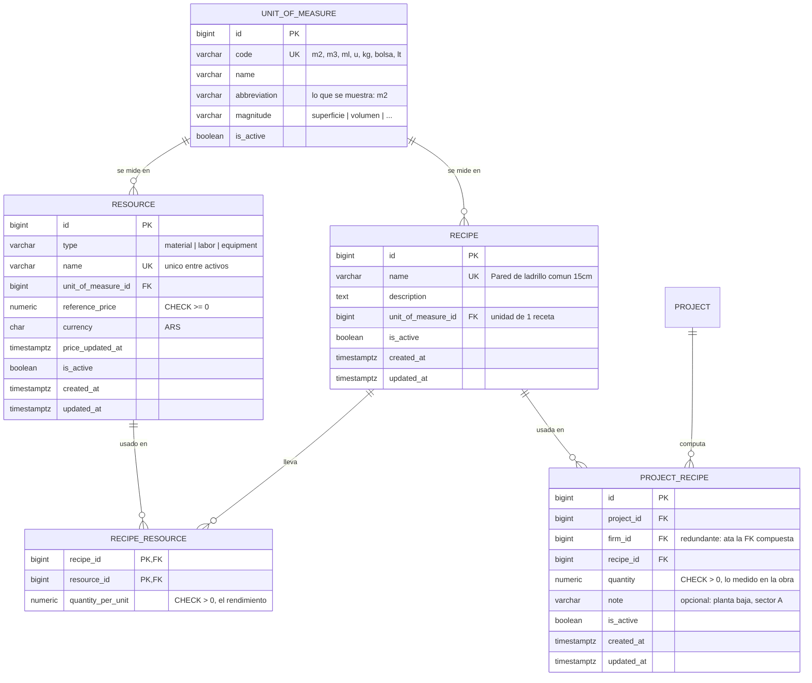

# ADR-003: Cómputo de materiales — catálogo del sistema de recetas y recursos

**Estado:** Aceptada
**Fecha:** 2026-09-07 (aceptada 2026-09-09, al sembrarse sus permisos junto con T-03)
**Contexto:** Modelo de datos del cómputo de materiales. Desbloquea HU-4 y HU-5 del Sprint 1, y es la base sobre la que se apoyan los presupuestos del Módulo 1.

---

## Contexto

### Qué hay que resolver

La promesa central del producto es que una obra pueda **calcular cuántos materiales necesita**. La propuesta del cliente lo define así:

> **Cálculo Automático por Fórmulas y Recetas.** El usuario ingresa la medida de un componente constructivo (en m2, m3, metros lineales, etc.) y el sistema calcula los insumos requeridos. Cada componente cuenta con una **receta predefinida** (proporciones por unidad de medida) que automatiza el cálculo de materiales (ej. "10 m2 de pared de 15cm" calcula automáticamente la cantidad exacta de ladrillos, arena y cemento).

Eso está hoy bloqueado. `docs/modelo-datos-sprint-1.md` §5 deja abiertos los modelos de `material` y de `building_component`, y `docs/historias/sprint-1.md` marca a HU-4 y HU-5 como **bloqueadas** esperando esta decisión. HU-5 está al final del camino crítico del sprint.

### Por qué los dos modelos que había no sirven

`modelo-datos §5` plantea dos opciones para el componente constructivo, y las dos quedaron fuera de juego por motivos distintos:

- **Plantilla global reutilizable + uso por obra** (lo que dibuja `docs/diagrams/der.mmd`). Fue diseñada **antes de ADR-002**, cuando la plataforma era de un solo estudio. No dice nada sobre a quién pertenece el catálogo bajo multi-tenant.
- **Componente por obra con jerarquía** (`parent_id` self-referencial). Usa **composición recursiva del componente consigo mismo**, que fue evaluada y rechazada explícitamente en la revisión académica del modelo.

Además, las dos hablan de "componentes" y ninguna nombra la receta, que es justamente lo que el producto promete.

### Qué restringe la decisión

- ADR-002 fija que la plataforma es **multi-tenant**: toda tabla de negocio lleva `firm_id` y toda lectura filtra por él. Cualquier dato que sea de un estudio no puede filtrarse a otro.
- ADR-002 fija también que **los endpoints chequean permisos, nunca roles**, y que cada módulo nuevo agrega sus permisos como filas.
- `modelo-datos §1`: se modela lo que las historias piden, salvo cuando agregarlo después sale caro.
- El sprint dura dos semanas y el equipo es de 2-3 personas.

---

## Investigación del dominio

Antes de decidir se revisó cómo resuelven esto los productos del rubro. Tres tradiciones distintas llegan a **la misma estructura de tres capas**:

| | España — Presto, CYPE Arquímedes | EE.UU. — RSMeans, InEight | LatAm |
|---|---|---|---|
| El insumo | *concepto básico*, con una **naturaleza**: mano de obra, maquinaria, materiales, otros | *line item* / resource | insumo |
| La receta: qué lleva **1 unidad** | *partida* con su *descomposición* | *assembly* | **APU** (Análisis de Precio Unitario) |
| Cuánto va en **esta** obra | *medición* / metrado | *takeoff quantity* | cómputo |

El **APU** es el estándar de la región y es exactamente lo que describe la propuesta del cliente: para 1 unidad de una tarea se listan los materiales, la mano de obra y el equipo con su cantidad por unidad —el *rendimiento*— y después `cantidad en obra × rendimiento × precio` da el costo.

Tres hallazgos ordenan la decisión:

**1. Catálogo y obra se separan, y lo que los distingue es la cantidad.** La documentación de CYPE lo dice literalmente: un *banco de precios* contiene la misma información que un presupuesto, **con la diferencia de que no se pueden ingresar los metrados**. La receta ("qué lleva 1 m² de pared") vive en el catálogo; la cantidad ("120 m² en esta obra") vive en la obra. Es la misma separación que en RSMeans entre *cost database* y *estimate*.

**2. El insumo es una sola entidad con un tipo.** Presto no tiene una tabla de materiales, otra de mano de obra y otra de maquinaria: tiene **conceptos** con una columna *naturaleza* (`mano de obra`, `maquinaria`, `materiales`, `otros`). Todos tienen unidad y precio, y todos entran en la descomposición de la misma forma.

**3. La composición recursiva existe en la industria, y es opcional.** Presto la llama *auxiliar*: un básico que a su vez está descompuesto (el mortero = cemento + arena + agua). CYPE permite partidas descompuestas en otras partidas. Pero es una **capa intermedia que se puede aplanar**: en vez de "pared → mortero → cemento", se escribe "pared → cemento" directo. Se pierde poder expresivo, no correctitud. Esto es lo que permite acatar la objeción académica sin quedar fuera del estándar del rubro.

Y una distinción que conviene tener a mano: **agrupar no es componer**. Los *capítulos* de Presto ("Albañilería", "Instalación sanitaria") agrupan partidas para ordenar el presupuesto, y los tienen todos los productos del rubro. Eso es clasificación, no un componente compuesto de componentes, y queda disponible más adelante sin contradecir nada de lo que se descarta acá.

---

## Decisión

### 1. El catálogo es de la plataforma, no de cada estudio

Los recursos y las recetas se **siembran por migración**, son iguales para todos los estudios y son **de solo lectura en runtime**. Ningún endpoint escribe en ellos.

> **Parcialmente reemplazado por [ADR-005](0005-catalog-administration.md) (2026-09-12).** Lo de "solo lectura en runtime" dejó de valer: el catálogo se administra por pantalla, porque crece de a poco y sus precios envejecen, y con el catálogo cerrado actualizar un precio era una migración y un deploy. Todo lo demás de esta sección sigue vigente —el catálogo es único, global y sembrado— y el seed sigue existiendo como contenido inicial.

Lo único que pertenece a una obra es **qué recetas usa y en qué cantidad**.

```
CATÁLOGO DEL SISTEMA — global, sembrado, solo lectura
  unit_of_measure    m2, m3, ml, u, kg, bolsa, lt
  resource           "Ladrillo común"  · unidad u     · precio ref. $X
  recipe             "Pared de ladrillo común 15cm"   · unidad m2
  recipe_resource    1 m2 de esa pared lleva 60 u de ladrillo y 0,25 bolsa de cemento

DATOS DE LA OBRA — por estudio
  project_recipe     esta obra lleva 120 m2 de "Pared de ladrillo común 15cm"
```

Esto es lo que hace que la aplicación sirva **desde el minuto cero**: un arquitecto que entra por primera vez ya encuentra recetas cargadas y puede computar su obra sin haber definido nada. Si el catálogo fuera de cada estudio, cada uno arrancaría vacío y tendría que cargar a mano las proporciones de ladrillos por metro cuadrado — que es exactamente el trabajo que el producto promete evitar.

El catálogo tampoco es información sensible: que 1 m² de pared de 15cm lleve 60 ladrillos es conocimiento del rubro, no una ventaja competitiva de un estudio.

### 2. Cinco tablas



Con eso, el cómputo completo de una obra —cantidades y costo— es **una sola query**:

```sql
SELECT r.name,
       SUM(pr.quantity * rr.quantity_per_unit)                     AS cantidad,
       SUM(pr.quantity * rr.quantity_per_unit * r.reference_price) AS costo
  FROM project_recipe pr
  JOIN recipe_resource rr ON rr.recipe_id = pr.recipe_id
  JOIN resource r         ON r.id = rr.resource_id
 WHERE pr.project_id = :project AND pr.is_active
 GROUP BY r.id, r.name;
```

### 3. El insumo se llama `resource` y lleva un tipo

No es una tabla `material` sino una tabla `resource` con `type IN ('material', 'labor', 'equipment')`, expresado como `VARCHAR` + `CHECK` según `modelo-datos §3.7`.

La diferencia no es de alcance —las dos opciones viven en el mismo lugar— sino de **cuántas tablas hacen falta cuando lleguen la mano de obra y el equipo**, que la propuesta del cliente pide explícitamente: *"permite asignar las horas-hombre (oficial, ayudante) y las horas-máquina (hormigonera, retroexcavadora) necesarias para cada ítem"*.

Una receta real de 1 m² de pared es *60 ladrillos + 0,25 bolsas de cemento + 0,5 h de oficial + 0,25 h de ayudante*. Con una tabla `material`, las dos últimas líneas **no se pueden guardar** hasta que existan una tabla `labor`, una tabla `equipment`, y sus dos tablas de receta correspondientes — y a partir de ahí, toda query de costo pasa a ser tres joins en vez de uno. Con `resource`, son cuatro filas de la misma tabla y la query no cambia.

Es la columna *naturaleza* de Presto. **El Sprint 1 siembra únicamente `type = 'material'`**; los otros dos valores existen en el `CHECK` y no tienen filas.

### 4. `recipe`, no `building_component`

La entidad que lleva la receta se llama `recipe`. Reemplaza al `building_component` de los documentos previos por dos razones: el nombre viejo promete más de lo que la tabla hace, y "componente constructivo" es un término que probablemente se necesite más adelante para otra cosa (un elemento del modelo del edificio, no una línea de cómputo).

`recipe` es además cómo el equipo nombra el concepto al hablarlo, y no se traduce mal: en el vocabulario del rubro esto es una *partida* o un *APU*, pero ninguno de los dos se entiende sin explicación previa.

### 5. Una fila de `recipe` es una línea del cómputo, no un objeto físico

Si una obra tiene ocho paredes de 15cm, es **una** fila `project_recipe` con 120 m², no ocho filas de 15 m². Así funciona el cómputo en la práctica —se agrega la medición por tipo de trabajo— y así se evita repetir la misma receta ocho veces.

Por eso `project_recipe` **no** lleva `UNIQUE (project_id, recipe_id)`: una obra sí puede tener dos líneas de la misma receta cuando se quiere computar por sectores ("Pared 15cm — planta baja" y "— planta alta"), y `note` es la etiqueta que las distingue.

### 6. La obra referencia el catálogo, no lo copia

`project_recipe` guarda `recipe_id` + cantidad, y el cálculo lee las líneas del catálogo en el momento de consultar. No hay copia de la receta hacia la obra.

Es la opción correcta **mientras personalizar una receta esté fuera de alcance**, que es la decisión de producto para este sprint. Ahorra una tabla y toda la maquinaria de copiado.

El día que se pida personalización, el camino es **aditivo**: se agrega `project_recipe_resource` con las líneas propias de esa obra, se rellena copiando lo que el catálogo diga en ese momento, y el cálculo pasa a leer de ahí con *fallback* al catálogo. No es partir una tabla en dos ni migrar datos de negocio. Es exactamente lo que hace CYPE, donde la partida del presupuesto tiene su propia descomposición inicializada desde el banco de precios.

### 7. El aislamiento entre estudios lo sostiene una sola tabla

De las cinco, **solo `project_recipe` contiene datos de un estudio**. Las otras cuatro son catálogo global, así que no hay nada que aislar en ellas.

`project_recipe` lleva `firm_id` redundante a propósito, que habilita la FK compuesta:

```
(project_id, firm_id) → project (id, firm_id)
```

Es el mismo mecanismo que ADR-002 §5 usa en `project_member`, y garantiza estructuralmente que una línea de cómputo no pueda apuntar a la obra de otro estudio. Toda lectura filtra por `firm_id` desde el repositorio base (ADR-002 §8).

### 8. Permisos nuevos

Este es el primer módulo que agrega capacidades después de ADR-002, y es la comprobación de que el modelo funciona como se prometió: **son filas, no condicionales**.

| Ámbito | Código | Roles que lo reciben |
|---|---|---|
| `firm` | `catalog.view` | `owner`, `architect`, `client` |
| `project` | `project.recipe.view` | `lead`, `collaborator`, `viewer`, `client` |
| `project` | `project.recipe.manage` | `lead`, `collaborator` |
| `project` | `project.cost.view` | `lead`, `collaborator`, `viewer` |

**`project.cost.view` no lo tiene `client`**, y esa ausencia es la concreción del requisito R5 de ADR-002: *"el cliente entra al sistema, ve su obra y no ve los costos internos del estudio"*. Es también el primer ejemplo concreto del argumento de ADR-002 §7 de que `client` y `viewer` existen separados porque **el cliente no ve menos, ve otra cosa**: ve el listado de materiales que su obra necesita, no lo que le cuestan al estudio.

Ninguna de estas cuatro filas requiere tocar código de autorización: entran en la migración de seed del catálogo.

**El `owner` lee el cómputo y sus costos por `project.view_all`, y no lo modifica** (precisado al implementar HU-5, 2026-09-14). La tabla no le da ningún permiso de obra, y es correcto: no tiene fila en `project_member` en las obras que no integra. Pero ya puede abrir esas obras (HU-3), y un 403 sobre el cómputo de una obra de su propio estudio no protege nada. Por eso el `GET` del cómputo acepta cualquiera de las dos alturas, `requires_any(("project.recipe.view", "project"), ("project.view_all", "firm"))`, con el mismo argumento que el detalle de la obra en [ADR-002 §9](0002-authorization-model.md). El costo sigue la misma regla: se muestra con `project.cost.view` **o** con `project.view_all`. Las escrituras piden solo `project.recipe.manage`, así que auditar una obra no habilita a editarla. Ninguna fila del seed cambia.

### 9. Fuera de alcance

Composición de recetas dentro de recetas (los *auxiliares* de Presto) · capítulos o rubros para agrupar recetas · que un estudio edite una receta y la haga propia · recursos de tipo `labor` y `equipment` sembrados · precios por estudio o por proveedor · histórico de precios · costos indirectos, AIU y utilidad · importación de bancos de precios externos · conversión entre unidades.

---

## Consecuencias

**Se desbloquea:**

- HU-4 y HU-5 dejan de estar bloqueadas y se pueden escribir.
- La promesa central del producto —"esta obra necesita 7.200 ladrillos y 30 bolsas de cemento, unos $X"— queda resuelta por una query y es demostrable con datos sembrados, sin cargar nada a mano.
- El Módulo 1 (mano de obra y equipo en la receta) entra agregando filas con otro `type`, sin tablas nuevas.
- El Módulo 2 (proveedores) tiene contra qué normalizar: un catálogo único de recursos compartido por todos los estudios es precisamente lo que hace posible mapear los productos de un corralón contra "Ladrillo común".

**Compromisos que asumimos:**

- **Corregir una receta sembrada cambia el cómputo de todas las obras**, incluidas las ya presupuestadas. Es aceptable mientras el catálogo solo cambie por migración y no existan presupuestos cerrados; deja de serlo cuando entre el Módulo 2, y ahí corresponde la copia por obra descrita en §6.
- **Todos los estudios ven el mismo costo estimado**, porque el precio de referencia es único y global. No hay forma de que un estudio cargue sus propios precios hasta que exista la tabla de precios por estudio.
- **El catálogo crece por migración**, no por pantalla. Agregar una receta es un PR, no una tarea de un usuario.
- Un estudio no puede registrar en su obra un trabajo que el catálogo no contempla. Es la limitación más visible de este alcance y la primera candidata a revisarse.

**Queda pendiente de revisar, y bajo qué condición:**

| Tema | Se revisa cuando |
|---|---|
| Receta propia del estudio, editable | Un estudio pida ajustar proporciones según su experiencia |
| Copia de la receta hacia la obra | Existan presupuestos cerrados que no deban cambiar retroactivamente |
| Precios por estudio | Los precios de referencia globales dejen de ser representativos |
| Precios por proveedor | Entre el Módulo 2 |
| `labor` y `equipment` sembrados | Se quiera el costo real del componente y no solo el de materiales |
| Capítulos / rubros para agrupar | Una obra tenga suficientes líneas como para que el listado plano moleste |
| Composición de recetas (*auxiliares*) | Aparezcan recetas que compartan submezclas y duplicarlas se vuelva un problema de mantenimiento |
| Conversión entre unidades | Una receta necesite expresar un insumo en una unidad distinta a la de su catálogo |

**Relación con ADR-001.** ADR-001 (Aceptado) menciona en sus *Consecuencias*, como ejemplo de diseño previsor, *"`parent_id` nullable en `componente_constructivo` para la EDT jerárquica"*. Esta ADR **se aparta de ese ejemplo**: no hay `parent_id` ni composición recursiva. No reemplaza a ADR-001, cuya decisión es el stack tecnológico y no el modelo de datos: solo deja constancia de que ese ejemplo ya no aplica. El motivo del apartamiento es doble: la composición del componente consigo mismo fue rechazada en la revisión académica del modelo, y `modelo-datos §1.2` establece que agregar una columna nullable es barato en cualquier momento, así que no hay nada que anticipar.

**Documentos a actualizar** para que no contradigan esta ADR: `docs/historias/sprint-1.md` (HU-4 deja de ser un ABM y pasa a ser consulta del catálogo; HU-5 pasa a traer recetas del catálogo y las dos dejan de estar bloqueadas), `docs/modelo-datos-sprint-1.md` §5 (se cierran las tres entradas abiertas) y `docs/diagrams/der.mmd` (sigue con el modelo pre-multi-tenant).

---

## Alternativas descartadas

**Componente por obra con receta propia, sin catálogo.** Cada obra define sus componentes con descripción libre y su propia receta. Es lo más simple y lo que HU-5 describía originalmente. Descartada porque el producto promete recetas **predefinidas**: sin catálogo, el arquitecto tiene que saber y cargar a mano cuántos ladrillos entran en un metro cuadrado, que es justamente el cálculo que la aplicación existe para evitar. Además, cada obra repetiría la misma receta desde cero.

**Catálogo por estudio.** Cada estudio tiene su propio catálogo de recursos y recetas. Es más flexible y respeta lo que HU-4 dice hoy sobre la sensibilidad de los precios. Descartada porque **cada estudio arrancaría vacío**: la primera experiencia del producto sería una pantalla en blanco pidiendo que cargues proporciones de albañilería. La personalización que este modelo habilita se puede agregar después como recetas propias del estudio conviviendo con las del sistema.

**Semilla global copiada a cada estudio al crearlo.** Resuelve el arranque vacío manteniendo todo por estudio. Descartada por dos motivos: las correcciones a las recetas base no llegarían nunca a los estudios ya creados, y el Módulo 2 —que necesita mapear productos de proveedores contra un vocabulario común de materiales— tendría que hacerlo contra N copias divergentes de "Ladrillo común" en vez de contra una fila.

**Una tabla `material` en vez de `resource` con tipo.** Más directo de explicar y la pantalla de HU-4 no necesita filtrar nada. Descartada porque la propuesta del cliente pide explícitamente horas-hombre y horas-máquina por ítem: con tablas separadas por tipo de insumo, cada tipo nuevo trae su tabla, su tabla de receta y un join más en toda query de costo. Presto resuelve el mismo problema con una columna *naturaleza*, y es la alternativa que se revisaría primero si el `CHECK` de `type` se volviera incómodo.

**Composición recursiva de recetas** (`parent_id`, o una receta que se descompone en otras recetas). Es lo que hacen Presto con sus *auxiliares* y CYPE con las partidas descompuestas, y permite expresar "pared → mortero → cemento + arena" sin repetir la submezcla en cada receta que la use. Descartada porque fue rechazada en la revisión académica del modelo, y porque se puede aplanar sin perder correctitud: la receta de la pared nombra el cemento y la arena directamente. Se paga en duplicación del seed, no en capacidad.

**Copiar la receta a la obra al agregarla.** Habilita personalizar por obra y protege a las obras cerradas de cambios retroactivos en el catálogo. Descartada **por ahora** porque personalizar está fuera del alcance del sprint, y sin personalización la copia es una tabla y una máquina de copiado que no compran nada. Es el primer cambio a hacer cuando entre el Módulo 2, y es aditivo.

**Precio por estudio sobre un catálogo global de recursos.** Es el modelo que `modelo-datos §5` llamaba "el correcto a largo plazo", y respeta lo que HU-4 dice sobre información sensible. Descartada por ahora porque el precio de referencia único es lo que permite que las recetas sembradas devuelvan un costo sin que nadie cargue nada. Se agrega después como tabla de precios por estudio con *fallback* al global, sin tocar `recipe_resource`.

**`UNIQUE (project_id, recipe_id)`.** Fuerza una sola línea por receta y por obra, lo que hace más limpio el listado y evita duplicados por error. Descartada porque el cómputo por sectores es una práctica normal —medir la pared de cada planta por separado— y la constraint la haría imposible.

---

## Referencias

- Análisis de Precios Unitarios (APU): estructura de materiales, mano de obra, equipo y rendimientos. [Guía general](https://oneestimate.ai/es/blog/analisis-precios-unitarios-apu-construccion-2026) · [Aplicación en Argentina](https://onemake.ai/blog/apu-analisis-precios-unitarios-argentina)
- CYPE Arquímedes, [bancos de precios y presupuestos](https://info.cype.com/es/tema/arquimedes-bancos-de-precios-y-presupuestos/) — de acá sale la separación catálogo / obra: el banco de precios no admite metrados.
- Presto (RIB Spain), [presupuestos y descomposición](https://www.rib-software.es/pdf/Presto/Presto-Presupuestos.pdf) — las cuatro *naturalezas* del concepto básico y la figura del *auxiliar*.
- RSMeans, [unit cost y assemblies](https://www.rsmeans.com/resources/creating-unit-assembly-estimates-rsmeans-online) · InEight, [cost item assemblies](https://ineight.com/blog/what-are-cost-item-assemblies-in-construction-estimating-software/) — el equivalente anglosajón de la misma estructura.
- [ADR-002](0002-authorization-model.md) §5 y §8 — la FK compuesta contra `project (id, firm_id)` y el aislamiento entre estudios.
- `docs/modelo-datos-sprint-1.md` §3 — convenciones de modelado que aplican a las cinco tablas.

> Las fuentes del rubro se consultaron durante el diseño: verificar las citas de Presto y CYPE contra su documentación oficial antes de usarlas en la defensa.
