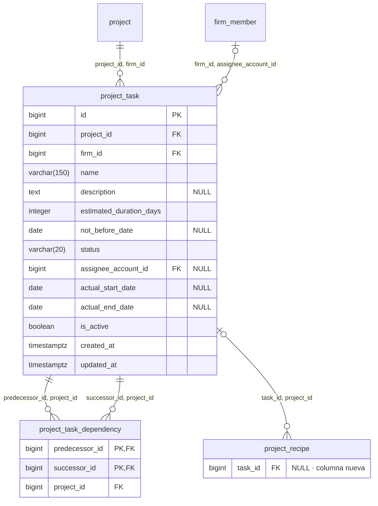
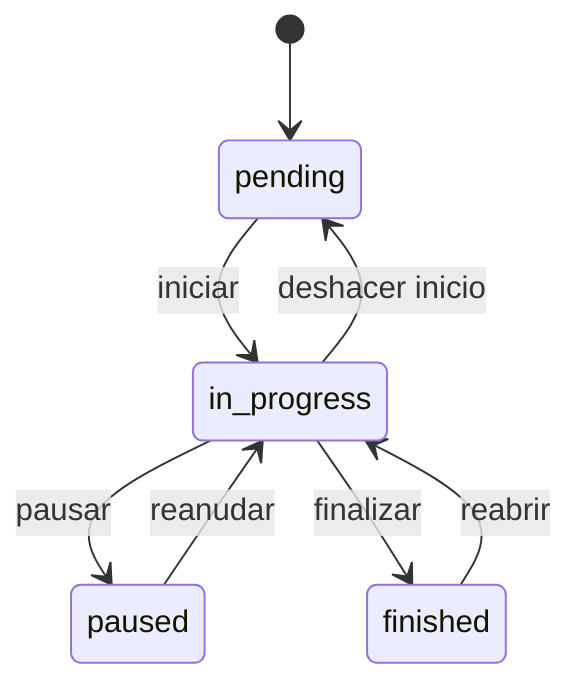

# ADR-009: Planificación de la obra — tareas, dependencias y fechas calculadas

**Estado:** Propuesta
**Fecha:** 2026-10-07
**Contexto:** Modelo de datos y reglas de cálculo para planificar una obra. Desbloquea HU-13 y HU-14 del Sprint 3 y deja definido sobre qué se apoyan HU-15, HU-16 y HU-19. Precisa lo que [ADR-001](0001-stack.md) anticipó sobre el camino crítico.

---

## Contexto

### Qué pide la cátedra

> Dividir la obra en rubros y tareas. Cada tarea tiene responsable, fechas, duración estimada, costo y estado: pendiente, en curso, pausada o finalizada.
> Permitir dependencias entre tareas. Una tarea no puede iniciarse si sus predecesoras obligatorias no finalizaron.

Hasta ahora una obra no tiene planificación: tiene equipo (`project_member`), cómputo (`project_recipe`) y versiones del presupuesto (`budget_version`). Ver [der.md](../der.md).

### Qué decidimos hacer además de lo pedido

El pedido se cumple con fechas cargadas a mano y dependencias que solo bloquean. Decidimos ir más lejos: **las fechas las calcula el sistema** a partir de las duraciones y las dependencias. El arquitecto carga cada tarea con lo que lleva y con qué tiene que estar terminado antes; cuándo empieza, cuándo termina y cuándo termina la obra salen solos, y se corren solos cuando algo se atrasa.

Eso mete en el sprint el camino crítico, que ADR-001 ya había previsto: *"se resuelve con un ordenamiento topológico sobre las tablas relacionales, sin necesidad de una base de grafos para el volumen de tareas esperado en una obra"*.

### Qué restringe la decisión

- Las convenciones de [modelo-datos-sprint-1.md](../modelo-datos-sprint-1.md) §3: `firm_id`, baja lógica, `VARCHAR` + `CHECK`, `DATE` para fechas de calendario, FK compuesta para invariantes entre tablas.
- [ADR-002](0002-authorization-model.md): permisos y nunca roles; obra ajena → 404.
- `project_member` **se borra de verdad** al sacar a alguien del equipo (ADR-002 §11.3): no tiene `is_active`.
- El costo de una obra sale hoy de un solo lugar, el cómputo a precio vigente (ADR-003, ADR-005 §5). No queremos un segundo número de costo que pueda contradecirlo.

---

## Decisión

### 1. Dos tablas nuevas y una columna en el cómputo

**`project_task`** — una tarea de una obra.

| Regla | Cómo la sostiene el esquema |
|---|---|
| La tarea es de una obra de ese estudio | FK compuesta `(project_id, firm_id) → project (id, firm_id)`, igual que `project_recipe` |
| El responsable es del mismo estudio | FK compuesta `(firm_id, assignee_account_id) → firm_member (firm_id, account_id)` |
| La duración es positiva | `CHECK (estimated_duration_days > 0)` |
| El estado es uno de cuatro | `CHECK (status IN ('pending', 'in_progress', 'paused', 'finished'))`, por defecto `'pending'` |
| Una tarea pendiente no tiene fechas reales | `CHECK (status <> 'pending' OR actual_start_date IS NULL)` |
| Una tarea que arrancó tiene inicio real | `CHECK (status = 'pending' OR actual_start_date IS NOT NULL)` |
| Solo una finalizada tiene fin real, y siempre lo tiene | `CHECK ((status = 'finished') = (actual_end_date IS NOT NULL))` |
| El fin real no es anterior al inicio real | `CHECK (actual_end_date >= actual_start_date)` |
| Nombre único entre las tareas activas de la obra | Índice único parcial `(project_id, lower(name)) WHERE is_active` (modelo-datos §3.4: es una etiqueta) |
| Una dependencia solo puede unir tareas de la misma obra | `UNIQUE (id, project_id)`, para que `project_task_dependency` y `project_recipe` tengan a qué apuntar (modelo-datos §3.8) |

**`project_task_dependency`** — "la sucesora no puede empezar hasta que termine la predecesora".

Es un vínculo puro y no una entidad, así que sigue a `recipe_resource`: sin `is_active`, sin timestamps, y se borra de verdad al quitarla.

| Regla | Cómo la sostiene el esquema |
|---|---|
| No se repite una dependencia | PK `(predecessor_id, successor_id)` |
| Las dos tareas son de la misma obra | Dos FK compuestas, `(predecessor_id, project_id)` y `(successor_id, project_id)`, contra `project_task (id, project_id)` |
| Una tarea no depende de sí misma | `CHECK (predecessor_id <> successor_id)` |

Índice en `successor_id`: "¿de qué depende esta tarea?" es la consulta del bloqueo.

**`project_recipe.task_id`** — nullable. Una línea de cómputo se asigna **a lo sumo a una tarea**, o queda sin asignar. FK compuesta `(task_id, project_id) → project_task (id, project_id)`: una línea no puede asignarse a una tarea de otra obra.

### 2. Qué se guarda y qué se calcula

| Dato | Origen |
|---|---|
| Nombre, descripción, duración estimada, "no antes de", responsable | Lo carga el usuario |
| Estado | Lo cambia el usuario, por las transiciones de §5 |
| Inicio y fin **reales** | Los registra el cambio de estado; se pueden corregir |
| Inicio y fin **previstos**, holgura, si es crítica | **Se calculan al leer. No hay columna** |
| Fin previsto de la obra | Se calcula: el fin más tardío entre sus tareas |
| Costo de la tarea | Se calcula: suma de sus líneas de cómputo a precio vigente |

**Las fechas previstas no se guardan.** Dependen del día de hoy (§4), así que una columna quedaría vieja cada medianoche sin que nadie escribiera nada. El cálculo recorre las tareas de una obra en memoria: son decenas o pocos cientos, y es más barato recalcular que invalidar.

Las "fechas" que pide la cátedra son, entonces, cuatro: dos previstas (calculadas) y dos reales (registradas).

### 3. Las dependencias

- **Toda dependencia es obligatoria.** El pedido dice "predecesoras obligatorias"; lo leemos como "las predecesoras, que son obligatorias". Si una tarea no tiene que esperar a otra, no se conecta. No hay columna para distinguirlas.
- **Un solo tipo: fin → inicio.** La sucesora empieza el día hábil siguiente al fin de la predecesora. Sin días de espera entre tareas: un fraguado o una entrega se cargan como una tarea propia, que además queda a la vista en el Gantt.
- **Sin ciclos.** Al agregar `A → B` se rechaza si ya existe un camino de `B` a `A`.

### 4. Cómo se calculan las fechas

Días **hábiles de lunes a viernes**, sin feriados. Una función de calendario única, usada por este cálculo, por el avance planificado (HU-16) y por la proyección mensual (HU-19).

**Recorrido hacia adelante**, en orden topológico:

| Estado de la tarea | Inicio | Fin |
|---|---|---|
| Finalizada | El real | El real |
| En curso o pausada | El real | El más tardío entre *inicio real + duración* y **hoy** |
| Pendiente | El más tardío entre: inicio de la obra, su "no antes de", el día hábil siguiente al fin de su última predecesora, y **hoy** | *Inicio + duración* |

Tres consecuencias de esa tabla:

- **Lo real reemplaza a lo previsto.** En cuanto una tarea arranca o termina, las que dependen se calculan desde lo que pasó.
- **Nada previsto queda en el pasado.** Una tarea en curso que ya debería haber terminado se da por terminada "no antes de hoy", y una pendiente que ya debería haber arrancado, lo mismo. Así un atraso corre las fechas siguientes día a día sin que nadie lo cargue.
- **"Pausada" se calcula igual que "en curso".** Mientras no termina, empuja.

El **inicio de la obra** es `project.estimated_start_date`, que ya existe y es opcional. Sin ella no se calcula: la sección pide cargarla.

**Recorrido hacia atrás**, desde el fin previsto de la obra: da para cada tarea no finalizada su **holgura** en días hábiles (cuánto puede atrasarse sin mover el fin de la obra). Una tarea con holgura cero es **crítica**.

El porcentaje de avance **no entra** en este cálculo.

### 5. Estados y transiciones

| Transición | Efecto |
|---|---|
| Iniciar | Registra `actual_start_date` (hoy, corregible). **Se rechaza si alguna predecesora activa no está finalizada**, y el rechazo dice cuáles |
| Finalizar | Registra `actual_end_date` (hoy, corregible) |
| Reabrir | Borra `actual_end_date` |
| Deshacer inicio | Borra `actual_start_date` |
| Cualquier otra | Se rechaza |

**El bloqueo se chequea al iniciar, no es un invariante permanente.** Reabrir una tarea cuyas sucesoras ya arrancaron **se permite**, con una confirmación que las lista. El retrabajo existe y lo que ya se hizo no se deshace; las sucesoras con inicio real no se mueven, y las pendientes se recalculan solas.

### 6. Responsable

Un integrante del equipo de la obra, opcional. Se guarda contra **`firm_member`** y no contra `project_member`, porque `project_member` se borra de verdad: una FK ahí impediría sacar del equipo a quien terminó tareas, o perdería quién las hizo.

- Al **asignar**, el servicio exige que la persona integre la obra.
- Al **salir del equipo**, sus tareas no finalizadas quedan sin responsable; las finalizadas lo conservan.

### 7. Baja de una tarea

Baja lógica, en cualquier estado, con confirmación. En la misma transacción:

- Sus dependencias se **borran**, en las dos direcciones. Las sucesoras dejan de estar bloqueadas por ella; la confirmación las lista.
- Sus líneas de cómputo vuelven a quedar **sin asignar**. Nunca se dan de baja por esto.

### 8. Costo

El costo de una tarea es la suma del costo de sus líneas de cómputo, con el mismo cálculo y los mismos precios vigentes del presupuesto de HU-11. Una tarea sin líneas cuesta cero.

Las líneas sin asignar siguen contando en el presupuesto de la obra. En la planificación aparecen como un total "sin asignar a ninguna tarea".

### 9. Permisos

| Ámbito | Código | Roles |
|---|---|---|
| `project` | `project.task.view` | `lead`, `collaborator`, `viewer`, `client` |
| `project` | `project.task.manage` | `lead`, `collaborator` |

Es el mismo reparto que `project.recipe.view` / `project.recipe.manage` (ADR-003 §8). El `owner` lee por `project.view_all`. El costo de las tareas exige además `project.cost.view`, así que **el `client` ve la planificación sin importes**.

### 10. Reglas que el esquema no puede garantizar

Van en el servicio, cada una con su test:

1. **No hay ciclos de dependencias.** Además, escribir una dependencia toma un bloqueo sobre la fila de la obra, para que dos altas simultáneas no cierren un ciclo entre las dos.
2. **Una tarea no se inicia con predecesoras sin finalizar.**
3. **Solo se permiten las transiciones de §5.**
4. **El responsable integra la obra** al momento de asignarlo.
5. **Dar de baja una tarea** borra sus dependencias y desasigna sus líneas.
6. **Sacar a alguien del equipo** desasigna sus tareas no finalizadas.
7. **Una dependencia no une tareas dadas de baja**, y una línea de cómputo no se asigna a una.

### 11. Dónde vive el cálculo

Un módulo propio, de funciones puras sobre tareas y aristas ya leídas de la base: detección de ciclos, orden topológico, recorridos hacia adelante y hacia atrás, y el calendario de días hábiles. Sin SQL adentro, así se prueba sin base.

Es también la costura para la extensión de §Consecuencias: el resto de la aplicación le pide "las fechas de esta obra" y no sabe cómo se obtienen.

---

## Consecuencias

**Se desbloquea:**

- HU-13 (tareas) y HU-14 (dependencias y fechas previstas).
- HU-15 tiene qué dibujar: fechas previstas y reales, estado, críticas y aristas.
- HU-19 puede proyectar el gasto por mes: cada tarea tiene costo y fechas.

**Compromisos que asumimos:**

- El sprint incluye **más de lo que pide la cátedra**: fechas calculadas, propagación de atrasos y camino crítico. HU-14 crece.
- `project.estimated_start_date` pasa a ser necesaria para planificar. No se vuelve `NOT NULL`: una obra puede existir sin planificación.
- Las fechas previstas **cambian solas con el paso de los días**. Es lo buscado, pero obliga a tener una referencia fija para comparar (línea base, abajo).
- `project_recipe` gana una columna y una regla: HU-5 tiene que ofrecer la asignación a una tarea.

**Queda pendiente de decidir, y con qué historia:**

| Tema | Se decide al arrancar |
|---|---|
| **Rubros.** Fuera por ahora: el pedido los menciona una sola vez y se consulta con la cátedra. Si entran, es una tabla y una FK nullable en `project_task` | Respuesta de la cátedra |
| **Línea base.** Acordado en principio y **revisable**: un botón "Fijar planificación" copia las fechas previstas de cada tarea (dos columnas `DATE` en `project_task` y una fecha en `project`); la comparación planificado/real es contra esa copia; volver a fijar reemplaza la anterior | HU-16 |
| Avance: cómo se calcula el planificado, cómo se agrega a la obra, relación con el estado, historial | HU-16 |
| Calendario o Gantt, y con qué componente | HU-15 |
| Si las versiones del presupuesto guardan la asignación de líneas a tareas | HU-19 |

**Extensiones previstas, no descartadas:**

| Tema | Se revisa cuando |
|---|---|
| **Base de grafos (Neo4j) para los cálculos de red.** Fue propuesta del equipo y bien vista por la cátedra. Se suma como **proyección**: Postgres sigue siendo la fuente de verdad de tareas y dependencias, el grafo se carga desde ahí y reemplaza la implementación del módulo de §11. No requiere migrar datos ni cambiar estas tablas | El módulo de planificación esté funcionando |
| Días de espera entre tareas, y los otros tipos de dependencia | La tarea "de espera" resulte incómoda |
| Días hábiles configurables por obra, y feriados | Una obra trabaje sábados, o las fechas calculadas fallen por feriados |
| Simulación de atrasos ("qué pasa si") | Después del Gantt |
| Historial de líneas base | Haga falta ver cómo cambió el plan |

---

## Alternativas descartadas

**Fechas cargadas a mano, con las dependencias solo bloqueando.** Cumple el pedido y es bastante menos trabajo. Descartada porque el valor de cargar dependencias está en que el plan se mueva solo: con fechas a mano, cada atraso obliga a corregir una por una las tareas siguientes.

**Guardar las fechas previstas en columnas.** Lecturas más baratas. Descartada porque dependen de la fecha de hoy: quedarían viejas cada día sin ninguna escritura, y habría que recalcular igual.

**Base de grafos como fuente de verdad de las dependencias.** El modelo se parece más al problema y los recorridos se escriben en una línea. Descartada **para este sprint** por el corte: el bloqueo cruza el estado de la tarea con sus aristas, y con dos bases eso son dos escrituras sin transacción común. Con el volumen de una obra tampoco hay ganancia de rendimiento. Queda como extensión, en el rol de proyección.

**Dependencias obligatorias y no obligatorias.** Lectura más literal del pedido. Descartada porque una dependencia que no bloquea no dice nada: si no hay que esperar, no se conecta.

**Responsable con FK a `project_member`.** Dejaría en el esquema que el responsable integra la obra. Descartada porque `project_member` se borra: habría que elegir entre no poder sacar a alguien del equipo o perder quién hizo cada tarea.

**Costo de la tarea cargado a mano.** Más simple y sirve para tareas sin cómputo. Descartada porque crea un segundo número de costo de la obra, sin nada que lo haga coincidir con el presupuesto.

**Una línea de cómputo repartida entre varias tareas.** Más fiel cuando un ítem se ejecuta en etapas. Descartada por la tabla intermedia y la pantalla de reparto: lo mismo se logra cargando dos líneas.

**Bloquear la reapertura de una tarea con sucesoras iniciadas.** Mantendría siempre que "si arrancó, sus predecesoras terminaron". Descartada porque registrar un retrabajo obligaría a borrar fechas reales de trabajo ya hecho.

**Días corridos.** Sin calendario que mantener. Descartada porque con fechas calculadas da resultados que nadie espera: una tarea "de 5 días" terminaría contando el fin de semana.

---

## Referencias

- [ADR-001](0001-stack.md) — PostgreSQL, y el camino crítico por orden topológico.
- [ADR-002](0002-authorization-model.md) §7 y §11.3 — permisos por rol, y por qué `project_member` no tiene `is_active`.
- [ADR-003](0003-recipe-catalog.md) §8 — el reparto de permisos que este copia.
- [ADR-005](0005-catalog-administration.md) §5 — precio vigente.
- [modelo-datos-sprint-1.md](../modelo-datos-sprint-1.md) §3 — convenciones.
- [sprint-3.md](../historias/sprint-3.md) — HU-13 a HU-16 y HU-19.
