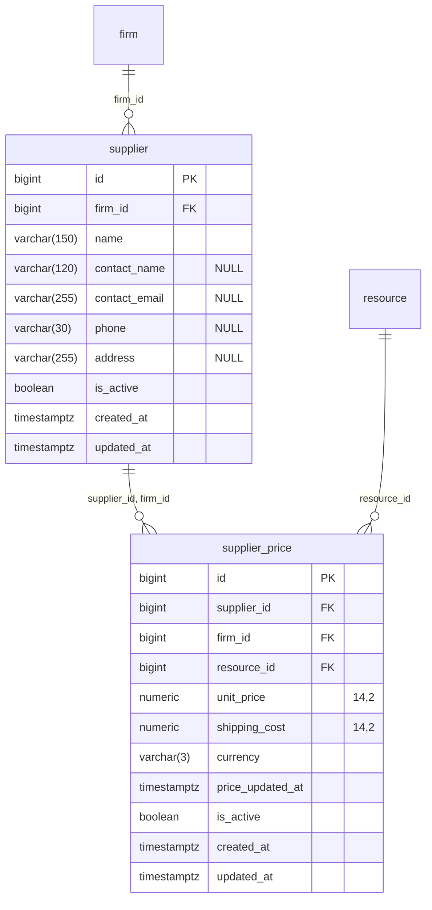

# ADR-010: Proveedores y listas de precios

**Estado:** Propuesta
**Fecha:** 2026-10-07
**Contexto:** Modelo de datos para los proveedores de un estudio, sus precios por material y la comparación de compra. Desbloquea HU-17 y HU-18 del Sprint 3 y cierra el pendiente "precios por proveedor" que dejaron [ADR-003](0003-recipe-catalog.md) y [ADR-005](0005-catalog-administration.md).

---

## Contexto

### Qué pide la cátedra

> Incorporar proveedores y listas de precios. Un material puede tener distintos precios y costos de envío según el proveedor.
> Comparar alternativas de compra y mostrar el proveedor más económico por material. No se exige optimización automática de toda la compra.

### De dónde partimos

Un material tiene hoy **un solo precio**: `resource.reference_price`, único y global, que mantiene el soporte (ADR-005). Con ese precio se calculan el cómputo y el presupuesto. No existe el concepto de proveedor.

ADR-003 dejó escrito para qué servía que el catálogo de recursos fuera uno solo y compartido: *"el Módulo 2 (proveedores) tiene contra qué normalizar"*. Es lo que esta ADR aprovecha.

### Qué restringe la decisión

- Las convenciones de [modelo-datos-sprint-1.md](../modelo-datos-sprint-1.md) §3: `firm_id` en toda tabla de negocio, baja lógica, `NUMERIC(14,2)` para importes, `currency` modelado.
- [ADR-002](0002-authorization-model.md): permisos y nunca roles; lo de otro estudio → 404; el `client` no ve costos.
- El pedido excluye optimizar la compra completa: la comparación tiene que tener sentido **material por material**.

---

## Decisión

### 1. Los proveedores son del estudio

Cada estudio carga sus proveedores y sus precios, y ningún otro estudio los ve. Un precio de proveedor es un acuerdo entre ese estudio y ese proveedor: es información sensible y no tiene sentido que sea global.

**Los materiales siguen siendo los del catálogo de la plataforma.** Un proveedor no carga productos propios: le pone precio a un `resource` que ya existe. Eso es lo que hace comparable la lista de un corralón con la de otro: los dos cotizan el mismo "Ladrillo común".

### 2. Dos tablas nuevas



**`supplier`** — un proveedor de un estudio.

| Regla | Cómo la sostiene el esquema |
|---|---|
| Nombre único entre los proveedores activos del estudio | Índice único parcial `(firm_id, lower(name)) WHERE is_active` (modelo-datos §3.4) |
| Un precio solo puede ser de un proveedor del mismo estudio | `UNIQUE (id, firm_id)`, para la FK compuesta de `supplier_price` (modelo-datos §3.8) |

**`supplier_price`** — un renglón de la lista de precios: este proveedor vende este material a este precio.

| Regla | Cómo la sostiene el esquema |
|---|---|
| El renglón es del mismo estudio que su proveedor | FK compuesta `(supplier_id, firm_id) → supplier (id, firm_id)` |
| Un proveedor no repite material en su lista | Índice único parcial `(supplier_id, resource_id) WHERE is_active` |
| El precio y el envío no son negativos | `CHECK (unit_price >= 0)`, `CHECK (shipping_cost >= 0)` |
| La moneda es un código ISO 4217 | `CHECK (currency ~ '^[A-Z]{3}$')`, por defecto `'ARS'` |

`supplier_price` lleva `firm_id` aunque se pueda deducir del proveedor: es lo que permite que el repositorio base filtre por estudio como en cualquier otra tabla (modelo-datos §3.2), y la FK compuesta impide que diverja.

Es una entidad con `id` y baja lógica, y no un vínculo puro como `recipe_resource`: sus renglones se editan de a uno (un precio cambia mucho más seguido que la composición de una lista), y un renglón sacado por error se vuelve a cargar sin perder la fila anterior.

`price_updated_at` se actualiza solo cuando cambia `unit_price` o `shipping_cost`, igual que `resource.price_updated_at` (ADR-005 §5): es la fecha que la pantalla muestra como "actualizado el".

### 3. Qué significan el precio y el envío

- **`unit_price`** es el precio por **una unidad del material**, en la unidad de medida que ese `resource` tiene en el catálogo (una bolsa, un m³). El proveedor no elige otra unidad.
- **`shipping_cost`** es un importe **fijo por material**: lo que cuesta que ese proveedor entregue ese material, sin importar la cantidad. Cero si no cobra envío.

Es la lectura literal del pedido —"un material puede tener distintos precios y costos de envío según el proveedor"— y es la que deja bien definida la comparación por material.

### 4. La comparación

Para un material y una cantidad, cada proveedor que lo ofrece tiene un costo total:

```
total = redondeo(unit_price × cantidad, 2) + shipping_cost
```

**El más económico es el de menor total.** Si empatan, se muestran todos los empatados.

Depende de la cantidad, y eso es lo buscado: para poca cantidad gana el de envío barato, para mucha el de mejor precio unitario.

| Vista | Cantidad que usa |
|---|---|
| Por material, desde el catálogo del estudio | La que escribe el usuario; 1 por defecto |
| Por obra | La que ese material lleva en el cómputo de la obra (HU-5) |

Entran en la comparación solo los renglones activos de proveedores activos. Un material que nadie ofrece aparece igual, como "sin proveedor", con su precio de referencia.

**La comparación se calcula al leer; no se guarda.** No hay tabla de "proveedor elegido": el pedido es mostrar el más económico, no registrar una compra.

### 5. El presupuesto no cambia

El cómputo, el presupuesto de HU-11 y las versiones de HU-12 siguen calculando con `resource.reference_price`. Los precios de proveedor **solo** alimentan la comparación.

Si el presupuesto "actualizado" del dashboard usa precios de proveedor es una pregunta de HU-19 (D-17), y se decide ahí.

### 6. Permisos

| Ámbito | Código | Roles |
|---|---|---|
| `firm` | `supplier.view` | `owner`, `architect` |
| `firm` | `supplier.manage` | `owner`, `architect` |

El `client` no recibe ninguno: toda esta información son costos del estudio.

La vista de compras **de una obra** no pide permiso nuevo: exige lo mismo que ver sus costos, `project.cost.view` o `project.view_all`, con el `requires_any` que ya protege el presupuesto.

### 7. Reglas que el esquema no puede garantizar

Van en el servicio, cada una con su test:

1. **Una lista solo lleva materiales.** El `resource` de un renglón tiene `type = 'material'`: ni mano de obra ni equipo.
2. **Solo se agrega un material activo** del catálogo. Si después el soporte lo da de baja, el renglón queda pero deja de ofrecerse en la comparación.
3. **Un renglón no se carga en un proveedor dado de baja.**
4. **Un proveedor dado de baja sale de toda comparación**, con sus renglones.
5. **La vista de compras de una obra** solo muestra proveedores del estudio de esa obra.

### 8. Rutas nuevas

- `GET/POST /firms/{firm_id}/suppliers`, `GET/PATCH /firms/{firm_id}/suppliers/{supplier_id}`, `POST .../deactivate` — `supplier.view` para leer, `supplier.manage` para escribir.
- `GET/POST /firms/{firm_id}/suppliers/{supplier_id}/prices`, `PATCH .../prices/{price_id}`, `POST .../prices/{price_id}/deactivate` — igual.
- `GET /firms/{firm_id}/purchasing/compare?resource_id=&quantity=` — `supplier.view`.
- `GET /firms/{firm_id}/projects/{project_id}/purchasing` — `project.cost.view` o `project.view_all`.

---

## Consecuencias

**Se desbloquea:**

- HU-17 (proveedores y listas) y HU-18 (comparación).
- Cierra el pendiente "precios por proveedor" de ADR-003 y ADR-005.

**Compromisos que asumimos:**

- Cada estudio arranca con la sección vacía. Para la demo lo cubren los datos de T-09.
- Hay **dos precios** para un mismo material: el de referencia (con el que se presupuesta) y los de proveedor (con los que se compara). Las pantallas tienen que decir siempre cuál muestran.
- La comparación supone que cada material se compra entero a un solo proveedor.

**Queda pendiente de revisar, y bajo qué condición:**

| Tema | Se revisa cuando |
|---|---|
| Presupuestar con precios de proveedor en vez del de referencia | HU-19 (D-17) |
| Envío por pedido, compartido entre materiales | Se quiera optimizar la compra completa, que hoy está excluida |
| Historial de precios con vigencias | Haga falta saber cuánto costaba algo en una fecha pasada |
| Registrar a qué proveedor se compró | Existan órdenes de compra |
| Importar una lista desde un archivo | Cargar a mano resulte inviable |
| Proveedores compartidos entre estudios, o sembrados por la plataforma | Varios estudios pidan los mismos |
| Productos propios del proveedor, mapeados contra el catálogo (lo que ADR-001 anota como unificación semántica) | Los proveedores tengan catálogos que no calcen con el nuestro |

---

## Alternativas descartadas

**Proveedores de la plataforma, mantenidos por el soporte.** La aplicación traería datos desde el primer día. Descartada porque obligaría al soporte a mantener precios reales de comercios, que cambian todo el tiempo, y porque no habría precios propios de un estudio.

**Proveedores generales más los del estudio**, como las recetas (ADR-006). Arranque con datos y libertad para cargar los propios. Descartada por el costo: duplica las reglas (quién edita qué, cuál entra en la comparación) y las pantallas.

**Envío fijo por proveedor, uno por pedido.** Es lo más parecido a un flete real. Descartada porque el envío se compartiría entre todos los materiales que se le compren: no se puede decir cuál es el más económico "por material" sin decidir la compra entera, que es la optimización que el pedido excluye.

**Envío por unidad.** La comparación no dependería de la cantidad. Descartada porque el envío pasa a ser un recargo al precio y la comparación pierde contenido.

**`supplier_price` como vínculo puro**, con clave `(supplier_id, resource_id)` y borrado físico, como `recipe_resource`. Menos columnas. Descartada porque los renglones se editan de a uno y llevan datos propios; la regla del equipo es baja lógica salvo en vínculos sin contenido.

**Garantizar en el esquema que el recurso sea un material**, con una FK compuesta `(resource_id, resource_type)` y un `CHECK`. Es el patrón de modelo-datos §3.8. Descartada porque ese patrón se reserva para reglas que protegen algo grave: acá el costo de una columna redundante no se justifica, y alcanza con la regla en el servicio y su test.

**Guardar el proveedor más económico de cada material.** Lecturas más baratas. Descartada porque depende de la cantidad y de precios que cambian: quedaría viejo con cada edición.

---

## Referencias

- [ADR-002](0002-authorization-model.md) §7 — permisos por rol.
- [ADR-003](0003-recipe-catalog.md) — el catálogo único de recursos, y "precios por proveedor" como pendiente.
- [ADR-005](0005-catalog-administration.md) §5 — precio de referencia y `price_updated_at`.
- [modelo-datos-sprint-1.md](../modelo-datos-sprint-1.md) §3 — convenciones.
- [sprint-3.md](../historias/sprint-3.md) — HU-17 y HU-18.
