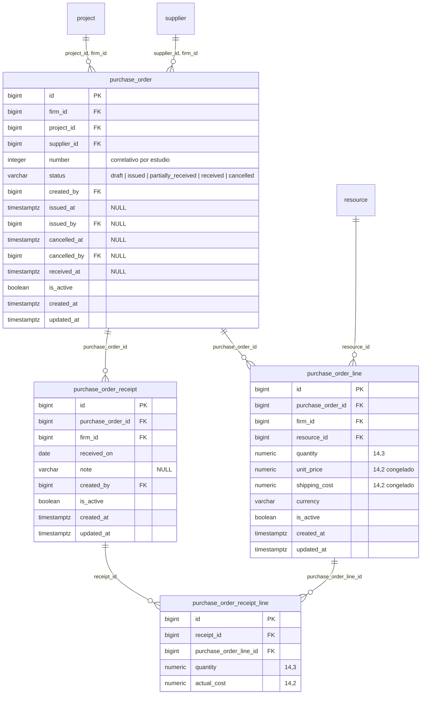

# ADR-011: Órdenes de compra

**Estado:** Aceptada en parte (HU-20). §1 a §8 rigen; las recepciones de §1 y §3 entran con HU-22
**Fecha:** 2026-10-25
**Contexto:** Modelo de datos, estados, permisos y rutas de las órdenes de compra a proveedores. Deja firmes HU-20, HU-21 y HU-22 del [Sprint 4](../historias/sprint-4.md) y es la base de los puntos de [ADR-012](0012-supplier-loyalty-points.md).

---

## Contexto

### Qué pide la cátedra

> Generar órdenes de compra a proveedores a partir de la comparación de alternativas. La orden pasa por los estados borrador, emitida, recibida parcialmente y recibida, registrando las cantidades recibidas y su costo real.

### De dónde partimos

[ADR-010](0010-suppliers-price-lists.md) dejó a cada estudio con sus proveedores (`supplier`) y sus listas (`supplier_price`), y HU-18 calcula al leer, para cada material del cómputo de una obra, qué proveedor lo vende más barato para la cantidad que lleva. ADR-010 §4 dejó escrito que **no se registra ninguna compra**: "el pedido es mostrar el más económico, no registrar una compra". Esta ADR es la que registra la compra, y lo hace sin tocar lo anterior: la comparación sigue calculándose al leer y el presupuesto sigue con el precio de referencia (ADR-010 §5).

### Qué restringe la decisión

- Las convenciones de siempre: `firm_id` en toda tabla de negocio con FK compuesta para que no diverja, baja lógica, `NUMERIC(14,2)` para importes, `currency` modelado, estados como `VARCHAR` + `CHECK` y nunca un `ENUM` nativo (como `project_task.status`, [ADR-009](0009-project-planning.md) §5).
- [ADR-002](0002-authorization-model.md): permisos y nunca roles; lo de otro estudio → 404.
- La comparación es material por material (ADR-010 §4): una orden no puede depender de optimizar la compra completa.
- Decisiones del equipo al armar el sprint: la orden pertenece a una obra; se genera desde la pestaña Compras de esa obra; existe un estado **anulada**; hay **varias recepciones** por orden; no se recibe más de lo pedido; la gestionan la propietaria y los arquitectos del estudio.

---

## Decisión

### 1. Cuatro tablas nuevas

**`purchase_order`** — una orden a un proveedor, para una obra.

| Regla | Cómo la sostiene el esquema |
|---|---|
| La obra es del mismo estudio que la orden | FK compuesta `(project_id, firm_id) → project (id, firm_id)` |
| El proveedor es del mismo estudio que la orden | FK compuesta `(supplier_id, firm_id) → supplier (id, firm_id)`, la que ADR-010 dejó preparada con `UNIQUE (id, firm_id)` |
| El número no se repite en el estudio | `UNIQUE (firm_id, number)` (§4) |
| El estado es uno de los cinco | `CHECK (status IN ('draft', 'issued', 'partially_received', 'received', 'cancelled'))` |
| Las fechas acompañan al estado | `CHECK`: `issued_at` presente salvo en `draft` y en una `cancelled` que nunca se emitió; `cancelled_at` presente si y solo si `cancelled`; `received_at` presente si y solo si `received` |

`is_active` es para **descartar un borrador**, que es distinto de anularlo: un borrador descartado nunca existió para nadie y sale de todos los listados; una orden anulada se emitió o pudo emitirse, y queda visible con su estado. Solo un `draft` se descarta.

**`purchase_order_line`** — un renglón: este material, esta cantidad, a este precio.

| Regla | Cómo la sostiene el esquema |
|---|---|
| El renglón es del estudio de su orden | FK compuesta `(purchase_order_id, firm_id) → purchase_order (id, firm_id)` |
| Una orden no repite material | Índice único parcial `(purchase_order_id, resource_id) WHERE is_active` |
| Cantidad positiva, importes no negativos | `CHECK (quantity > 0)`, `CHECK (unit_price >= 0)`, `CHECK (shipping_cost >= 0)` |
| Moneda ISO 4217 | `CHECK (currency ~ '^[A-Z]{3}$')`, por defecto `'ARS'` |

`quantity` tiene 3 decimales, la escala del cómputo, para que la cantidad que viene de HU-18 entre tal cual.

**`purchase_order_receipt`** — una entrega: lo que llegó un día.

`is_active` existe para la única corrección que se permite (§3): anular la última recepción. Una recepción anulada deja de contar en todo lo acumulado.

**`purchase_order_receipt_line`** — cuánto llegó de un renglón en esa entrega y cuánto se pagó.

| Regla | Cómo la sostiene el esquema |
|---|---|
| Cantidad positiva, costo no negativo | `CHECK (quantity > 0)`, `CHECK (actual_cost >= 0)` |
| Un renglón aparece una vez por entrega | `UNIQUE (receipt_id, purchase_order_line_id)` |

Sin `firm_id` ni `is_active` propios: es composición pura de la recepción, como `budget_version_item` lo es de su versión ([ADR-007](0007-budget-versions.md) §1). Se alcanza solo a través de `receipt_id`, que ya está atado al estudio, y se anula con su recepción.

`actual_cost` es **lo pagado por esa entrega de ese renglón**, envío incluido si el proveedor lo cobró ahí. Es un importe y no un precio unitario: lo que el arquitecto tiene en la mano es la factura o el remito, no una división.

### 2. Precio congelado, material referenciado

El precio unitario, el envío y la moneda se **copian** del renglón de `supplier_price` al generar la orden, y no cambian si después el proveedor actualiza su lista. Una orden es un compromiso con un precio; si leyera el precio vivo, una orden emitida cambiaría de total sola.

El material, en cambio, se **referencia** (`resource_id` con FK). El catálogo usa baja lógica, así que el nombre y la unidad siguen ahí aunque el material se retire, y no hay nada que mostrar que no esté en `resource`. Es la misma partición de ADR-007 §2, al revés de lo que hace `budget_version_item`: allá se copia todo porque el ítem es un comprobante que no puede depender de nada; acá lo único que puede cambiar y que importa es el precio.

### 3. Estados y transiciones

| Desde | Hacia | Quién lo decide | Condición |
|---|---|---|---|
| — | `draft` | el usuario, al generar (§5) | — |
| `draft` | `issued` | el usuario, "Emitir" | al menos un renglón activo |
| `draft` | `cancelled` | el usuario, "Anular" | — |
| `issued` | `cancelled` | el usuario, "Anular" | ninguna recepción activa |
| `issued` | `partially_received` | **el servicio**, al registrar una recepción | llegó algo, pero no todo |
| `issued` / `partially_received` | `received` | **el servicio**, al registrar una recepción | llegó todo lo pedido de todos los renglones |
| `partially_received` | `issued` / `partially_received` | **el servicio**, al anular la última recepción | se recalcula desde lo que queda |

`cancelled` y `received` son finales. Las transiciones que el estado no permite responden **409**.

**Las dos recibidas no se eligen: se derivan.** El servicio las fija después de cada recepción comparando, por renglón, lo pedido contra la suma de lo recibido en recepciones activas. Se **guardan** en `status` igual —y no se calculan al leer— porque el listado del estudio filtra por estado, y un filtro sobre un valor calculado obligaría a agregar recepciones por cada orden listada. Un test sostiene que `status` coincide siempre con lo que dicen las recepciones.

**Una orden emitida ya no se edita**: ni renglones, ni cantidades, ni proveedor. Lo que se le hace después es recibirla o anularla.

**Corregir una recepción (D-20):** mientras la orden no esté `received`, se puede **anular la última recepción activa** (baja lógica) y volver a cargarla. Se anula solo la última para que el historial se lea en orden: corregir una del medio dejaría recepciones posteriores calculadas sobre una base que ya no existe. Una orden `received` queda cerrada porque ya sumó puntos (ADR-012) y deshacerla obligaría a restarlos.

### 4. Numeración correlativa por estudio (D-21)

`number` es correlativo **por estudio**, y la pantalla lo muestra como `OC-0001`. Se lee igual desde la obra y desde el listado del estudio, que es donde más se busca una orden, y es como numera un estudio real.

Se calcula al generar el borrador con `COALESCE(MAX(number), 0) + 1` sobre las órdenes del estudio, bajo lock de la fila `firm` (`SELECT ... FOR UPDATE`), con `UNIQUE (firm_id, number)` como respaldo: el mismo mecanismo de ADR-007 §3, con el lock un nivel más arriba porque la numeración también lo está. Un borrador descartado conserva su número: los huecos no se reutilizan.

### 5. Cómo se genera una orden (HU-20)

Desde la pestaña Compras de la obra se eligen materiales y se pide "Generar órdenes". Por cada material:

1. Se toma el **más económico** de la comparación de HU-18 para la cantidad del cómputo. Si hay empate, el primero por nombre de proveedor, que es el orden en que la comparación ya los devuelve.
2. Si la obra ya tiene un **borrador activo de ese proveedor**, el renglón se agrega a ese borrador; si no, se crea uno. Así una obra nunca tiene dos borradores al mismo proveedor y el usuario no tiene que juntarlos a mano.
3. Si ese borrador ya tiene el material, se actualiza la cantidad en vez de duplicarlo.

En borrador, **cambiar el proveedor de un renglón** lo mueve al borrador de la obra para el proveedor nuevo (creándolo si hace falta), con el precio y el envío de la lista de ese proveedor. Un borrador que se queda sin renglones sigue existiendo hasta que se descarta o se le agregan.

Solo se pide lo que tiene oferta activa: un material "sin proveedor" no genera renglón, y el proveedor elegido tiene que ofrecer el material en su lista vigente al momento de generar o mover el renglón.

### 6. Permisos

| Ámbito | Código | Roles |
|---|---|---|
| `firm` | `purchase_order.view` | `owner`, `architect` |
| `firm` | `purchase_order.manage` | `owner`, `architect` |

**De estudio y no de obra**, aunque la orden pertenezca a una obra. El equipo decidió que gestionan las compras la propietaria y los arquitectos del estudio, estén o no en el equipo de la obra, y un permiso de obra solo lo tendría quien está en ese equipo. El líder de cada obra queda cubierto: es siempre `owner` o `architect` del estudio, porque un cliente del estudio no puede liderar una obra (`FIRM_CLIENT_CANNOT_LEAD`, ADR-002 §11).

**El `client` no recibe ninguno**: una orden son costos del estudio, igual que los precios de proveedor (ADR-010 §6).

Entran en una migración de seed, con el mismo mecanismo que `b97f764e437b_seed_recipe_catalog_permissions.py`. `purchase_order.view` es también el permiso con el que se lee el nivel del estudio (ADR-012).

### 7. Reglas que el esquema no puede garantizar

Van en el servicio, cada una con su test:

1. **No se recibe más de lo pedido.** Por renglón, lo recibido en recepciones activas más lo de esta recepción no supera `quantity`. → 409.
2. **Solo un `draft` se edita o se descarta.** → 409 sobre cualquier otro estado.
3. **No se emite un borrador vacío.** → 409.
4. **No se anula una orden con algo recibido.** → 409.
5. **Solo se recibe una orden `issued` o `partially_received`.** → 409.
6. **El proveedor de un renglón ofrece ese material** en su lista vigente, y es un material (ADR-010 §7). → 422.
7. **La orden, su obra y su proveedor son del mismo estudio** del que pide. Lo ajeno → 404.
8. **`status` coincide con las recepciones activas** después de toda escritura.
9. **Nada se borra:** no hay `DELETE` bajo los prefijos de órdenes. Un test sobre la tabla de rutas lo sostiene, como en HU-12 y HU-17.

### 8. Rutas nuevas

Bajo la obra, para lo que nace en la obra:

- `POST /firms/{firm_id}/projects/{project_id}/purchase-orders/generate` — genera o completa borradores desde una lista de `resource_id` (§5). `purchase_order.manage`.
- `GET /firms/{firm_id}/projects/{project_id}/purchase-orders` — las órdenes de la obra. `purchase_order.view`.

Bajo el estudio, para todo lo demás, así un arquitecto que no está en el equipo de la obra la gestiona igual:

- `GET /firms/{firm_id}/purchase-orders?project_id=&supplier_id=&status=` — el listado del estudio. `purchase_order.view`.
- `GET /firms/{firm_id}/purchase-orders/{order_id}` — el detalle, con renglones, recepciones y acumulados. `purchase_order.view`.
- `PATCH .../lines/{line_id}`, `POST .../lines`, `POST .../lines/{line_id}/deactivate` — editar un borrador. `purchase_order.manage`.
- `POST .../{order_id}/issue`, `POST .../{order_id}/cancel`, `POST .../{order_id}/discard` — `purchase_order.manage`.
- `POST .../{order_id}/receipts` — registrar una recepción. `POST .../{order_id}/receipts/{receipt_id}/deactivate` — anular la última. `purchase_order.manage`.

Las rutas bajo la obra resuelven la obra con `get_visible` como el resto, así que sirven a quien está en su equipo o tiene `project.view_all`. El listado del estudio es la puerta para todos los demás.

**Precisado al implementar HU-20** (2026-10-25):

- **La migración crea solo `purchase_order` y `purchase_order_line`**, con todas las columnas y `CHECK` de estado de §1 desde la primera fila. `purchase_order_receipt` y `purchase_order_receipt_line` entran con HU-22, que es la que las escribe.
- **La cantidad que propone generar es lo que falta pedir:** la del cómputo menos lo que ya está en renglones activos de órdenes activas no anuladas de esa obra, **borradores incluidos**. Así "Generar órdenes" no pide dos veces lo mismo. Un material sin nada que pedir, o sin oferta, no genera renglón y vuelve en la respuesta como omitido (`already_ordered` / `no_supplier`). Un material que no es del cómputo de la obra es un error del pedido: 422.
- **Si el borrador ya tiene el material, se suma la cantidad** al renglón existente y su precio queda el que congeló: un precio ya congelado no se refresca a espaldas del arquitecto. Agregar a mano un material que la orden ya tiene es 409.
- **La comparación de la obra suma `ordered_quantity`** por material (`GET .../purchasing`), que la pantalla muestra como "Ya pedido".
- **Rutas exactas de HU-20:** `POST .../projects/{project_id}/purchase-orders/generate` (200, con las órdenes tocadas y los omitidos), `GET .../projects/{project_id}/purchase-orders?order_status=`, `GET /firms/{firm_id}/purchase-orders/{order_id}`, `POST .../lines`, `PATCH .../lines/{line_id}`, `POST .../lines/{line_id}/supplier` (responde con el borrador al que fue el renglón), `POST .../lines/{line_id}/deactivate` y `POST .../{order_id}/discard` (204). Las de editar responden con la orden entera.
- En el front, los borradores se listan bajo la comparación, en la pestaña Compras, y cada uno abre `/firms/:firmId/purchase-orders/:orderId`.

---

## Consecuencias

**Se desbloquea:**

- HU-20, HU-21 y HU-22.
- HU-23: los puntos se enganchan en la transición a `received` (ADR-012).

**Compromisos que asumimos:**

- El precio de una orden puede quedar distinto del de la lista del proveedor: es lo buscado, y la pantalla tiene que decir que es el precio "al generar la orden".
- `status` es un dato derivado guardado, y hay que mantenerlo coherente en cada escritura (regla 8).
- Un borrador descartado deja un hueco en la numeración.
- La orden sigue suponiendo, como ADR-010, que cada material se compra entero a un proveedor: un renglón no se parte entre dos.

**Queda pendiente de revisar, y bajo qué condición:**

| Tema | Se revisa cuando |
|---|---|
| El costo real de las órdenes como gasto ejecutado en el dashboard (D-19) | Se quiera comparar lo gastado contra lo presupuestado. HU-19 sigue comparando presupuestos |
| Enviar la orden al proveedor (mail, PDF) | Se use la orden fuera del sistema |
| Devoluciones, remitos, facturas y pagos | Haga falta conciliar con administración |
| Stock e inventario de obra | Se quiera saber qué hay en obra y no solo qué llegó |
| Partir un renglón entre proveedores | Un proveedor no tenga toda la cantidad |

---

## Alternativas descartadas

**Estado derivado sin columna.** Calcular "recibida parcialmente" y "recibida" en cada lectura evita mantener un valor coherente. Descartada porque el listado del estudio filtra por estado, y filtrar por un valor calculado obliga a agregar recepciones de cada orden en cada listado.

**Una sola recepción acumulada y editable por renglón.** Menos tablas. Descartada porque el pedido habla de recibir parcialmente, y sin recepciones no queda registro de qué llegó cuándo ni de cuánto se pagó cada vez.

**Corregir con recepciones de ajuste negativas.** Conserva todo el historial. Descartada porque rompe `CHECK (quantity > 0)`, complica derivar el estado y obliga a pensar qué pasa con los puntos de una cantidad que baja.

**Numeración por obra**, como las versiones (ADR-007 §3). Descartada porque las órdenes se buscan sobre todo desde el listado del estudio, y ahí "OC-0003" tendría que decir además de qué obra.

**Permiso de obra** (`project.purchase.*` para `lead` y `collaborator`). Sería coherente con el resto de lo que vive en una obra. Descartada porque deja afuera a los arquitectos del estudio que no están en el equipo, que el equipo quiere que gestionen compras.

**Orden sin obra.** Más simple. Descartada porque se perdería saber a qué obra fue cada compra, que es lo que hace útil al costo real.

**Leer el precio vivo de la lista.** Sin columnas copiadas. Descartada porque una orden emitida cambiaría de total sola cuando el proveedor actualiza su lista.

---

## Referencias

- [ADR-002](0002-authorization-model.md) §7, §8 y §11 — permisos por rol, aislamiento, el cliente no lidera.
- [ADR-007](0007-budget-versions.md) §1 a §3 — copiar o referenciar, numeración bajo lock.
- [ADR-009](0009-project-planning.md) §5 — estados como `VARCHAR` + `CHECK`.
- [ADR-010](0010-suppliers-price-lists.md) — proveedores, listas y la comparación de la que sale una orden.
- [ADR-012](0012-supplier-loyalty-points.md) — los puntos que suma una orden recibida.
- [sprint-4.md](../historias/sprint-4.md) — HU-20, HU-21 y HU-22.
