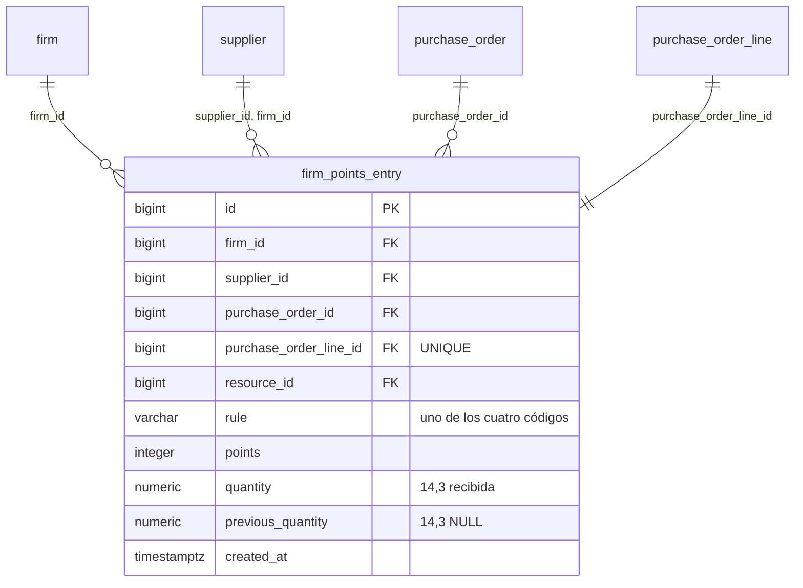

# ADR-012: Gamificación por recurrencia de compra

**Estado:** Aceptada
**Fecha:** 2026-10-25
**Contexto:** Qué premia la gamificación, cómo se calculan los puntos, cómo se guardan y cómo se leen los niveles. Deja firmes HU-23 y HU-24 del [Sprint 4](../historias/sprint-4.md). Se apoya en las órdenes de compra de [ADR-011](0011-purchase-orders.md).

---

## Contexto

### Qué pide la cátedra

> Agregar Gamification.

Nada más: el pedido no dice qué premiar, a quién ni cómo se ve.

### Qué decidió el equipo

Premiar la **recurrencia de compra a un mismo proveedor**. El estudio sube de nivel cuando le vuelve a comprar a un proveedor, y suma más cuando repite el mismo material en una cantidad parecida. La razón es de producto: una relación sostenida con un proveedor es lo que en la práctica consigue mejores condiciones, y premiarla ata la gamificación a las órdenes de compra, que es lo nuevo del sprint, en vez de dejarla como un contador suelto.

**Esta definición se confirma con la cátedra** (`sprint-4.md`, "Pendiente de la cátedra"). Si la cátedra pide otra cosa, lo que cambia es la regla de §3. La tabla de asientos y los niveles sirven igual para premiar otras acciones.

### Qué restringe la decisión

- Las decisiones del equipo al armar el sprint: el perfil es **el estudio**, con un nivel general y otro por proveedor. Suma cuando la orden queda **recibida**. Cantidad similar es **±50%**. Los puntos por renglón son **10 / 6 / 3 / 0**. Hay **cuatro niveles fijos**.
- [ADR-002](0002-authorization-model.md): permisos y nunca roles. El `client` no ve costos ni compras.
- Los puntos tienen que poder explicarse: el historial dice qué orden sumó cuánto y por qué.

---

## Decisión

### 1. Los puntos son del estudio

Las compras las hace el estudio, no una persona: varios arquitectos le compran al mismo corralón, y la relación con el proveedor es del estudio. Los puntos se suman al estudio y, además, se acumulan por proveedor, que es lo que da el **nivel con cada proveedor**.

### 2. Cuándo suma

Una orden suma **en la transición a `received`** (ADR-011 §3), en la misma transacción que la recepción que la completa. Una orden que se anula nunca sumó, y una que queda recibida parcialmente todavía no suma: el reconocimiento es por una compra que efectivamente llegó.

Por eso ADR-011 §3 cierra una orden `received`: anular la recepción que la completó obligaría a restar puntos ya mostrados.

### 3. Cuántos puntos da cada renglón

Cada renglón activo de la orden recibe los puntos de la **primera** regla que cumple, comparado contra las órdenes **ya recibidas antes** por el mismo estudio y al mismo proveedor, de cualquier obra:

| Código | Caso | Puntos |
|---|---|---|
| `same_material_similar_quantity` | Mismo proveedor, mismo material, cantidad similar a la última compra de ese material | **10** |
| `same_material` | Mismo proveedor, mismo material, otra cantidad | **6** |
| `same_supplier` | Mismo proveedor, un material que nunca le había comprado | **3** |
| `first_purchase` | Primera orden recibida del estudio a ese proveedor | **0** |

- **"La última compra de ese material"** es el renglón de ese material en la orden `received` más reciente del estudio a ese proveedor, por `received_at` y después por id. Se compara contra la última y no contra un promedio: es la que el arquitecto tiene en la cabeza ("como la vez pasada").
- **"Similar"** es `|q − q_anterior| ≤ 0,5 × q_anterior`, con las cantidades **recibidas** (no las pedidas): es lo que efectivamente se compró.
- **Los renglones de una misma orden no se comparan entre sí.** Si es la primera orden a ese proveedor, todos sus renglones son `first_purchase`, aunque haya varios.
- Los valores (10, 6, 3, 0), el 0,5 y los umbrales de §5 son **constantes en un solo módulo**, junto a la función que aplica la regla.

La regla es una **función pura** —recibe los renglones de la orden y las compras anteriores, y devuelve un código y unos puntos por renglón—, igual que `services/projection.py` y `services/purchasing.py`, así que se testea sin base de datos.

### 4. Los puntos se guardan como asientos

| Regla | Cómo la sostiene el esquema |
|---|---|
| Un renglón suma una sola vez | `UNIQUE (purchase_order_line_id)` |
| El proveedor es del mismo estudio | FK compuesta `(supplier_id, firm_id) → supplier (id, firm_id)` |
| La regla es una de las cuatro | `CHECK (rule IN (...))` |
| Los puntos no son negativos | `CHECK (points >= 0)` |

**Un asiento guarda la regla y los puntos que se aplicaron ese día**, no se recalcula. Si mañana se cambia un valor o el porcentaje, los puntos ganados antes no se mueven. Es lo esperable de un sistema de puntos, y es lo que permite que el historial explique cada número con la regla que se usó. `previous_quantity` es la cantidad contra la que se comparó, para que el historial pueda decir "como la vez pasada (1.000 u)".

**Es inmutable: no lleva `is_active` ni `updated_at`**, igual que `budget_version` ([ADR-007](0007-budget-versions.md) §1). Ningún flujo da de baja un asiento, porque una orden recibida no se reabre (§2). Por lo mismo, su repositorio no hereda de `FirmScopedRepository`, que exige `is_active`: filtra por estudio a mano, como `BudgetVersionRepository`.

**El nivel no se guarda.** Es la suma de los asientos del estudio (o del estudio con ese proveedor), calculada al leer. No hay ninguna columna que mantener coherente.

### 5. Niveles

Cuatro niveles fijos, iguales para el estudio y para cada proveedor:

| Nivel | Desde |
|---|---|
| Bronce | 0 puntos |
| Plata | 50 puntos |
| Oro | 150 puntos |
| Platino | 400 puntos |

La respuesta dice el nivel actual, los puntos, el nivel siguiente y cuántos puntos faltan. En Platino no hay siguiente. Son constantes y no se editan desde una pantalla.

### 6. Permiso (D-22)

El nivel, los puntos y el historial se leen con **`purchase_order.view`** (ADR-011 §6): `owner` y `architect`. No suma ninguna fila. Los puntos salen de las órdenes, y quien ve unos ve los otros. **El `client` no ve nada de esto.**

### 7. Rutas nuevas

- `GET /firms/{firm_id}/loyalty` — nivel del estudio, puntos, nivel siguiente y el historial de asientos, del más reciente al más viejo, con orden, obra, proveedor, material, regla y puntos.
- El **nivel con cada proveedor** viaja en la respuesta de `GET /firms/{firm_id}/suppliers/{supplier_id}` y en el listado de proveedores, para no agregar una ruta por pantalla. Esas rutas piden `supplier.view`, que hoy tienen los mismos dos roles. Si alguna vez dejan de coincidir, el nivel se muestra solo a quien tenga además `purchase_order.view`.

### 8. Reglas, cada una con su test

1. Cada caso de §3, incluido un renglón que cae justo en el borde del ±50% (adentro) y uno apenas afuera.
2. La primera orden a un proveedor da `first_purchase` en todos sus renglones.
3. Una orden con renglones de distintos casos suma cada uno por su regla.
4. Una orden anulada no suma. Una recibida parcialmente no suma hasta completarse.
5. Completar la misma orden dos veces no duplica asientos (`UNIQUE`).
6. Las órdenes de otro estudio no cuentan como compra anterior.
7. Cambiar las constantes no altera los asientos ya escritos.

### 9. Precisado al implementar (2026-10-26)

**Al implementar HU-23:**

- **"La última compra de ese material" es por material, no por orden.** El texto de §3 —"el renglón de ese material en la orden `received` más reciente"— se podía leer como "solo mirar la última orden", y entonces un material comprado dos órdenes atrás contaría como nunca comprado y `same_material` casi nunca se aplicaría. Se compara contra **la orden recibida más reciente que tenía ese material**, por `received_at` y después por id. La consulta usa `DISTINCT ON (resource_id)`.
- **`bought_before` es un argumento aparte de la regla**, y no se deduce de si hay compras anteriores de esos materiales: un mapa vacío también describe a un estudio que le compra seguido y nunca le compró ninguno de esos materiales. El primero da `first_purchase` (0) y el segundo `same_supplier` (3).
- **El enganche es `_apply_received_status`** (ADR-011 §8), la única función que escribe el estado recibido. Se calcula antes de sobrescribir el estado si la orden **está entrando** en `received`, así una escritura posterior que la encuentre ya recibida no vuelve a sumar. Además el servicio no suma si la orden ya tiene asientos, y el `UNIQUE` lo sostiene un nivel más abajo.
- **La cantidad que se guarda y se compara es la recibida**, leída de las recepciones activas (HU-22). En una orden `received` coincide con la pedida, pero la regla está definida sobre la recibida y es esa la que se usa.
- **Los umbrales de nivel de §5 no entran todavía.** La regla de §3 y sus valores están en `services/loyalty.py`, como pide esta ADR; los cuatro niveles los agrega HU-24 en ese mismo módulo, cuando haya quien los lea. No tiene sentido dejar constantes sin consumidor.
- **Nombres de constraints cortos a propósito:** `uq_firm_points_entry_purchase_order_line_id` ya mide 43 caracteres, y Postgres guarda 63. Los nombres generados por la convención se verificaron contra ese límite antes de escribir la migración.

**Al implementar HU-24:**

- **El nivel por proveedor va solo en la ficha**, no en el listado de proveedores como decía §7. Los criterios de HU-24 piden "en la ficha de cada proveedor" y nada más, y el listado es una pantalla de HU-17: sumarle una columna por una historia ajena no se justificaba. Si después se quiere ver el nivel de todos de un vistazo, es una consulta agregada más.
- **El nivel se lee con `supplier.view` en la ficha**, como anticipaba §7, sin chequear además `purchase_order.view`. Hoy los dos permisos los tienen los mismos dos roles; si alguna vez dejan de coincidir, hay que agregar el segundo chequeo y el campo pasa a ser opcional. Está anotado en el esquema.
- **El nivel lo arma `level_of()` en `schemas/loyalty.py`**, no cada ruta por su lado. Las dos pantallas que muestran un nivel —la del estudio y la del proveedor— lo describen igual, y el esquema se valida directo contra el dataclass del servicio, que tiene los mismos nombres de campo. Evita que una ruta importe de otra, que el proyecto no hacía en ningún lado.
- **El historial viene entero y sin paginar**, como el listado de órdenes del estudio de HU-21 y por la misma razón: las órdenes recibidas de un estudio son pocas. Ordenado por id descendente y no por `created_at`, porque los asientos escritos en una misma transacción comparten timestamp.
- **La barra se mide entre el umbral del nivel actual y el del siguiente**, no desde cero: en Plata con 60 puntos muestra cuánto hay de 60 entre 50 y 150, que es lo que significa "cuánto falta para el próximo". En Platino va llena y el texto dice que es el máximo.
- **`LevelOut` manda `level_from`** además del nivel y los puntos, justamente para que la barra pueda hacer esa cuenta sin conocer la tabla de umbrales.
- **Las órdenes invalidan también la clave del nivel y la de proveedores.** Recibir una orden es lo que suma puntos, así que `useRefresh` de las órdenes refresca las dos pantallas que muestran un nivel; si no, una entrega registrada en una pestaña dejaba el nivel viejo en otra.

---

## Consecuencias

**Se desbloquea:**

- HU-23 (puntos) y HU-24 (niveles).

**Compromisos que asumimos:**

- Los puntos dependen de que las órdenes se completen. Una orden que queda para siempre en `partially_received` no suma.
- Los valores elegidos (10 / 6 / 3 / 0 y los umbrales) son del equipo y no tienen respaldo empírico. Están en un solo lugar para poder ajustarlos.
- Un ajuste de valores no es retroactivo.

**Queda pendiente de revisar, y bajo qué condición:**

| Tema | Se revisa cuando |
|---|---|
| Otra definición de gamificación | La cátedra no acepte la recurrencia de compra |
| Puntos por otras acciones (terminar tareas, cargar cómputos) | Se quiera premiar algo más que comprar |
| Puntos o nivel por usuario | Se quiera reconocer a cada arquitecto |
| Canjes, descuentos o beneficios reales con el proveedor | Los proveedores participen del sistema |
| Ranking entre estudios | Haya varios estudios activos y tenga sentido compararlos |

---

## Alternativas descartadas

**Puntos por usuario.** Más "juego". Descartada porque las compras son del estudio, y dos arquitectos que le compran al mismo corralón no sumarían juntos.

**Sumar al emitir.** Más inmediato. Descartada porque una orden emitida puede anularse o no llegar nunca, y habría que restar puntos ya mostrados.

**Calcular los puntos siempre desde las órdenes, sin asientos.** Ninguna tabla nueva. Descartada porque cualquier cambio de valores reescribiría el pasado, y el historial no podría explicar con qué regla se ganó cada número.

**Comparar contra el promedio histórico** de ese material con ese proveedor. Más estable. Descartada por difícil de explicar en pantalla: "como la vez pasada" se entiende, "dentro del 50% de tu promedio ponderado" no.

**Niveles configurables por soporte.** Más flexible. Descartada por el costo de una pantalla de administración para algo que nadie pidió cambiar.

**Guardar el nivel en el estudio.** Lectura más barata. Descartada porque es un valor derivado más para mantener coherente, cuando la suma es una consulta indexada.

---

## Referencias

- [ADR-002](0002-authorization-model.md) §7 — permisos por rol.
- [ADR-007](0007-budget-versions.md) §1 — tablas inmutables sin `is_active`.
- [ADR-010](0010-suppliers-price-lists.md) — proveedores.
- [ADR-011](0011-purchase-orders.md) §3 y §6 — la transición a `received` y `purchase_order.view`.
- [sprint-4.md](../historias/sprint-4.md) — HU-23 y HU-24.
