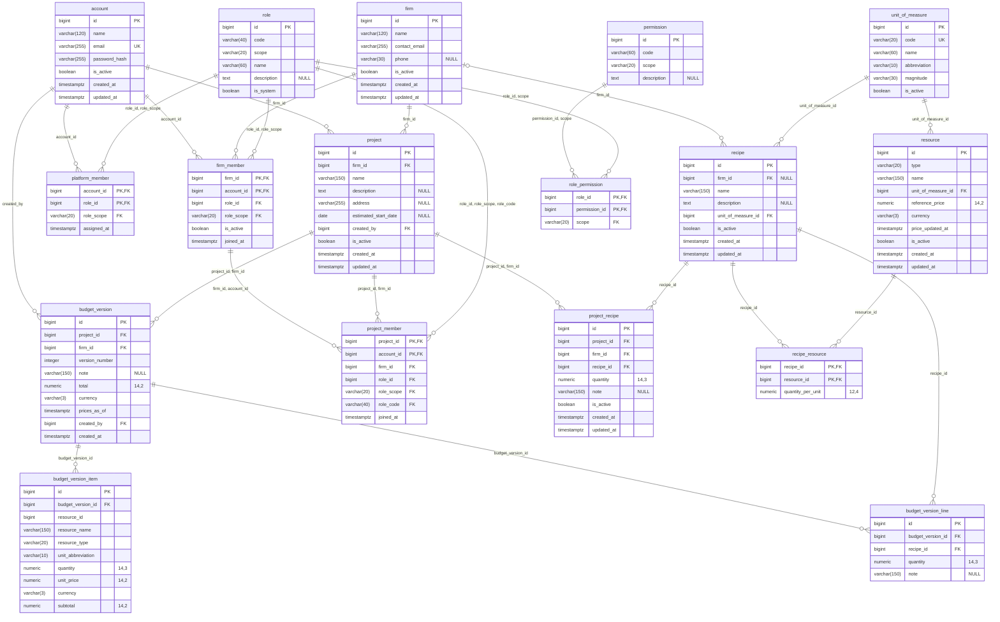
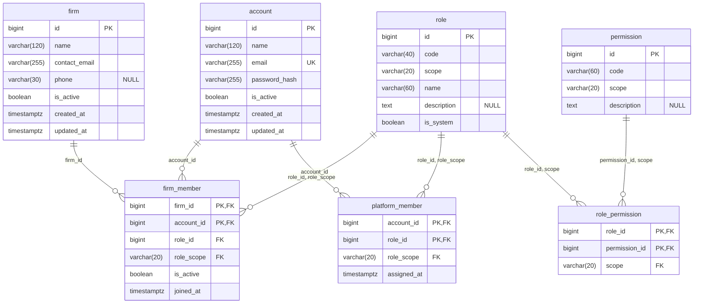
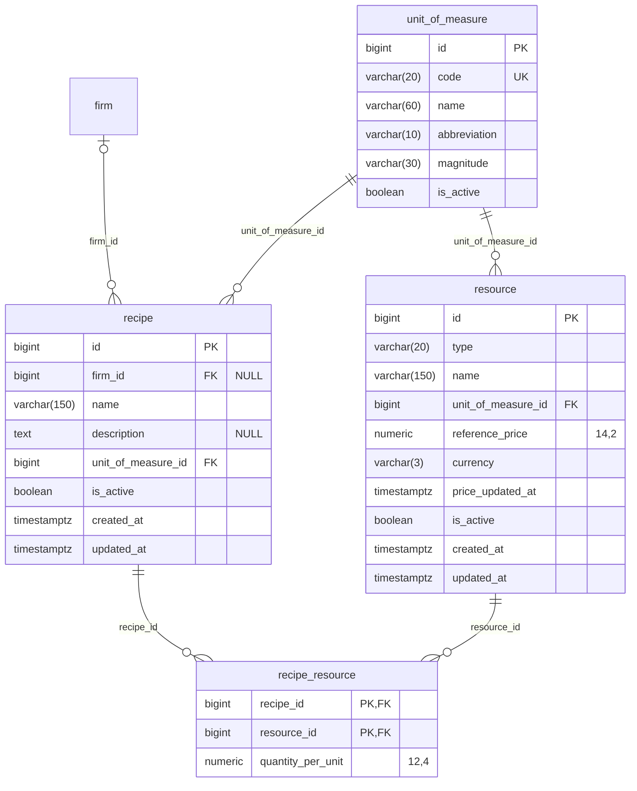
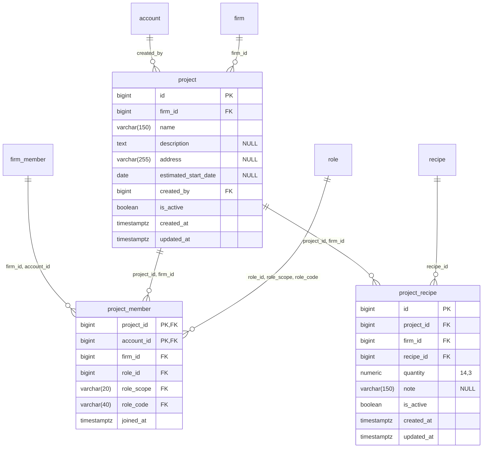
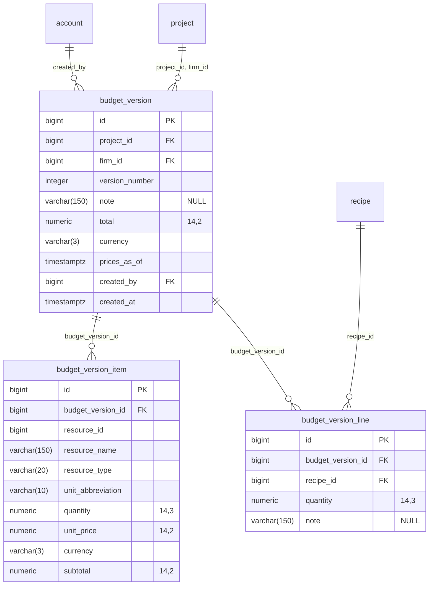

# Diagrama entidad-relación

> **Archivo generado: no editar a mano.** Sale de los modelos de SQLAlchemy
> (`backend/app/models/`). Al cambiar un modelo se regenera con:
>
> ```bash
> cd backend && uv run python -m scripts.generate_erd
> ```
>
> El CI falla si este archivo no coincide con los modelos.

Es el estado **actual** del esquema: 17 tablas. Lo que todavía se está
diseñando no aparece acá sino en la ADR que lo propone. El porqué de cada tabla está en
las ADR que cita cada área, y las convenciones en
[modelo-datos-sprint-1.md](modelo-datos-sprint-1.md).

## Cómo leerlo

- `PK`, `FK`, `UK`: clave primaria, clave foránea, columna única por sí sola.
- `"NULL"`: la columna admite nulos. Sin esa marca es `NOT NULL`.
- `numeric "14,2"`: precisión y escala (Mermaid no admite la coma dentro del tipo).
- Cada línea es una clave foránea, etiquetada con las columnas que la forman en la
  tabla hija. Una clave foránea compuesta es una sola línea.
- `||--o{` uno a muchos · `|o--o{` la clave foránea admite nulos · `||--o|` uno a uno.
- Las tablas de reglas listan lo que el esquema garantiza y el dibujo no muestra:
  `CHECK`, unicidad compuesta o parcial, claves foráneas compuestas y `ON DELETE`.

## Modelo completo



## Identidad y autorización

Definida en: [ADR-002](adr/0002-authorization-model.md), [ADR-004](adr/0004-authentication.md).



| Tabla | Regla | Definición |
|---|---|---|
| `account` | CHECK | `email = lower(email)` |
| `account` | UNIQUE | `(email)` |
| `firm_member` | CHECK | `role_scope = 'firm'` |
| `firm_member` | FK compuesta | `(role_id, role_scope) → role (id, scope)` |
| `permission` | CHECK | `scope IN ('platform', 'firm', 'project')` |
| `permission` | UNIQUE | `(code, scope)` |
| `permission` | UNIQUE | `(id, scope)` |
| `platform_member` | CHECK | `role_scope = 'platform'` |
| `platform_member` | FK compuesta | `(role_id, role_scope) → role (id, scope)` |
| `role` | CHECK | `scope IN ('platform', 'firm', 'project')` |
| `role` | UNIQUE | `(code, scope)` |
| `role` | UNIQUE | `(id, scope)` |
| `role` | UNIQUE | `(id, scope, code)` |
| `role_permission` | FK compuesta | `(permission_id, scope) → permission (id, scope)` |
| `role_permission` | FK compuesta | `(role_id, scope) → role (id, scope)` |
| `role_permission` | ON DELETE CASCADE | `(permission_id, scope) → permission (id, scope)` |
| `role_permission` | ON DELETE CASCADE | `(role_id, scope) → role (id, scope)` |

## Catálogo

Definida en: [ADR-003](adr/0003-recipe-catalog.md), [ADR-005](adr/0005-catalog-administration.md), [ADR-006](adr/0006-firm-recipes.md).



| Tabla | Regla | Definición |
|---|---|---|
| `recipe` | UNIQUE parcial | `(firm_id, lower(recipe.name)) WHERE is_active AND firm_id IS NOT NULL` |
| `recipe` | UNIQUE parcial | `(lower(recipe.name)) WHERE is_active AND firm_id IS NULL` |
| `recipe_resource` | CHECK | `quantity_per_unit > 0` |
| `recipe_resource` | ON DELETE CASCADE | `(recipe_id) → recipe (id)` |
| `recipe_resource` | ON DELETE CASCADE | `(resource_id) → resource (id)` |
| `resource` | CHECK | `currency ~ '^[A-Z]{3}$'` |
| `resource` | CHECK | `reference_price >= 0` |
| `resource` | CHECK | `type IN ('material', 'labor', 'equipment')` |
| `resource` | UNIQUE parcial | `(lower(resource.name)) WHERE is_active` |
| `unit_of_measure` | UNIQUE | `(code)` |

## Obra y cómputo

Definida en: [ADR-002](adr/0002-authorization-model.md) §3-§5, [ADR-003](adr/0003-recipe-catalog.md).



| Tabla | Regla | Definición |
|---|---|---|
| `project` | UNIQUE | `(id, firm_id)` |
| `project_member` | CHECK | `role_scope = 'project'` |
| `project_member` | FK compuesta | `(firm_id, account_id) → firm_member (firm_id, account_id)` |
| `project_member` | FK compuesta | `(project_id, firm_id) → project (id, firm_id)` |
| `project_member` | FK compuesta | `(role_id, role_scope, role_code) → role (id, scope, code)` |
| `project_member` | UNIQUE parcial | `(project_id) WHERE role_code = 'client'` |
| `project_member` | UNIQUE parcial | `(project_id) WHERE role_code = 'lead'` |
| `project_recipe` | CHECK | `quantity > 0` |
| `project_recipe` | FK compuesta | `(project_id, firm_id) → project (id, firm_id)` |

## Versiones del presupuesto

Definida en: [ADR-007](adr/0007-budget-versions.md).



| Tabla | Regla | Definición |
|---|---|---|
| `budget_version` | CHECK | `currency ~ '^[A-Z]{3}$'` |
| `budget_version` | CHECK | `total >= 0` |
| `budget_version` | CHECK | `version_number > 0` |
| `budget_version` | FK compuesta | `(project_id, firm_id) → project (id, firm_id)` |
| `budget_version` | UNIQUE | `(project_id, version_number)` |
| `budget_version_item` | CHECK | `currency ~ '^[A-Z]{3}$'` |
| `budget_version_item` | CHECK | `quantity > 0` |
| `budget_version_item` | CHECK | `resource_type IN ('material', 'labor', 'equipment')` |
| `budget_version_item` | CHECK | `subtotal >= 0` |
| `budget_version_item` | CHECK | `unit_price >= 0` |
| `budget_version_item` | ON DELETE CASCADE | `(budget_version_id) → budget_version (id)` |
| `budget_version_line` | CHECK | `quantity > 0` |
| `budget_version_line` | ON DELETE CASCADE | `(budget_version_id) → budget_version (id)` |
