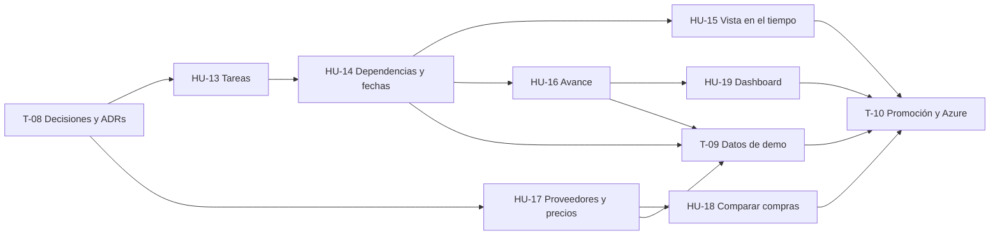

# Historias de Usuario — Sprint 3

**Materia:** Proyecto Integral de Desarrollo — UCAio
**Duración del sprint:** 2 semanas
**Equipo:** 3 personas (fullstack)

> **Estado de este documento: planificación cerrada, el resto en borrador.** HU-13 y HU-14 están firmes: las define [ADR-009](../adr/0009-project-planning.md). Las demás historias todavía tienen puntos sin decidir, marcados **[D-n]** y listados en [Preguntas de diseño abiertas](#preguntas-de-diseño-abiertas) con la historia que los destraba: se cierran al arrancar cada una, no antes.

## Requerimientos de la cátedra

Texto recibido para este sprint, sin editar:

> Dividir la obra en rubros y tareas. Cada tarea tiene responsable, fechas, duración estimada, costo y estado: pendiente, en curso, pausada o finalizada.
> Permitir dependencias entre tareas. Una tarea no puede iniciarse si sus predecesoras obligatorias no finalizaron.
> Mostrar la planificación mediante una vista calendario o Gantt.
> Registrar el porcentaje de avance real y compararlo con el planificado.
> Incorporar proveedores y listas de precios. Un material puede tener distintos precios y costos de envío según el proveedor.
> Comparar alternativas de compra y mostrar el proveedor más económico por material. No se exige optimización automática de toda la compra.
> Dashboard con presupuesto original vs. actualizado, avance planificado vs. real y proyección mensual de gastos.

## Qué ya está cubierto y qué es nuevo

A diferencia del Sprint 2, casi todo es nuevo: los dos sprints anteriores no tienen ni planificación ni proveedores. Lo que existe son las piezas sobre las que este sprint se apoya.

**Hacemos más de lo que pide el texto:** las fechas de las tareas las calcula el sistema desde las duraciones y las dependencias, con camino crítico y atrasos que se propagan solos (ADR-009). El pedido se cumplía con fechas cargadas a mano.

| Requerimiento | Dónde se resuelve | Estado |
|---|---|---|
| Dividir la obra en rubros y tareas | **HU-13** (tareas) | Nuevo. **Los rubros quedan fuera por ahora**: el pedido los menciona una sola vez y se consulta con la cátedra |
| Cada tarea tiene responsable, fechas, duración estimada, costo y estado | **HU-13** y **HU-14** | Nuevo. Las fechas no se cargan: las calcula HU-14. El costo sale del cómputo (HU-5) |
| Estados: pendiente, en curso, pausada, finalizada | **HU-13** | Nuevo |
| Dependencias entre tareas | **HU-14** | Nuevo |
| Una tarea no se inicia si sus predecesoras obligatorias no finalizaron | **HU-14** | Nuevo. Toda dependencia es obligatoria |
| Vista calendario o Gantt | **HU-15** | Nuevo |
| Registrar el porcentaje de avance real | **HU-16** | Nuevo |
| Compararlo con el planificado | **HU-16** | Nuevo |
| Proveedores y listas de precios | **HU-17** | Nuevo. ADR-003 y ADR-005 dejaron "precios por proveedor" como pendiente |
| Un material con distintos precios y costos de envío según el proveedor | **HU-17** | Nuevo. Los materiales son los `resource` del catálogo (ADR-003) |
| Comparar alternativas de compra | **HU-18** | Nuevo |
| Mostrar el proveedor más económico por material | **HU-18** | Nuevo |
| No se exige optimización automática de toda la compra | **HU-18** | Fuera de alcance, explícito en el pedido |
| Dashboard: presupuesto original vs. actualizado | **HU-19** | Nuevo. Se apoya en el presupuesto (HU-11) y sus versiones (HU-12) |
| Dashboard: avance planificado vs. real | **HU-19** | Nuevo. Muestra lo que calcula HU-16 |
| Dashboard: proyección mensual de gastos | **HU-19** | Nuevo. Necesita los costos y las fechas de las tareas (HU-13) |

Lo que ya existe y este sprint usa (ver [der.md](../der.md)):

- **La obra y su equipo** (`project`, `project_member`): de ahí puede salir el responsable de una tarea.
- **El cómputo y el presupuesto** (`project_recipe`, HU-5 y HU-11): hoy es la única fuente de costos de una obra.
- **Las versiones del presupuesto** (`budget_version`, HU-12): presupuestos congelados contra los que se puede comparar.
- **El catálogo de recursos** (`resource`, con su precio de referencia único): los materiales a los que un proveedor les pone precio.

## Reglas heredadas

No son decisiones de este sprint: son lo que los Sprints 1 y 2 dejaron fijado, y toda historia de acá las cumple.

- Plataforma **multi-estudio**; un recurso de otro estudio responde **404**.
- Los endpoints chequean **permisos y nunca roles** ([ADR-002](../adr/0002-authorization-model.md)). Un permiso nuevo es una fila, no código.
- **Baja lógica** en todo; nada se borra.
- Importes en **ARS**, con `currency` modelado.
- El `client` de una obra **no ve costos** (`project.cost.view`).
- Toda pantalla se usa bien a **375px**.
- Toda tabla nueva pasa por una **ADR antes que por el código**, y `der.md` se regenera con el modelo.

---

## T-08 — Decisiones de diseño y ADRs del sprint

*Tarea de equipo, no historia de usuario. Va primero: todas las historias del sprint cambian el modelo de datos.*

- **Hecho:** [ADR-009](../adr/0009-project-planning.md), planificación (tareas, dependencias, fechas calculadas, estados, camino crítico). Deja firmes HU-13 y HU-14.
- **Falta, y bloquea a HU-17:** ADR de **proveedores y listas de precios** (D-14 y D-15).
- **No se hace por adelantado:** las preguntas de avance, vista y dashboard se cierran al arrancar su historia, y se registran editando ADR-009 o en una ADR nueva si agregan modelo.

**Depende de:** nada.
**Estimación:** 2 días, de a tres.

---

## HU-13 — Tareas de la obra

> Como **arquitecto**, quiero cargar las tareas de mi obra, cada una con su responsable, su duración estimada, su costo y su estado, para tener planificado qué hay que hacer y quién lo hace.

**Criterios de aceptación**

- Dentro de la obra hay una sección **"Planificación"** con el listado de tareas.
- Se pueden crear, editar y dar de baja **tareas**. Cada una tiene: nombre, descripción opcional, **duración estimada** en días hábiles (entero mayor que cero), **responsable** opcional y, también opcional, una fecha **"no antes de"**.
- El **responsable** se elige entre los integrantes del equipo de la obra (HU-6). Si después sale del equipo, sus tareas no finalizadas quedan sin responsable y las finalizadas lo conservan.
- El **estado** es uno de cuatro: **pendiente**, **en curso**, **pausada** o **finalizada**. Una tarea nace pendiente.
- El estado se cambia desde el listado y desde la tarea, con estas acciones y ninguna otra: **iniciar**, **pausar**, **reanudar**, **finalizar**, **reabrir** (una finalizada vuelve a en curso) y **deshacer inicio** (una en curso vuelve a pendiente).
- Iniciar registra la **fecha real de inicio** y finalizar la **fecha real de fin**; por defecto hoy, y se pueden corregir. El fin no puede ser anterior al inicio.
- El **costo** de una tarea no se escribe: es la suma de las **líneas de cómputo** asignadas a ella, a precio vigente. Desde la tarea se asignan y desasignan líneas del cómputo de la obra; una línea está en una sola tarea o en ninguna.
- En el cómputo (HU-5), cada línea muestra a qué tarea está asignada y se puede cambiar desde ahí.
- La planificación muestra el costo de cada tarea, el total, y aparte el importe del cómputo **sin asignar a ninguna tarea**.
- El nombre es único entre las tareas activas de la obra.
- **Baja lógica**, en cualquier estado, con confirmación. Sus líneas de cómputo vuelven a quedar sin asignar; no se dan de baja.
- Escribir exige `project.task.manage` (`lead`, `collaborator`). Ver exige `project.task.view` (también `viewer` y `client`) o `project.view_all`.
- El `client` ve las tareas **sin costos** (`project.cost.view`).
- Si la obra no tiene tareas, estado vacío con un llamado a crear la primera.
- Se usa bien a 375px.

**Fuera de alcance:** rubros (se consultan con la cátedra); subtareas; plantillas de planificación reutilizables entre obras; más de un responsable por tarea; responsables sin cuenta en el sistema; costo cargado a mano; repartir una línea de cómputo entre varias tareas; adjuntos, comentarios o notificaciones.
**Depende de:** T-08 (ADR-009), HU-5 y HU-6.
**Estimación:** 3 días.
**Definida por:** [ADR-009](../adr/0009-project-planning.md).

---

## HU-14 — Dependencias y fechas previstas

> Como **arquitecto**, quiero indicar qué tareas tienen que terminar antes de que otra empiece y que el sistema calcule solo cuándo cae cada una, para saber cuándo termina la obra y ver cómo se corre todo cuando algo se atrasa.

**Criterios de aceptación**

*Dependencias*

- Al editar una tarea se le pueden agregar y quitar **predecesoras**, elegidas entre las tareas activas de la misma obra.
- **Toda dependencia es obligatoria**: la tarea no puede empezar hasta que la predecesora termine.
- **Una tarea no puede iniciarse si alguna de sus predecesoras no está finalizada.** El rechazo dice cuáles faltan, y vale también llamando al endpoint directo.
- Una tarea no puede depender de sí misma, no se repite una dependencia, y no se puede crear un **ciclo**, ni directo ni por caminos más largos. El rechazo lo explica.
- Cada tarea muestra sus predecesoras y sus sucesoras, con el estado de cada una.
- Dar de baja una tarea quita sus dependencias; la confirmación lista las sucesoras que dejan de estar bloqueadas por ella.
- Reabrir una tarea cuyas sucesoras ya arrancaron **se permite**, con una confirmación que las lista.

*Fechas previstas*

- Para planificar, la obra necesita su **fecha de inicio**. Si no la tiene, la sección pide cargarla.
- Cada tarea muestra su **inicio y fin previstos**, calculados y no editables:
  - Una tarea sin predecesoras empieza en el inicio de la obra, o en su "no antes de" si es posterior.
  - Una tarea con predecesoras empieza el día hábil siguiente al fin de la última, o en su "no antes de" si es posterior.
  - Termina después de su duración, contando **días hábiles de lunes a viernes**.
- **Lo real reemplaza a lo previsto:** una tarea iniciada o finalizada usa sus fechas reales, y las que dependen se calculan desde ahí.
- **Nada previsto queda en el pasado:** una tarea en curso o pausada que ya pasó su fin previsto, y una pendiente que ya pasó su inicio previsto, se corren a hoy, y con ellas las que dependen.
- La planificación muestra la **fecha prevista de fin de la obra**.
- Cada tarea no finalizada muestra su **holgura** en días hábiles, y las **críticas** (holgura cero) están destacadas.
- Las fechas se recalculan solas al cambiar una tarea, una dependencia o un estado.
- Ver exige lo mismo que ver las tareas; escribir, `project.task.manage`.
- Se usa bien a 375px.

**Fuera de alcance:** dependencias no obligatorias; días de espera entre tareas (una espera se carga como tarea); otros tipos de dependencia; sábados, feriados o calendario propio de la obra; simular un atraso sin registrarlo; dependencias entre obras distintas; base de grafos (extensión prevista en ADR-009).
**Depende de:** HU-13.
**Estimación:** 4 días.
**Definida por:** [ADR-009](../adr/0009-project-planning.md).

---

## HU-15 — Vista de la planificación en el tiempo

> Como **arquitecto**, quiero ver las tareas de mi obra ubicadas en el tiempo, para entender de un vistazo qué se hace cuándo, qué se superpone y qué viene atrasado.

**Criterios de aceptación**

- La sección "Planificación" tiene una vista temporal de las tareas: **calendario o Gantt**. El pedido admite cualquiera de las dos; alcanza con una. **[D-9]**
- Cada tarea se dibuja desde su inicio hasta su fin, con su nombre: con las fechas **reales** donde las hay y las **previstas** donde no.
- Las tareas se distinguen por **estado**, y las **críticas** están destacadas.
- El día de hoy y la fecha prevista de fin de la obra están marcados.
- Se puede mover la ventana de tiempo hacia adelante y hacia atrás, y cambiar la escala. **[D-9]**
- Elegir una tarea en la vista abre su detalle.
- Las dependencias de HU-14 son visibles desde la vista. **[D-9]**
- Es una vista de lectura: las tareas se editan desde su formulario.
- Si la obra no tiene tareas o no tiene fecha de inicio, estado vacío que dice qué falta.
- La ve quien puede ver las tareas (`project.task.view`).
- Se usa bien a 375px. **[D-9]**

**Fuera de alcance:** arrastrar una tarea para cambiarle la duración o las dependencias; exportar a PDF o a imagen; vista de varias obras a la vez; carga de trabajo por persona.
**Depende de:** HU-14.
**Estimación:** 3 días (preliminar).

---

## HU-16 — Avance real contra planificado

> Como **arquitecto**, quiero registrar cuánto avanzó de verdad cada tarea y compararlo con lo que estaba planificado, para saber si la obra viene en fecha o atrasada.

**Criterios de aceptación**

- En cada tarea se registra el **porcentaje de avance real**, de 0 a 100.
- Un botón **"Fijar planificación"** guarda las fechas previstas de ese momento como **lo planificado**. Como las fechas previstas se corren solas con cada atraso, la comparación es contra esa copia y no contra ellas. Volver a fijar reemplaza la anterior. *(Acordado en principio; se revisa al arrancar la historia.)*
- Sin planificación fijada, la comparación no se muestra y la sección pide fijarla.
- Una tarea creada después de fijar aparece marcada, y no entra en la comparación hasta que se vuelva a fijar.
- Cada tarea muestra su **avance planificado** a la fecha de hoy. **[D-10]**
- Cada tarea muestra la **diferencia** entre los dos, e indica si viene atrasada, en fecha o adelantada.
- La comparación se ve también para **la obra entera**. **[D-11]**
- La relación entre el avance y el estado de la tarea es coherente: una tarea finalizada está al 100%. **[D-12]**
- Si se guarda historial de los avances registrados o solo el valor actual. **[D-13]**
- El avance **no mueve las fechas previstas**: esas dependen solo de duraciones, dependencias y fechas reales (ADR-009 §4).
- Registrar avance y fijar la planificación exigen `project.task.manage`.
- Se usa bien a 375px.

**Fuera de alcance:** historial de planificaciones fijadas; certificaciones de obra; fotos o evidencia del avance; avance medido en cantidades físicas (m² ejecutados) en vez de porcentaje; curva S.
**Depende de:** HU-14.
**Estimación:** 2,5 días (preliminar).

---

## HU-17 — Proveedores y listas de precios

> Como **arquitecto**, quiero cargar mis proveedores y el precio y el costo de envío que cada uno me da por cada material, para saber cuánto me sale de verdad comprar y no depender de un único precio de referencia.

**Criterios de aceptación**

- Se pueden crear, editar y dar de baja **proveedores**, con nombre y datos de contacto. **[D-14]**
- Cada proveedor tiene una **lista de precios**: los materiales que vende, cada uno con su **precio** y su **costo de envío**. **[D-15]**
- **Un mismo material puede tener precios de varios proveedores**, cada uno con sus propios valores.
- Los materiales de una lista se eligen del catálogo de recursos que ya existe, con el buscador de HU-4. Una lista lleva **materiales**: no mano de obra ni equipo.
- Un proveedor no repite material en su lista.
- El precio y el costo de envío no son negativos. Cada precio muestra cuándo se actualizó por última vez.
- Dar de baja un proveedor lo saca de las comparaciones de HU-18.
- Quién administra los proveedores y con qué permiso. **[D-14] [D-16]**
- Aislamiento: lo que es de un estudio no lo ve otro. **[D-14]**
- Se usa bien a 375px.

**Fuera de alcance:** importar una lista de precios desde un archivo; historial de precios con vigencias; órdenes de compra; condiciones de pago, descuentos por volumen o por cantidad; stock y plazos de entrega; unificación automática de catálogos de proveedores.
**Depende de:** T-08.
**Estimación:** 2,5 días (preliminar).

---

## HU-18 — Comparar alternativas de compra

> Como **arquitecto**, quiero comparar lo que me cobra cada proveedor por un material y ver cuál es el más económico, para decidir a quién le compro.

**Criterios de aceptación**

- Para un material, se ven todos los proveedores que lo ofrecen con su precio, su costo de envío y el **costo total** de comprarlo ahí. **[D-15]**
- La lista está ordenada del más económico al más caro, y **el más económico está destacado**.
- Dentro de una obra, hay una vista de compras con **los materiales de su cómputo** y, para cada uno, la cantidad que lleva la obra y el proveedor más económico con su costo.
- Un material que ningún proveedor ofrece aparece igual, indicado como "sin proveedor", con su precio de referencia.
- **La comparación es material por material.** No se arma una compra óptima para toda la obra: lo excluye el pedido.
- Si dos proveedores empatan, se muestran los dos.
- Ver la comparación exige poder ver costos: **el `client` no la ve**.
- Si no hay proveedores cargados, estado vacío con un llamado a cargar el primero.
- Se usa bien a 375px.

**Fuera de alcance:** optimización de la compra completa (juntar pedidos para ahorrar envíos); generar o enviar un pedido; elegir y registrar a qué proveedor se compró; comparar por calidad o por plazo.
**Depende de:** HU-17, y HU-5 para la vista por obra.
**Estimación:** 2 días (preliminar).

---

## HU-19 — Dashboard de la obra

> Como **arquitecto**, quiero un tablero de mi obra que me muestre cómo viene la plata y cómo viene el avance, para detectar un desvío sin recorrer cada sección.

**Criterios de aceptación**

- Dentro de la obra hay una sección **"Dashboard"** con tres bloques.
- **Presupuesto original vs. actualizado:** los dos importes, la diferencia en pesos y en porcentaje, y si el actualizado está por encima o por debajo. **[D-17]**
- **Avance planificado vs. real** de la obra entera, con el desvío, tomado de HU-16, y la fecha prevista de fin de la obra contra la planificada.
- **Proyección mensual de gastos:** cuánto se espera gastar en cada mes de la obra, en un gráfico y con sus importes. **[D-18]**
- Cada bloque tiene su estado vacío y dice qué falta cargar para que tenga datos (no hay presupuesto original, no hay tareas con fechas y costo).
- Los números del dashboard coinciden con los de las secciones de donde salen.
- Exige poder ver costos: **el `client` no ve el dashboard**. **[D-16]**
- Se usa bien a 375px.

**Fuera de alcance:** dashboard de todas las obras del estudio; gasto real ejecutado (facturas, pagos); alertas o notificaciones por desvío; exportar a PDF; elegir el rango de fechas o personalizar los bloques.
**Depende de:** HU-14 y HU-16. Usa HU-11 y HU-12, que ya existen. **[D-17]** define si además depende de HU-18.
**Estimación:** 3 días (preliminar).

---

## T-09 — Datos de demo

*Habilitadora: sin datos, las pantallas nuevas se muestran vacías en la defensa.*

- La obra de demo "Casa Rodríguez" suma fecha de inicio, tareas con duración y líneas de cómputo asignadas, dependencias, algunas tareas ya iniciadas y finalizadas, y avance registrado.
- Proveedores de demo con listas de precios que cubran los materiales de las recetas sembradas, con diferencias que hagan visible la comparación.
- Como en T-04 y T-06, el seed **no pisa** lo editado por pantalla.

**Depende de:** HU-13, HU-14, HU-16 y HU-17.
**Estimación:** 1 día (preliminar).

---

## T-10 — Promoción `dev → main` y verificación en Azure

*Cierra la Definition of Done de todas las historias del sprint ([reglas-de-trabajo §3](../reglas-de-trabajo.md)).*

- PR `dev → main` con merge commit, que dispara `deploy.yml`.
- Recorrida de las siete historias en el ambiente de Azure, con las cuentas de demo.

**Depende de:** todas las historias.
**Estimación:** 0,5 día.

---

## Preguntas de diseño abiertas

Lo que queda sin decidir. Cada pregunta se cierra **al arrancar la historia que la necesita**, no antes: decidir el dashboard sin tener las tareas funcionando es decidir a ciegas.

**Bloquean el arranque de su historia**

| | Pregunta | Destraba |
|---|---|---|
| **D-14** | **De quién son los proveedores.** ¿De cada estudio, de la plataforma, o de los dos? De esto depende quién los administra | HU-17 |
| **D-15** | **Cómo se expresa el costo de envío.** ¿Por material, por proveedor o por pedido? ¿Fijo o proporcional a la cantidad? De esto depende qué es el "costo total" que compara HU-18 | HU-17 |

**Se deciden al llegar**

| | Pregunta | Destraba |
|---|---|---|
| **D-9** | **Calendario o Gantt.** ¿Cuál, con qué librería o componente propio, qué escalas de tiempo, cómo se muestran las dependencias y cómo se resuelve a 375px? | HU-15 |
| **D-10** | **Cómo se calcula el avance planificado.** ¿Qué porcentaje "debería" tener una tarea a una fecha dada? | HU-16 |
| **D-11** | **Cómo se agrega el avance.** Para pasar de tareas a obra, ¿cada tarea pesa por su costo, por su duración, o todas igual? | HU-16 |
| **D-12** | **Avance y estado.** ¿Finalizar una tarea la lleva al 100%? ¿Llegar al 100% la finaliza? ¿Una tarea pendiente puede tener avance? | HU-16 |
| **D-13** | **Historial del avance.** ¿Se guarda cada registro con su fecha, o solo el valor actual? | HU-16 |
| **D-16** | **Permisos de proveedores, compras y dashboard.** Los de planificación ya están en ADR-009 §9 | HU-17, HU-19 |
| **D-17** | **Qué es el presupuesto "original" y qué el "actualizado".** ¿El original es una versión guardada (cuál)? ¿El actualizado es el borrador vivo, o usa precios de proveedor? ¿Las versiones guardan la asignación de líneas a tareas? | HU-19 |
| **D-18** | **Cómo se proyecta el gasto por mes.** ¿Cómo se reparte el costo de una tarea que dura varios meses, y qué pasa con el costo sin asignar a ninguna tarea? | HU-19 |

**Pendiente de la cátedra**

- **Rubros.** El pedido dice "dividir la obra en rubros y tareas" y no los vuelve a mencionar. Quedan fuera hasta consultarlo. Si entran, es una tabla y una FK opcional en la tarea: agregarlo después es barato.

**Cerradas** (D-1 a D-8, en [ADR-009](../adr/0009-project-planning.md)): las tareas cuelgan directo de la obra; el costo sale del cómputo; el responsable es un integrante de la obra; las fechas se calculan en días hábiles; las transiciones de estado son las de HU-13; toda dependencia es obligatoria y de tipo fin → inicio; reabrir una predecesora se permite; las dependencias viven en Postgres.

---

## Orden de ejecución

Qué depende de qué. Las historias no tienen persona asignada: se toman del frente de las que quedaron liberadas.

- **Camino crítico: T-08 → HU-13 → HU-14 → HU-16 → HU-19 → T-10.** Suma **15 días de trabajo en un sprint de 10 hábiles.** Calcular las fechas puso a HU-14 en el medio de la cadena y la alargó: ya no entra hecha por una persona de punta a punta.
- **Cómo entra igual:** partiendo cada historia de la cadena en backend y frontend, hechos en paralelo por dos personas, como en el Sprint 2. HU-13 y HU-14 son las dos que más lo necesitan.
- **Dos frentes independientes** después de T-08: **planificación** (HU-13 y lo que cuelga) y **compras** (HU-17 → HU-18). No comparten pantallas ni tablas.
- **HU-19 va última** porque muestra lo que calculan las demás.

**Carga total:** 27,5 días-persona estimados sobre 30 disponibles: 21,5 de historias y tareas, más los 2 días de T-08 que son de a tres. **Casi no queda margen** para QA cruzado, tests de aislamiento y responsive.

**Qué se recorta si el sprint se aprieta**, en este orden:

1. **Holgura y camino crítico** de HU-14. Las fechas previstas y el fin de la obra se quedan; lo que sale es el recorrido hacia atrás. No lo pide el texto.
2. **Las dependencias dibujadas en la vista** de HU-15: se ven en el detalle de la tarea.
3. **La vista de compras por obra** de HU-18: queda la comparación por material, que es lo que pide el texto.

Lo que no se recorta: el bloqueo al iniciar, una vista temporal, el avance planificado contra real, el proveedor más económico por material y los tres bloques del dashboard. Es el pedido.

### Dónde estamos

*Se completa a medida que avanza el sprint, como en los Sprints 1 y 2.*

**2026-10-07.** Backlog en borrador. Queda liberada **T-08**.

**2026-10-07 (tarde).** **ADR-009 escrita** (planificación): HU-13 y HU-14 quedan firmes. Se decidió calcular las fechas desde las dependencias, que no estaba en el pedido, y dejar la base de grafos como extensión prevista. Los rubros quedan fuera hasta consultar a la cátedra.

**Queda liberada:** HU-13. **Falta de T-08:** D-14 y D-15, que bloquean a HU-17.
