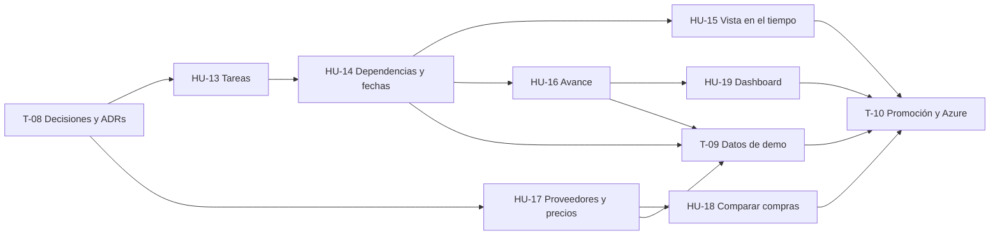

# Historias de Usuario — Sprint 3

**Materia:** Proyecto Integral de Desarrollo — UCAio
**Duración del sprint:** 2 semanas
**Equipo:** 3 personas (fullstack)

> **Estado de este documento:** HU-13 y HU-14 están firmes, las define [ADR-009](../adr/0009-project-planning.md); HU-17 y HU-18 también, por [ADR-010](../adr/0010-suppliers-price-lists.md); HU-15 quedó firme al arrancarla, por ADR-009 §12. HU-16 y HU-19 todavía tienen puntos sin decidir, marcados **[D-n]** y listados en [Preguntas de diseño abiertas](#preguntas-de-diseño-abiertas) con la historia que los destraba: se cierran al arrancar cada una, no antes.

## Requerimientos de la cátedra

Texto recibido para este sprint, sin editar:

> Dividir la obra en rubros y tareas. Cada tarea tiene responsable, fechas, duración estimada, costo y estado: pendiente, en curso, pausada o finalizada.
> Permitir dependencias entre tareas. Una tarea no puede iniciarse si sus predecesoras obligatorias no finalizaron.
> Mostrar la planificación mediante una vista calendario o Gantt.
> Registrar el porcentaje de avance real y compararlo con el planificado.
> Incorporar proveedores y listas de precios. Un material puede tener distintos precios y costos de envío según el proveedor.
> Comparar alternativas de compra y mostrar el proveedor más económico por material. No se exige optimización automática de toda la compra.
> Dashboard con presupuesto original vs. actualizado, avance planificado vs. real y proyección mensual de gastos.

## Qué ya está cubierto y qué es nuevo

A diferencia del Sprint 2, casi todo es nuevo: los dos sprints anteriores no tienen ni planificación ni proveedores. Lo que existe son las piezas sobre las que este sprint se apoya.

**Hacemos más de lo que pide el texto:** las fechas de las tareas las calcula el sistema desde las duraciones y las dependencias, con camino crítico y atrasos que se propagan solos (ADR-009). El pedido se cumplía con fechas cargadas a mano.

| Requerimiento | Dónde se resuelve | Estado |
|---|---|---|
| Dividir la obra en rubros y tareas | **HU-13** (tareas) | Nuevo. **Los rubros quedan fuera por ahora**: el pedido los menciona una sola vez y se consulta con la cátedra |
| Cada tarea tiene responsable, fechas, duración estimada, costo y estado | **HU-13** y **HU-14** | Nuevo. Las fechas no se cargan: las calcula HU-14. El costo sale del cómputo (HU-5) |
| Estados: pendiente, en curso, pausada, finalizada | **HU-13** | Nuevo |
| Dependencias entre tareas | **HU-14** | Nuevo |
| Una tarea no se inicia si sus predecesoras obligatorias no finalizaron | **HU-14** | Nuevo. Toda dependencia es obligatoria |
| Vista calendario o Gantt | **HU-15** | Nuevo |
| Registrar el porcentaje de avance real | **HU-16** | Nuevo |
| Compararlo con el planificado | **HU-16** | Nuevo |
| Proveedores y listas de precios | **HU-17** | Nuevo. ADR-003 y ADR-005 dejaron "precios por proveedor" como pendiente |
| Un material con distintos precios y costos de envío según el proveedor | **HU-17** | Nuevo. Los materiales son los `resource` del catálogo (ADR-003) |
| Comparar alternativas de compra | **HU-18** | Nuevo |
| Mostrar el proveedor más económico por material | **HU-18** | Nuevo |
| No se exige optimización automática de toda la compra | **HU-18** | Fuera de alcance, explícito en el pedido |
| Dashboard: presupuesto original vs. actualizado | **HU-19** | Nuevo. Se apoya en el presupuesto (HU-11) y sus versiones (HU-12) |
| Dashboard: avance planificado vs. real | **HU-19** | Nuevo. Muestra lo que calcula HU-16 |
| Dashboard: proyección mensual de gastos | **HU-19** | Nuevo. Necesita los costos y las fechas de las tareas (HU-13) |

Lo que ya existe y este sprint usa (ver [der.md](../der.md)):

- **La obra y su equipo** (`project`, `project_member`): de ahí puede salir el responsable de una tarea.
- **El cómputo y el presupuesto** (`project_recipe`, HU-5 y HU-11): hoy es la única fuente de costos de una obra.
- **Las versiones del presupuesto** (`budget_version`, HU-12): presupuestos congelados contra los que se puede comparar.
- **El catálogo de recursos** (`resource`, con su precio de referencia único): los materiales a los que un proveedor les pone precio.

## Reglas heredadas

No son decisiones de este sprint: son lo que los Sprints 1 y 2 dejaron fijado, y toda historia de acá las cumple.

- Plataforma **multi-estudio**; un recurso de otro estudio responde **404**.
- Los endpoints chequean **permisos y nunca roles** ([ADR-002](../adr/0002-authorization-model.md)). Un permiso nuevo es una fila, no código.
- **Baja lógica** en todo; nada se borra.
- Importes en **ARS**, con `currency` modelado.
- El `client` de una obra **no ve costos** (`project.cost.view`).
- Toda pantalla se usa bien a **375px**.
- Toda tabla nueva pasa por una **ADR antes que por el código**, y `der.md` se regenera con el modelo.

---

## T-08 — Decisiones de diseño y ADRs del sprint

*Tarea de equipo, no historia de usuario. Va primero: todas las historias del sprint cambian el modelo de datos.*

- **Hecho:** [ADR-009](../adr/0009-project-planning.md), planificación (tareas, dependencias, fechas calculadas, estados, camino crítico). Deja firmes HU-13 y HU-14.
- **Hecho:** [ADR-010](../adr/0010-suppliers-price-lists.md), proveedores, listas de precios y comparación. Deja firmes HU-17 y HU-18.
- **No se hace por adelantado:** las preguntas de avance, vista y dashboard se cierran al arrancar su historia, y se registran editando ADR-009 o en una ADR nueva si agregan modelo.

**Depende de:** nada.
**Estimación:** 2 días, de a tres.

---

## HU-13 — Tareas de la obra

> Como **arquitecto**, quiero cargar las tareas de mi obra, cada una con su responsable, su duración estimada, su costo y su estado, para tener planificado qué hay que hacer y quién lo hace.

**Criterios de aceptación**

- Dentro de la obra hay una sección **"Planificación"** con el listado de tareas.
- Se pueden crear, editar y dar de baja **tareas**. Cada una tiene: nombre, descripción opcional, **duración estimada** en días hábiles (entero mayor que cero), **responsable** opcional y, también opcional, una fecha **"no antes de"**.
- El **responsable** se elige entre los integrantes del equipo de la obra (HU-6) que pueden gestionar sus tareas (`project.task.manage`: `lead` y `collaborator`). Si después sale del equipo, sus tareas no finalizadas quedan sin responsable y las finalizadas lo conservan.
- El **estado** es uno de cuatro: **pendiente**, **en curso**, **pausada** o **finalizada**. Una tarea nace pendiente.
- El estado se cambia desde el listado y desde la tarea, con estas acciones y ninguna otra: **iniciar**, **pausar**, **reanudar**, **finalizar**, **reabrir** (una finalizada vuelve a en curso) y **deshacer inicio** (una en curso vuelve a pendiente).
- Iniciar registra la **fecha real de inicio** y finalizar la **fecha real de fin**; por defecto hoy, y se pueden corregir. El fin no puede ser anterior al inicio.
- El **costo** de una tarea no se escribe: es la suma de las **líneas de cómputo** asignadas a ella, a precio vigente. Desde la tarea se asignan y desasignan líneas del cómputo de la obra; una línea está en una sola tarea o en ninguna.
- En el cómputo (HU-5), cada línea muestra a qué tarea está asignada y se puede cambiar desde ahí.
- La planificación muestra el costo de cada tarea y, aparte, el importe del cómputo **sin asignar a ninguna tarea**. El total de la obra no se repite acá: está en el cómputo.
- Cargar una versión del presupuesto (HU-12) deja las líneas cargadas **sin asignar**, y la confirmación lo avisa.
- El nombre es único entre las tareas activas de la obra.
- **Baja lógica**, en cualquier estado, con confirmación. Sus líneas de cómputo vuelven a quedar sin asignar; no se dan de baja.
- Escribir exige `project.task.manage` (`lead`, `collaborator`). Ver exige `project.task.view` (también `client`) o `project.view_all`.
- El `client` ve las tareas **sin costos** (`project.cost.view`).
- Si la obra no tiene tareas, estado vacío con un llamado a crear la primera.
- Se usa bien a 375px.

**Fuera de alcance:** rubros (se consultan con la cátedra); subtareas; plantillas de planificación reutilizables entre obras; más de un responsable por tarea; responsables sin cuenta en el sistema; costo cargado a mano; repartir una línea de cómputo entre varias tareas; adjuntos, comentarios o notificaciones.
**Depende de:** T-08 (ADR-009), HU-5 y HU-6.
**Estimación:** 3 días.
**Definida por:** [ADR-009](../adr/0009-project-planning.md).

---

## HU-14 — Dependencias y fechas previstas

> Como **arquitecto**, quiero indicar qué tareas tienen que terminar antes de que otra empiece y que el sistema calcule solo cuándo cae cada una, para saber cuándo termina la obra y ver cómo se corre todo cuando algo se atrasa.

**Criterios de aceptación**

*Dependencias*

- Al editar una tarea se le pueden agregar y quitar **predecesoras**, elegidas entre las tareas activas de la misma obra.
- **Toda dependencia es obligatoria**: la tarea no puede empezar hasta que la predecesora termine.
- **Una tarea no puede iniciarse si alguna de sus predecesoras no está finalizada.** El rechazo dice cuáles faltan, y vale también llamando al endpoint directo.
- Una tarea no puede depender de sí misma, no se repite una dependencia, y no se puede crear un **ciclo**, ni directo ni por caminos más largos. El rechazo lo explica.
- Cada tarea muestra sus predecesoras y sus sucesoras, con el estado de cada una.
- Dar de baja una tarea quita sus dependencias; la confirmación lista las sucesoras que dejan de estar bloqueadas por ella.
- Reabrir una tarea cuyas sucesoras ya arrancaron **se permite**, con una confirmación que las lista.

*Fechas previstas*

- Para planificar, la obra necesita su **fecha de inicio**. Si no la tiene, la sección pide cargarla.
- Cada tarea muestra su **inicio y fin previstos**, calculados y no editables:
  - Una tarea sin predecesoras empieza en el inicio de la obra, o en su "no antes de" si es posterior.
  - Una tarea con predecesoras empieza el día hábil siguiente al fin de la última, o en su "no antes de" si es posterior.
  - Termina después de su duración, contando **días hábiles de lunes a viernes**.
- **Lo real reemplaza a lo previsto:** una tarea iniciada o finalizada usa sus fechas reales, y las que dependen se calculan desde ahí.
- **Nada previsto queda en el pasado:** una tarea en curso o pausada que ya pasó su fin previsto, y una pendiente que ya pasó su inicio previsto, se corren a hoy, y con ellas las que dependen.
- La planificación muestra la **fecha prevista de fin de la obra**.
- Cada tarea no finalizada muestra su **holgura** en días hábiles, y las **críticas** (holgura cero) están destacadas.
- Las fechas se recalculan solas al cambiar una tarea, una dependencia o un estado.
- Ver exige lo mismo que ver las tareas; escribir, `project.task.manage`.
- Se usa bien a 375px.

**Fuera de alcance:** dependencias no obligatorias; días de espera entre tareas (una espera se carga como tarea); otros tipos de dependencia; sábados, feriados o calendario propio de la obra; simular un atraso sin registrarlo; dependencias entre obras distintas; base de grafos (extensión prevista en ADR-009).
**Depende de:** HU-13.
**Estimación:** 4 días.
**Definida por:** [ADR-009](../adr/0009-project-planning.md).

---

## HU-15 — Vista de la planificación en el tiempo

> Como **arquitecto**, quiero ver las tareas de mi obra ubicadas en el tiempo, para entender de un vistazo qué se hace cuándo, qué se superpone y qué viene atrasado.

**Criterios de aceptación**

- La sección "Planificación" tiene, además del listado, una vista **Gantt** de las tareas: una fila por tarea y un eje de tiempo. El pedido admite calendario o Gantt; alcanza con una.
- Cada tarea se dibuja desde su inicio hasta su fin, con su nombre: con las fechas **reales** donde las hay y las **previstas** donde no.
- Las tareas se distinguen por **estado**, con los colores del listado, y las **críticas** están destacadas.
- El día de hoy y la fecha prevista de fin de la obra están marcados.
- Se puede mover la ventana de tiempo hacia adelante y hacia atrás, y cambiar la escala entre **días, semanas y meses**.
- Elegir una tarea en la vista abre su detalle.
- Las dependencias de HU-14 se leen en ese detalle, que lista predecesoras y sucesoras. **La vista no las dibuja.**
- Es una vista de lectura: nada se arrastra. Desde el detalle, quien tiene `project.task.manage` abre el formulario de la tarea, y al guardar la vista se actualiza sola.
- Si la obra no tiene tareas o no tiene fecha de inicio, estado vacío que dice qué falta.
- La ve quien puede ver las tareas (`project.task.view`).
- **A 375px no se ofrece el Gantt**: la planificación muestra el listado en tarjetas, como hasta ahora. El Gantt en pantallas chicas queda para después.

**Fuera de alcance:** arrastrar una tarea para cambiarle la duración o las dependencias; dibujar las dependencias sobre el Gantt (queda para una vista de grafo); el Gantt a 375px; exportar a PDF o a imagen; vista de varias obras a la vez; carga de trabajo por persona.
**Depende de:** HU-14.
**Estimación:** 3 días (preliminar).
**Definida por:** [ADR-009](../adr/0009-project-planning.md) §12.

---

## HU-16 — Avance real contra planificado

> Como **arquitecto**, quiero registrar cuánto avanzó de verdad cada tarea y compararlo con lo que estaba planificado, para saber si la obra viene en fecha o atrasada.

**Criterios de aceptación**

- En cada tarea se registra el **porcentaje de avance real**, de 0 a 100.
- Un botón **"Fijar planificación"** guarda las fechas previstas de ese momento como **lo planificado**. Como las fechas previstas se corren solas con cada atraso, la comparación es contra esa copia y no contra ellas. Volver a fijar reemplaza la anterior. *(Acordado en principio; se revisa al arrancar la historia.)*
- Sin planificación fijada, la comparación no se muestra y la sección pide fijarla.
- Una tarea creada después de fijar aparece marcada, y no entra en la comparación hasta que se vuelva a fijar.
- Cada tarea muestra su **avance planificado** a la fecha de hoy. **[D-10]**
- Cada tarea muestra la **diferencia** entre los dos, e indica si viene atrasada, en fecha o adelantada.
- La comparación se ve también para **la obra entera**. **[D-11]**
- La relación entre el avance y el estado de la tarea es coherente: una tarea finalizada está al 100%. **[D-12]**
- Si se guarda historial de los avances registrados o solo el valor actual. **[D-13]**
- El avance **no mueve las fechas previstas**: esas dependen solo de duraciones, dependencias y fechas reales (ADR-009 §4).
- Registrar avance y fijar la planificación exigen `project.task.manage`.
- Se usa bien a 375px.

**Fuera de alcance:** historial de planificaciones fijadas; certificaciones de obra; fotos o evidencia del avance; avance medido en cantidades físicas (m² ejecutados) en vez de porcentaje; curva S.
**Depende de:** HU-14.
**Estimación:** 2,5 días (preliminar).

---

## HU-17 — Proveedores y listas de precios

> Como **arquitecto**, quiero cargar mis proveedores y el precio y el costo de envío que cada uno me da por cada material, para saber cuánto me sale de verdad comprar y no depender de un único precio de referencia.

**Criterios de aceptación**

- El estudio tiene una sección **"Proveedores"**. Se pueden crear, editar y dar de baja proveedores, con nombre y, opcionales, persona de contacto, email, teléfono y dirección.
- **Los proveedores son del estudio**: los de otro estudio no aparecen en ningún listado y, pedidos por URL, dan **404**.
- El nombre es único entre los proveedores activos del estudio.
- Cada proveedor tiene una **lista de precios**: los materiales que vende, cada uno con su **precio unitario** y su **costo de envío**.
- El material se elige del catálogo de la plataforma con el buscador de HU-4. Una lista lleva **materiales**: no mano de obra ni equipo.
- El precio es por una unidad del material, en la unidad que tiene en el catálogo, y la pantalla la muestra ("$ por bolsa").
- El costo de envío es un importe **fijo por material**, sin importar la cantidad. Puede ser cero.
- **Un mismo material puede estar en la lista de varios proveedores**, cada uno con sus valores. Un proveedor no lo repite en la suya.
- El precio y el envío no son negativos. Cada renglón muestra cuándo se actualizó por última vez.
- Los renglones se agregan, editan y quitan de a uno. Baja lógica.
- Dar de baja un proveedor lo saca de las comparaciones de HU-18, con toda su lista.
- **El presupuesto de la obra no cambia**: sigue calculando con el precio de referencia. Las pantallas dicen siempre cuál de los dos precios muestran.
- Leer exige `supplier.view` y escribir `supplier.manage`, los dos para `owner` y `architect`. **El `client` no ve la sección.**
- Estado vacío con un llamado a cargar el primer proveedor.
- Se usa bien a 375px.

**Fuera de alcance:** proveedores compartidos entre estudios o sembrados por la plataforma; productos propios del proveedor fuera del catálogo; importar una lista desde un archivo; historial de precios con vigencias; órdenes de compra; condiciones de pago, descuentos por volumen; stock y plazos de entrega.
**Depende de:** T-08 (ADR-010) y HU-4.
**Estimación:** 2,5 días.
**Definida por:** [ADR-010](../adr/0010-suppliers-price-lists.md).

---

## HU-18 — Comparar alternativas de compra

> Como **arquitecto**, quiero comparar lo que me cobra cada proveedor por un material y ver cuál es el más económico, para decidir a quién le compro.

**Criterios de aceptación**

- **Por material:** desde un material se ven todos los proveedores del estudio que lo ofrecen, con su precio unitario, su costo de envío y el **costo total** para una cantidad.
- El costo total es **precio unitario × cantidad + envío**. La cantidad la escribe el usuario; por defecto, 1.
- La lista está ordenada del más económico al más caro, y **el más económico está destacado**. Si dos empatan, se destacan los dos.
- Al cambiar la cantidad, el orden se recalcula: el más económico puede ser otro.
- **Por obra:** dentro de la obra hay una vista de compras con los **materiales de su cómputo** y, para cada uno, la cantidad que lleva la obra, el proveedor más económico para esa cantidad y su costo total.
- Un material que ningún proveedor ofrece aparece igual, indicado como **"sin proveedor"**, con su precio de referencia.
- **La comparación es material por material.** No se arma una compra óptima para toda la obra: lo excluye el pedido.
- Solo entran proveedores y renglones activos.
- La vista por material exige `supplier.view`. La vista por obra exige poder ver sus costos (`project.cost.view` o `project.view_all`): **el `client` no la ve**.
- Si el estudio no tiene proveedores, estado vacío con un llamado a cargar el primero.
- Se usa bien a 375px.

**Fuera de alcance:** optimización de la compra completa (juntar pedidos para ahorrar envíos); generar o enviar un pedido; elegir y registrar a qué proveedor se compró; comparar por calidad o por plazo; reemplazar el precio de referencia del presupuesto por el del proveedor.
**Depende de:** HU-17, y HU-5 para la vista por obra.
**Estimación:** 2 días.
**Definida por:** [ADR-010](../adr/0010-suppliers-price-lists.md).

---

## HU-19 — Dashboard de la obra

> Como **arquitecto**, quiero un tablero de mi obra que me muestre cómo viene la plata y cómo viene el avance, para detectar un desvío sin recorrer cada sección.

**Criterios de aceptación**

- Dentro de la obra hay una sección **"Dashboard"** con tres bloques.
- **Presupuesto original vs. actualizado:** los dos importes, la diferencia en pesos y en porcentaje, y si el actualizado está por encima o por debajo. **[D-17]**
- **Avance planificado vs. real** de la obra entera, con el desvío, tomado de HU-16, y la fecha prevista de fin de la obra contra la planificada.
- **Proyección mensual de gastos:** cuánto se espera gastar en cada mes de la obra, en un gráfico y con sus importes. **[D-18]**
- Cada bloque tiene su estado vacío y dice qué falta cargar para que tenga datos (no hay presupuesto original, no hay tareas con fechas y costo).
- Los números del dashboard coinciden con los de las secciones de donde salen.
- Exige poder ver costos: **el `client` no ve el dashboard**. **[D-16]**
- Se usa bien a 375px.

**Fuera de alcance:** dashboard de todas las obras del estudio; gasto real ejecutado (facturas, pagos); alertas o notificaciones por desvío; exportar a PDF; elegir el rango de fechas o personalizar los bloques.
**Depende de:** HU-14 y HU-16. Usa HU-11 y HU-12, que ya existen. **[D-17]** define si además depende de HU-18.
**Estimación:** 3 días (preliminar).

---

## T-09 — Datos de demo

*Habilitadora: sin datos, las pantallas nuevas se muestran vacías en la defensa.*

- La obra de demo "Casa Rodríguez" suma fecha de inicio, tareas con duración y líneas de cómputo asignadas, dependencias, algunas tareas ya iniciadas y finalizadas, y avance registrado.
- Proveedores de demo con listas de precios que cubran los materiales de las recetas sembradas, con diferencias que hagan visible la comparación.
- Como en T-04 y T-06, el seed **no pisa** lo editado por pantalla.

**Depende de:** HU-13, HU-14, HU-16 y HU-17.
**Estimación:** 1 día (preliminar).

---

## T-10 — Promoción `dev → main` y verificación en Azure

*Cierra la Definition of Done de todas las historias del sprint ([reglas-de-trabajo §3](../reglas-de-trabajo.md)).*

- PR `dev → main` con merge commit, que dispara `deploy.yml`.
- Recorrida de las siete historias en el ambiente de Azure, con las cuentas de demo.

**Depende de:** todas las historias.
**Estimación:** 0,5 día.

---

## Preguntas de diseño abiertas

Lo que queda sin decidir. Cada pregunta se cierra **al arrancar la historia que la necesita**, no antes: decidir el dashboard sin tener las tareas funcionando es decidir a ciegas.

**Se deciden al llegar**

| | Pregunta | Destraba |
|---|---|---|
| **D-10** | **Cómo se calcula el avance planificado.** ¿Qué porcentaje "debería" tener una tarea a una fecha dada? | HU-16 |
| **D-11** | **Cómo se agrega el avance.** Para pasar de tareas a obra, ¿cada tarea pesa por su costo, por su duración, o todas igual? | HU-16 |
| **D-12** | **Avance y estado.** ¿Finalizar una tarea la lleva al 100%? ¿Llegar al 100% la finaliza? ¿Una tarea pendiente puede tener avance? | HU-16 |
| **D-13** | **Historial del avance.** ¿Se guarda cada registro con su fecha, o solo el valor actual? | HU-16 |
| **D-16** | **Permisos del dashboard.** Los de planificación están en ADR-009 §9 y los de proveedores en ADR-010 §6 | HU-19 |
| **D-17** | **Qué es el presupuesto "original" y qué el "actualizado".** ¿El original es una versión guardada (cuál)? ¿El actualizado es el borrador vivo, o usa precios de proveedor? ¿Las versiones guardan la asignación de líneas a tareas? | HU-19 |
| **D-18** | **Cómo se proyecta el gasto por mes.** ¿Cómo se reparte el costo de una tarea que dura varios meses, y qué pasa con el costo sin asignar a ninguna tarea? | HU-19 |

**Pendiente de la cátedra**

- **Rubros.** El pedido dice "dividir la obra en rubros y tareas" y no los vuelve a mencionar. Quedan fuera hasta consultarlo. Si entran, es una tabla y una FK opcional en la tarea: agregarlo después es barato.

**Cerradas**

- D-1 a D-8, en [ADR-009](../adr/0009-project-planning.md): las tareas cuelgan directo de la obra; el costo sale del cómputo; el responsable es un integrante de la obra que puede gestionar sus tareas; las fechas se calculan en días hábiles; las transiciones de estado son las de HU-13; toda dependencia es obligatoria y de tipo fin → inicio; reabrir una predecesora se permite; las dependencias viven en Postgres.
- D-9, en [ADR-009](../adr/0009-project-planning.md) §12: la vista es un Gantt, hecho con un componente propio y de lectura; elegir una tarea abre su detalle, desde donde se edita; las dependencias no se dibujan; a 375px se ve el listado.
- D-14 y D-15, en [ADR-010](../adr/0010-suppliers-price-lists.md): los proveedores son del estudio; el envío es un importe fijo por material.

---

## Orden de ejecución

Qué depende de qué. Las historias no tienen persona asignada: se toman del frente de las que quedaron liberadas.

- **Camino crítico: T-08 → HU-13 → HU-14 → HU-16 → HU-19 → T-10.** Suma **15 días de trabajo en un sprint de 10 hábiles.** Calcular las fechas puso a HU-14 en el medio de la cadena y la alargó: ya no entra hecha por una persona de punta a punta.
- **Cómo entra igual:** partiendo cada historia de la cadena en backend y frontend, hechos en paralelo por dos personas, como en el Sprint 2. HU-13 y HU-14 son las dos que más lo necesitan.
- **Dos frentes independientes** después de T-08: **planificación** (HU-13 y lo que cuelga) y **compras** (HU-17 → HU-18). No comparten pantallas ni tablas.
- **HU-19 va última** porque muestra lo que calculan las demás.

**Carga total:** 27,5 días-persona estimados sobre 30 disponibles: 21,5 de historias y tareas, más los 2 días de T-08 que son de a tres. **Casi no queda margen** para QA cruzado, tests de aislamiento y responsive.

**Qué se recorta si el sprint se aprieta**, en este orden:

1. **Holgura y camino crítico** de HU-14. Las fechas previstas y el fin de la obra se quedan; lo que sale es el recorrido hacia atrás. No lo pide el texto.
2. **Las dependencias dibujadas en la vista** de HU-15: se ven en el detalle de la tarea. *Aplicado al arrancar HU-15 (ADR-009 §12), no por tiempo: se prefirió dejarlas para una vista de grafo.*
3. **La vista de compras por obra** de HU-18: queda la comparación por material, que es lo que pide el texto.

Lo que no se recorta: el bloqueo al iniciar, una vista temporal, el avance planificado contra real, el proveedor más económico por material y los tres bloques del dashboard. Es el pedido.

### Dónde estamos

*Se completa a medida que avanza el sprint, como en los Sprints 1 y 2.*

**2026-10-07.** Backlog en borrador. Queda liberada **T-08**.

**2026-10-07 (tarde).** **ADR-009 escrita** (planificación): HU-13 y HU-14 quedan firmes. Se decidió calcular las fechas desde las dependencias, que no estaba en el pedido, y dejar la base de grafos como extensión prevista. Los rubros quedan fuera hasta consultar a la cátedra.

**ADR-010 escrita** (proveedores): HU-17 y HU-18 quedan firmes. **T-08 terminada** en lo que bloqueaba el arranque.

**Quedan liberadas:** HU-13 (planificación) y HU-17 (compras), en paralelo.

**2026-10-09.** **Backend de HU-13 implementado** (`feat/hu13-tasks-back`): la tabla `project_task`, la columna `project_recipe.task_id`, los permisos `project.task.view` y `project.task.manage`, y las nueve rutas de la planificación. `project_task_dependency` no se creó: entra con HU-14.

Al implementar se afinó ADR-009 en tres puntos:

- **Responsable:** solo quien tiene `project.task.manage` en la obra (`lead` y `collaborator`), y la regla se chequea al asignar. Cambiar de rol no desasigna; salir del equipo, sí.
- **Redondeo:** cada tarea y el "sin asignar" se redondean por separado y el total de la planificación es su suma. Puede diferir en centavos del total de Presupuesto, que redondea por recurso.
- **Cargar una versión (HU-12)** deja las líneas cargadas sin asignar. Que la versión guarde la tarea de cada línea queda para HU-19 (D-17).

**Contrato para el front de HU-13**, todo bajo `/firms/{firm_id}/projects/{project_id}`:

| Ruta | Para qué |
|---|---|
| `GET /tasks` | El listado: tareas, costo de cada una, `unassigned_cost` y `total_cost`. Los tres costos llegan en `null` a quien no puede ver costos |
| `GET /tasks/assignees` | Las opciones del desplegable de responsable |
| `POST /tasks`, `PUT /tasks/{id}`, `DELETE /tasks/{id}` | Alta, edición y baja |
| `POST /tasks/{id}/transitions` | Cambiar el estado: `{"action": "start" \| "pause" \| "resume" \| "finish" \| "reopen" \| "undo_start", "on_date": "2026-10-01"}`. `on_date` es opcional y solo vale en `start` y `finish` |
| `PUT /tasks/{id}/actual-dates` | Corregir las fechas reales |
| `PUT /tasks/{id}/lines` | Reemplazar las líneas de cómputo de la tarea: `{"line_ids": [...]}` |
| `PUT /takeoff/lines/{id}/task` | Asignar una línea desde el cómputo: `{"task_id": 7}` o `{"task_id": null}` |

Cada línea de `GET /takeoff` trae ahora `task: {id, name}` o `null`. Una regla rota responde **409** con el texto para mostrar en `detail`, como en HU-5.

**Queda para el front:** la sección "Planificación", la tarea de cada línea en el cómputo, y un aviso en la confirmación de "Cargar versión" de que las líneas cargadas quedan sin asignar a ninguna tarea.

**Queda liberada:** HU-14, en lo que es backend. El punto donde entra el bloqueo por predecesoras está marcado en `transition()` de `backend/app/services/tasks.py`.

**2026-10-09 (tarde).** **Front de HU-13 implementado** (`feat/hu13-tasks-front`): la pestaña "Planificación" de la obra, con el listado de tareas, su costo, el importe sin asignar y el total; alta, edición y baja; cambio de estado; corrección de fechas reales; y la asignación de líneas de cómputo desde la tarea y desde el cómputo.

Cómo quedó resuelto lo que la historia dejaba abierto:

- **El estado se cambia desde su propia etiqueta**, que es un desplegable con las acciones que ese estado admite. Todas las transiciones salen del mismo lugar; el menú ⋯ de la tarea queda para editar, líneas de cómputo, corregir fechas y dar de baja.
- **Iniciar y finalizar piden la fecha** en una confirmación, precargada en hoy y sin días futuros. Las otras cuatro acciones son de un clic.
- **"La tarea" es un conjunto de modales sobre el listado**, como en Equipo y Cómputo. No hay página de detalle por tarea; si HU-14 o HU-15 la necesitan, se agrega ahí.
- **El cómputo muestra siempre la columna "Tarea"**, con "Sin asignar" donde corresponde.
- **"Cargar versión" avisa** que las líneas cargadas quedan sin asignar a ninguna tarea.

De paso se unificó el redondeo de lo que se presiona: los enlaces del panel lateral y la etiqueta de estado usan el mismo que los botones, definido una sola vez en `frontend/src/theme.ts`.

**Falta para cerrar HU-13:** la revisión visual de los criterios y de 375px sobre lo mergeado en `dev`.

**2026-10-09 (noche).** **HU-14 implementada, backend y frontend** (`feat/hu14-dependencies`): la tabla `project_task_dependency`, el bloqueo al iniciar, y las fechas previstas, el fin de obra, la holgura y el camino crítico calculados al leer. **Holgura y camino crítico entran**: no hizo falta recortarlos.

El cálculo vive en `backend/app/services/schedule.py`, funciones puras sin base (ADR-009 §11), con sus tests en `test_schedule.py`. Al implementar se afinó ADR-009 §3 y §4: fin inclusivo, fines de semana, qué sucesoras cuentan hacia atrás y cómo se editan las dependencias.

**Contrato nuevo**, sobre las mismas rutas de HU-13:

| Dónde | Qué cambia |
|---|---|
| `POST /tasks`, `PUT /tasks/{id}` | Aceptan `predecessor_ids: [...]`: la lista completa, que reemplaza a la anterior. Vacía o ausente, sin predecesoras. Un ciclo, una tarea de otra obra o dada de baja, o la tarea misma responden **409** |
| `POST /tasks/{id}/transitions` | `start` responde **409** si alguna predecesora no está finalizada, nombrando cuáles |
| Cada tarea (`GET /tasks` y lo que devuelve cada escritura) | Suma `planned_start_date`, `planned_end_date`, `slack_days`, `is_critical`, `predecessors` y `successors` (`{id, name, status}`) |
| `GET /tasks` | Suma `project_start_date` y `planned_end_date` (fin de obra). Las tareas llegan ordenadas por inicio previsto |

Las fechas las ve también el `client`; los costos, no.

Cómo quedó resuelto en pantalla:

- **Predecesoras en el formulario de la tarea**, un desplegable múltiple que no ofrece las tareas que ya dependen de ella (cerrarían un ciclo).
- **"La tarea" es un modal de detalle**: se abre desde el nombre, en tabla y tarjeta, y lo ve todo el que ve la planificación. Muestra fechas previstas y reales, holgura, y predecesoras y sucesoras con su estado; elegir una abre la suya. HU-15 puede reusarlo.
- **"Inicio" y "Fin" en una columna cada uno**: la fecha prevista, que es la real una vez que pasó. Real en negro, prevista en gris. Columna nueva "Holgura"; las críticas, con una etiqueta roja (en mobile, la tarjeta con borde rojo).
- **"Iniciar" aparece deshabilitado** en el menú de estado mientras falte alguna predecesora, diciendo cuál.
- **Reabrir con sucesoras ya iniciadas** pide confirmación y las nombra. **Dar de baja** nombra las sucesoras que dejan de esperarla.
- **Sin fecha de inicio**, un aviso arriba del listado; quien puede editar la obra tiene un botón que abre su formulario.

**Falta para cerrar HU-14:** el PR a `dev` y la revisión en Azure.

**Queda liberada:** HU-15 (vista en el tiempo) y HU-16 (avance), en paralelo.

**2026-10-09 (reordenamiento de las secciones de la obra).** **Cada sección pasa a mostrar una sola cosa** (`refactor/budget-tabs`, sobre `fix/sprint-2-and-3-polish`). El total de la obra aparecía en "Cómputo", "Presupuesto" y "Planificación", y las dos primeras mostraban casi la misma tabla: el presupuesto es el cómputo con precios. Se separó **lo vivo** de **lo guardado**:

| Sección | Qué muestra | Qué dejó de mostrar |
|---|---|---|
| **Cómputo** | Todo lo que se calcula hoy: el total estimado, las recetas cargadas y el desglose por recurso con precio unitario y subtotales. Acá está "Guardar versión" | La tabla "Qué necesita la obra" con una columna de costo, que era el presupuesto sin precios unitarios |
| **Presupuestos** (antes "Presupuesto") | El listado de versiones guardadas; cada una abre su detalle de solo lectura | El presupuesto vivo, que se mudó a Cómputo |
| **Planificación** | El costo de cada tarea y el importe sin asignar | El "Total estimado" y la nota sobre la diferencia de centavos con Presupuesto |

Cómo quedó resuelto:

- **Es solo frontend.** Ningún endpoint, permiso ni cálculo cambió. `/takeoff` y `/tasks` siguen mandando su `total_cost`; el front ya no lo pinta y lo usa solo para saber si quien mira ve costos.
- **Cómputo pide dos respuestas**: `/takeoff` para las recetas y `/budget` para los precios y el total. La segunda solo a quien tiene `project.cost.view` o `project.view_all`, porque al `client` ese endpoint le responde 403.
- **El `client` ve lo mismo que antes**: las recetas y "Qué necesita la obra" con cantidades, sin importes. No ve "Presupuestos".
- **Orden de Cómputo: total, recetas, desglose.** El total es la respuesta que se viene a buscar, las recetas son lo que se edita, y el desglose es lo más largo y lo que menos se consulta.
- **Las rutas no cambiaron de nombre.** `budget` muestra el listado y `budget/versions` redirige ahí; `budget/versions/:id` sigue siendo el detalle.

Se ajustaron los criterios de HU-11 y HU-12 en [sprint-2.md](sprint-2.md), el de HU-13 acá arriba, y el redondeo de ADR-009 §8. HU-5 no cambia: el cómputo sigue mostrando la cantidad de cada recurso y su costo.

**2026-10-09 (correcciones sobre las mismas secciones).** En la misma rama, después del reordenamiento:

- **El presupuesto guardado que coincide con el cómputo queda marcado.** Al cargar una versión no quedaba ningún rastro de cuál era: "Cargar" copia las líneas y no guarda de dónde vinieron. Ahora `GET .../budget/versions` trae `matches_takeoff` por fila, calculado al leer; el listado lo muestra como la etiqueta "Cómputo actual" y deshabilita el "Cargar" de esa fila, y el cómputo dice "Igual a la v3" o "Tiene cambios sin guardar". Se descartó guardar "la última versión cargada" en la obra; el porqué está en ADR-007, alternativas descartadas. Es el único cambio de backend de la rama, sin migración.
- **"Editar" y "Dar de baja" de la obra pasaron a la sección "Datos".** Estaban en el encabezado compartido, a la vista sobre el cómputo y la planificación como si actuaran sobre ellos. "Datos" ganó un título propio para alinearlos como el botón principal de las otras secciones.
- **Menos texto fijo en pantalla.** Se quitaron la descripción bajo el título de Cómputo, Planificación, Presupuestos y Equipo, y la leyenda de Planificación que explicaba las fechas en gris y en negro. La distinción sigue: real en negro, prevista en gris.
- **Nombres que abren su fila, sin subrayado.** El de una tarea y el de un presupuesto guardado se leen como el texto de la fila y toman el verde del tema al pasar el mouse (clase `.name-link` en `frontend/src/index.css`).
- **Una sola esquina para etiquetas y botones.** Todo `Badge` usa la de los botones, definida en `frontend/src/theme.ts`; antes solo la tenía la etiqueta de estado de una tarea y el resto eran píldoras.

Se ajustaron HU-3 en [sprint-1.md](sprint-1.md), HU-12 en [sprint-2.md](sprint-2.md) y ADR-007 §6.

**Quedó anotado para después**, sobre `fix/sprint-2-and-3-polish`: alinear las columnas de los tres grupos del desglose del cómputo; la etiqueta de estado que se corta en la tabla de planificación; darle a los nombres alguna señal de que se tocan en mobile, donde no hay hover; igualar los enlaces a predecesoras y sucesoras del detalle de una tarea; y mostrar "Cómputo actual" también en el detalle de una versión.

**2026-10-10.** **Se quitó el rol de obra `viewer`** (`refactor/remove-viewer-role`, sobre `fix/sprint-2-and-3-polish`). Salió de revisar los ocho roles uno por uno preguntando a qué persona representa cada uno: el `viewer` era el único sin una. El razonamiento completo está en [ADR-002 §7](../adr/0002-authorization-model.md); en corto, quien mira sin costos ya es `client`, y quien miraría con costos es alguien de afuera que no puede tener ese rol.

- **Backend:** `viewer` sale de los roles asignables, así que el formulario de Equipo ofrece tres y la API responde 422 si se lo piden. La migración `c4d8b1e63f07` pasa a `collaborator` a quien lo tuviera y borra el rol; sus permisos caen por la cascada. No cambia el esquema.
- **Quedan con `project.cost.view` y `project.member.view`** solo `lead` y `collaborator`: todo el que ve costos en una obra también puede editarla. El `owner` los sigue viendo por `project.view_all`.
- **Tests:** donde el `viewer` hacía de "ve y no edita", ese papel lo hace el `client`; donde era un rol cualquiera, `collaborator`.

De esa misma revisión quedaron **anotados y sin hacer**:

- El `owner` no puede gestionar el equipo de una obra que no integra, y el padrón no deja dar de baja a un `lead`: si el responsable no está, nadie puede transferir la obra.
- La regla "cliente del estudio ⇒ solo cliente de obra" vale en un solo sentido: un `architect` puede quedar como cliente de una obra.
- `firm.edit` (estudio y plataforma) y `account.create`, `account.view`, `account.edit`, `account.deactivate` están sembrados y ningún endpoint los exige. Se dejan: son de funciones que se van a hacer.

**Pendiente aparte:** en la suite del backend apareció un test intermitente, distinto en cada corrida (catálogo, obras, tareas, padrón) y que pasa al repetirlo. No viene de este cambio y no se encontró la causa.

**Falta:** mergear `refactor/remove-viewer-role` a `fix/sprint-2-and-3-polish`.
