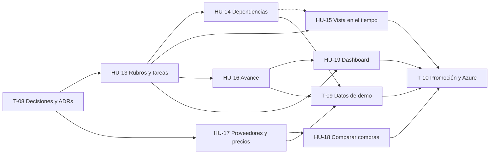

# Historias de Usuario — Sprint 3

**Materia:** Proyecto Integral de Desarrollo — UCAio
**Duración del sprint:** 2 semanas
**Equipo:** 3 personas (fullstack)

> **Estado de este documento: borrador de planificación.** Las historias dicen **qué** tiene que poder hacer el usuario, leído del pedido de la cátedra. Todavía **no hay ninguna decisión de diseño tomada**: ni modelo de datos, ni permisos, ni librerías. Lo que cada historia deja sin definir está marcado con **[D-n]** y listado en [Preguntas de diseño abiertas](#preguntas-de-diseño-abiertas). Esas preguntas se cierran en T-08, con [der.md](../der.md) a la vista, y recién entonces las historias quedan firmes.

## Requerimientos de la cátedra

Texto recibido para este sprint, sin editar:

> Dividir la obra en rubros y tareas. Cada tarea tiene responsable, fechas, duración estimada, costo y estado: pendiente, en curso, pausada o finalizada.
> Permitir dependencias entre tareas. Una tarea no puede iniciarse si sus predecesoras obligatorias no finalizaron.
> Mostrar la planificación mediante una vista calendario o Gantt.
> Registrar el porcentaje de avance real y compararlo con el planificado.
> Incorporar proveedores y listas de precios. Un material puede tener distintos precios y costos de envío según el proveedor.
> Comparar alternativas de compra y mostrar el proveedor más económico por material. No se exige optimización automática de toda la compra.
> Dashboard con presupuesto original vs. actualizado, avance planificado vs. real y proyección mensual de gastos.

## Qué ya está cubierto y qué es nuevo

A diferencia del Sprint 2, casi todo es nuevo: los dos sprints anteriores no tienen ni planificación ni proveedores. Lo que existe son las piezas sobre las que este sprint se apoya.

| Requerimiento | Dónde se resuelve | Estado |
|---|---|---|
| Dividir la obra en rubros y tareas | **HU-13** | Nuevo. ADR-003 dejó anotado "capítulos / rubros para agrupar" como pendiente |
| Cada tarea tiene responsable, fechas, duración estimada, costo y estado | **HU-13** | Nuevo. El equipo de la obra ya existe (HU-6) |
| Estados: pendiente, en curso, pausada, finalizada | **HU-13** | Nuevo |
| Dependencias entre tareas | **HU-14** | Nuevo |
| Una tarea no se inicia si sus predecesoras obligatorias no finalizaron | **HU-14** | Nuevo |
| Vista calendario o Gantt | **HU-15** | Nuevo |
| Registrar el porcentaje de avance real | **HU-16** | Nuevo |
| Compararlo con el planificado | **HU-16** | Nuevo |
| Proveedores y listas de precios | **HU-17** | Nuevo. ADR-003 y ADR-005 dejaron "precios por proveedor" como pendiente |
| Un material con distintos precios y costos de envío según el proveedor | **HU-17** | Nuevo. Los materiales son los `resource` del catálogo (ADR-003) |
| Comparar alternativas de compra | **HU-18** | Nuevo |
| Mostrar el proveedor más económico por material | **HU-18** | Nuevo |
| No se exige optimización automática de toda la compra | **HU-18** | Fuera de alcance, explícito en el pedido |
| Dashboard: presupuesto original vs. actualizado | **HU-19** | Nuevo. Se apoya en el presupuesto (HU-11) y sus versiones (HU-12) |
| Dashboard: avance planificado vs. real | **HU-19** | Nuevo. Muestra lo que calcula HU-16 |
| Dashboard: proyección mensual de gastos | **HU-19** | Nuevo. Necesita los costos y las fechas de las tareas (HU-13) |

Lo que ya existe y este sprint usa (ver [der.md](../der.md)):

- **La obra y su equipo** (`project`, `project_member`): de ahí puede salir el responsable de una tarea.
- **El cómputo y el presupuesto** (`project_recipe`, HU-5 y HU-11): hoy es la única fuente de costos de una obra.
- **Las versiones del presupuesto** (`budget_version`, HU-12): presupuestos congelados contra los que se puede comparar.
- **El catálogo de recursos** (`resource`, con su precio de referencia único): los materiales a los que un proveedor les pone precio.

## Reglas heredadas

No son decisiones de este sprint: son lo que los Sprints 1 y 2 dejaron fijado, y toda historia de acá las cumple.

- Plataforma **multi-estudio**; un recurso de otro estudio responde **404**.
- Los endpoints chequean **permisos y nunca roles** ([ADR-002](../adr/0002-authorization-model.md)). Un permiso nuevo es una fila, no código.
- **Baja lógica** en todo; nada se borra.
- Importes en **ARS**, con `currency` modelado.
- El `client` de una obra **no ve costos** (`project.cost.view`).
- Toda pantalla se usa bien a **375px**.
- Toda tabla nueva pasa por una **ADR antes que por el código**, y `der.md` se regenera con el modelo.

---

## T-08 — Decisiones de diseño y ADRs del sprint

*Tarea de equipo, no historia de usuario. Va primero: todas las historias del sprint cambian el modelo de datos.*

- Cerrar, de a una, las [preguntas de diseño abiertas](#preguntas-de-diseño-abiertas).
- Escribir las ADRs que salgan de ahí. Como mínimo una para **planificación** (rubros, tareas, dependencias, avance) y una para **proveedores y listas de precios**. El dashboard necesita ADR solo si agrega modelo.
- Actualizar este documento: reemplazar cada **[D-n]** por lo decidido y confirmar las estimaciones.

**Depende de:** nada.
**Estimación:** 2 días, de a tres.

---

## HU-13 — Rubros y tareas de la obra

> Como **arquitecto**, quiero dividir mi obra en rubros y cargar las tareas de cada uno, con su responsable, fechas, duración, costo y estado, para tener planificado qué hay que hacer, quién lo hace y cuándo.

**Criterios de aceptación**

- Dentro de la obra hay una sección **"Planificación"**.
- Se pueden crear, renombrar, ordenar y dar de baja **rubros** de la obra ("Albañilería", "Instalación eléctrica"). **[D-1]**
- Se pueden crear, editar y dar de baja **tareas** dentro de un rubro. Toda tarea pertenece a un rubro.
- Cada tarea tiene: nombre, **responsable**, **fecha de inicio**, **fecha de fin**, **duración estimada**, **costo** y **estado**. **[D-2] [D-3] [D-4]**
- El estado es uno de cuatro: **pendiente**, **en curso**, **pausada** o **finalizada**. Una tarea nace pendiente.
- El estado se cambia desde la misma pantalla. **[D-5]**
- La fecha de fin no puede ser anterior a la de inicio, la duración es mayor que cero y el costo no es negativo.
- El listado muestra las tareas agrupadas por rubro, con su estado visible, y cada rubro muestra el total de costo de sus tareas.
- Baja lógica de rubros y de tareas. **[D-6]**
- Escribir exige un permiso de obra; ver la planificación, otro. **[D-16]**
- El `client` no ve los costos de las tareas.
- Si la obra no tiene rubros, estado vacío con un llamado a crear el primero.
- Se usa bien a 375px.

**Fuera de alcance:** subtareas o tareas dentro de tareas; plantillas de planificación reutilizables entre obras; más de un responsable por tarea; adjuntos o comentarios en una tarea; notificaciones al responsable.
**Depende de:** T-08.
**Estimación:** 3 días (preliminar).

---

## HU-14 — Dependencias entre tareas

> Como **arquitecto**, quiero indicar qué tareas tienen que terminar antes de que otra empiece, para que nadie arranque un trabajo cuyo paso previo no está hecho.

**Criterios de aceptación**

- Al editar una tarea se le pueden agregar y quitar **predecesoras**, elegidas entre las tareas de la misma obra.
- Cada dependencia se marca como **obligatoria** o no. **[D-7]**
- **Una tarea no puede pasar a "en curso" si alguna de sus predecesoras obligatorias no está finalizada.** El rechazo dice cuáles faltan.
- Una predecesora no obligatoria no bloquea, pero la pantalla avisa que no terminó.
- Una tarea no puede depender de sí misma, y no se puede crear un ciclo (A depende de B, B depende de A, ni por caminos más largos). El rechazo lo explica.
- No se repite la misma dependencia entre dos tareas.
- Cada tarea muestra sus predecesoras y sus sucesoras, con el estado de cada una.
- El bloqueo vale también llamando al endpoint directo, no solo en la pantalla.
- Qué pasa cuando se da de baja o se reabre una tarea de la que otras dependen. **[D-6] [D-8]**
- Exige el mismo permiso que editar tareas (HU-13).

**Fuera de alcance:** cálculo de camino crítico; reprogramar automáticamente las fechas de las sucesoras cuando una predecesora se atrasa; dependencias entre tareas de obras distintas.
**Depende de:** HU-13.
**Estimación:** 2 días (preliminar).

---

## HU-15 — Vista de la planificación en el tiempo

> Como **arquitecto**, quiero ver las tareas de mi obra ubicadas en el tiempo, para entender de un vistazo qué se hace cuándo, qué se superpone y qué viene atrasado.

**Criterios de aceptación**

- La sección "Planificación" tiene una vista temporal de las tareas: **calendario o Gantt**. El pedido admite cualquiera de las dos; alcanza con una. **[D-9]**
- Cada tarea se dibuja desde su fecha de inicio hasta su fecha de fin, con su nombre.
- Las tareas se distinguen por **estado** y se pueden leer agrupadas por **rubro**.
- El día de hoy está marcado.
- Se puede mover la ventana de tiempo hacia adelante y hacia atrás, y cambiar la escala. **[D-9]**
- Una tarea atrasada (pasó su fecha de fin y no está finalizada) se distingue de las demás.
- Elegir una tarea en la vista abre su detalle.
- Las dependencias de HU-14 son visibles desde la vista. **[D-9]**
- Es una vista de lectura: las tareas se editan desde su formulario.
- Si no hay tareas con fechas, estado vacío.
- La ve quien puede ver la planificación (HU-13).
- Se usa bien a 375px. **[D-9]**

**Fuera de alcance:** arrastrar una tarea para cambiarle las fechas; exportar a PDF o a imagen; vista de varias obras a la vez; carga de recursos por persona.
**Depende de:** HU-13. Las dependencias en la vista dependen de HU-14.
**Estimación:** 3 días (preliminar).

---

## HU-16 — Avance real contra planificado

> Como **arquitecto**, quiero registrar cuánto avanzó de verdad cada tarea y compararlo con lo que estaba planificado, para saber si la obra viene en fecha o atrasada.

**Criterios de aceptación**

- En cada tarea se registra el **porcentaje de avance real**, de 0 a 100.
- Cada tarea muestra además su **avance planificado** a la fecha de hoy. **[D-10]**
- Cada tarea muestra la **diferencia** entre los dos, e indica si viene atrasada, en fecha o adelantada.
- La comparación se ve también **por rubro** y para **la obra entera**. **[D-11]**
- La relación entre el avance y el estado de la tarea es coherente: una tarea finalizada está al 100%. **[D-12]**
- Si se guarda historial de los avances registrados o solo el valor actual. **[D-13]**
- Registrar avance exige un permiso de obra. **[D-16]**
- Se usa bien a 375px.

**Fuera de alcance:** certificaciones de obra; fotos o evidencia del avance; avance medido en cantidades físicas (m² ejecutados) en vez de porcentaje; curva S.
**Depende de:** HU-13.
**Estimación:** 2 días (preliminar).

---

## HU-17 — Proveedores y listas de precios

> Como **arquitecto**, quiero cargar mis proveedores y el precio y el costo de envío que cada uno me da por cada material, para saber cuánto me sale de verdad comprar y no depender de un único precio de referencia.

**Criterios de aceptación**

- Se pueden crear, editar y dar de baja **proveedores**, con nombre y datos de contacto. **[D-14]**
- Cada proveedor tiene una **lista de precios**: los materiales que vende, cada uno con su **precio** y su **costo de envío**. **[D-15]**
- **Un mismo material puede tener precios de varios proveedores**, cada uno con sus propios valores.
- Los materiales de una lista se eligen del catálogo de recursos que ya existe, con el buscador de HU-4. Una lista lleva **materiales**: no mano de obra ni equipo.
- Un proveedor no repite material en su lista.
- El precio y el costo de envío no son negativos. Cada precio muestra cuándo se actualizó por última vez.
- Dar de baja un proveedor lo saca de las comparaciones de HU-18.
- Quién administra los proveedores y con qué permiso. **[D-14] [D-16]**
- Aislamiento: lo que es de un estudio no lo ve otro. **[D-14]**
- Se usa bien a 375px.

**Fuera de alcance:** importar una lista de precios desde un archivo; historial de precios con vigencias; órdenes de compra; condiciones de pago, descuentos por volumen o por cantidad; stock y plazos de entrega; unificación automática de catálogos de proveedores.
**Depende de:** T-08.
**Estimación:** 2,5 días (preliminar).

---

## HU-18 — Comparar alternativas de compra

> Como **arquitecto**, quiero comparar lo que me cobra cada proveedor por un material y ver cuál es el más económico, para decidir a quién le compro.

**Criterios de aceptación**

- Para un material, se ven todos los proveedores que lo ofrecen con su precio, su costo de envío y el **costo total** de comprarlo ahí. **[D-15]**
- La lista está ordenada del más económico al más caro, y **el más económico está destacado**.
- Dentro de una obra, hay una vista de compras con **los materiales de su cómputo** y, para cada uno, la cantidad que lleva la obra y el proveedor más económico con su costo.
- Un material que ningún proveedor ofrece aparece igual, indicado como "sin proveedor", con su precio de referencia.
- **La comparación es material por material.** No se arma una compra óptima para toda la obra: lo excluye el pedido.
- Si dos proveedores empatan, se muestran los dos.
- Ver la comparación exige poder ver costos: **el `client` no la ve**.
- Si no hay proveedores cargados, estado vacío con un llamado a cargar el primero.
- Se usa bien a 375px.

**Fuera de alcance:** optimización de la compra completa (juntar pedidos para ahorrar envíos); generar o enviar un pedido; elegir y registrar a qué proveedor se compró; comparar por calidad o por plazo.
**Depende de:** HU-17, y HU-5 para la vista por obra.
**Estimación:** 2 días (preliminar).

---

## HU-19 — Dashboard de la obra

> Como **arquitecto**, quiero un tablero de mi obra que me muestre cómo viene la plata y cómo viene el avance, para detectar un desvío sin recorrer cada sección.

**Criterios de aceptación**

- Dentro de la obra hay una sección **"Dashboard"** con tres bloques.
- **Presupuesto original vs. actualizado:** los dos importes, la diferencia en pesos y en porcentaje, y si el actualizado está por encima o por debajo. **[D-17]**
- **Avance planificado vs. real** de la obra entera, con el desvío, tomado de HU-16.
- **Proyección mensual de gastos:** cuánto se espera gastar en cada mes de la obra, en un gráfico y con sus importes. **[D-18]**
- Cada bloque tiene su estado vacío y dice qué falta cargar para que tenga datos (no hay presupuesto original, no hay tareas con fechas y costo).
- Los números del dashboard coinciden con los de las secciones de donde salen.
- Exige poder ver costos: **el `client` no ve el dashboard**. **[D-16]**
- Se usa bien a 375px.

**Fuera de alcance:** dashboard de todas las obras del estudio; gasto real ejecutado (facturas, pagos); alertas o notificaciones por desvío; exportar a PDF; elegir el rango de fechas o personalizar los bloques.
**Depende de:** HU-13 y HU-16. Usa HU-11 y HU-12, que ya existen. **[D-17]** define si además depende de HU-18.
**Estimación:** 3 días (preliminar).

---

## T-09 — Datos de demo

*Habilitadora: sin datos, las pantallas nuevas se muestran vacías en la defensa.*

- La obra de demo "Casa Rodríguez" suma rubros, tareas con fechas, dependencias y avance registrado.
- Proveedores de demo con listas de precios que cubran los materiales de las recetas sembradas, con diferencias que hagan visible la comparación.
- Como en T-04 y T-06, el seed **no pisa** lo editado por pantalla.

**Depende de:** HU-13, HU-14, HU-16 y HU-17.
**Estimación:** 1 día (preliminar).

---

## T-10 — Promoción `dev → main` y verificación en Azure

*Cierra la Definition of Done de todas las historias del sprint ([reglas-de-trabajo §3](../reglas-de-trabajo.md)).*

- PR `dev → main` con merge commit, que dispara `deploy.yml`.
- Recorrida de las siete historias en el ambiente de Azure, con las cuentas de demo.

**Depende de:** todas las historias.
**Estimación:** 0,5 día.

---

## Preguntas de diseño abiertas

Lo que las historias no pueden responder todavía. Acá solo están **las preguntas**: las alternativas, los trade-offs y la decisión van en T-08 y quedan registradas en las ADRs.

**Planificación**

- **D-1 — Qué es un rubro.** ¿Es propio de cada obra, sale de un catálogo común, o las dos cosas?
- **D-2 — De dónde sale el costo de una tarea.** ¿Se carga a mano, se calcula desde el cómputo, o se relaciona una tarea con líneas del cómputo?
- **D-3 — Quién puede ser responsable.** ¿Un integrante del equipo de la obra, cualquier persona del estudio, o alguien de afuera (un contratista sin cuenta)?
- **D-4 — Duración y fechas.** Con fecha de inicio, fecha de fin y duración hay un dato redundante: ¿cuál manda? ¿Los días son corridos o hábiles? ¿Hay fechas planificadas y fechas reales por separado?
- **D-5 — Transiciones de estado.** ¿Qué cambios de estado están permitidos y quién puede hacerlos? ¿Se puede reabrir una tarea finalizada?
- **D-6 — Bajas.** ¿Qué pasa con las tareas de un rubro dado de baja, y con las dependencias de una tarea dada de baja?
- **D-7 — Dependencias obligatorias y no obligatorias.** El pedido habla de predecesoras "obligatorias": ¿qué significa una que no lo es? ¿Todas las dependencias son "termina una, empieza la otra", o hay otros tipos?
- **D-8 — Reabrir una predecesora.** Si una tarea finalizada se reabre y sus sucesoras ya están en curso, ¿qué pasa con ellas?
- **D-9 — Calendario o Gantt.** ¿Cuál de las dos, con qué librería o componente propio, qué escalas de tiempo, cómo se muestran las dependencias y cómo se resuelve a 375px?

**Avance**

- **D-10 — Cómo se calcula el avance planificado.** ¿Qué porcentaje "debería" tener una tarea a una fecha dada?
- **D-11 — Cómo se agrega el avance.** Para pasar de tareas a rubro y a obra, ¿cada tarea pesa por su costo, por su duración, o todas igual?
- **D-12 — Avance y estado.** ¿Finalizar una tarea la lleva al 100%? ¿Llegar al 100% la finaliza? ¿Una tarea pendiente puede tener avance?
- **D-13 — Historial del avance.** ¿Se guarda cada registro con su fecha, o solo el valor actual?

**Proveedores y compras**

- **D-14 — De quién son los proveedores.** ¿De cada estudio, de la plataforma, o de los dos? De esto depende quién los administra.
- **D-15 — Cómo se expresa el costo de envío.** ¿Por material, por proveedor o por pedido? ¿Fijo o proporcional a la cantidad? De esto depende qué es el "costo total" que compara HU-18 y qué es "el más económico".

**Dashboard y transversales**

- **D-16 — Permisos nuevos.** ¿Qué permisos se agregan, a qué roles se les dan, y qué ve el `client` de la planificación y del avance?
- **D-17 — Qué es el presupuesto "original" y qué el "actualizado".** ¿El original es una versión guardada (cuál)? ¿El actualizado es el borrador vivo, usa precios de proveedor, o sale de los costos de las tareas?
- **D-18 — Cómo se proyecta el gasto por mes.** ¿Cómo se reparte el costo de una tarea que dura varios meses, y qué pasa con el costo que no está asignado a ninguna tarea?

---

## Orden de ejecución

Qué depende de qué. Las historias no tienen persona asignada: se toman del frente de las que quedaron liberadas.

- **Camino crítico: T-08 → HU-13 → HU-16 → HU-19 → T-10.** Suma 10,5 días de trabajo en un sprint de 10 días hábiles: no tiene holgura, y HU-13 es la historia que más cosas destraba.
- **Dos frentes independientes** después de T-08: **planificación** (HU-13 y lo que cuelga de ella) y **compras** (HU-17 → HU-18). No comparten pantallas ni tablas, así que avanzan en paralelo sin pisarse.
- **Después de HU-13 se abren tres historias a la vez:** HU-14, HU-15 y HU-16.
- **HU-19 va última** porque muestra lo que calculan las demás.

**Carga total:** 25 días-persona estimados (preliminar) sobre 30 disponibles: 19 de historias y tareas, más los 2 días de T-08 que son de a tres. El margen es para QA cruzado, tests de aislamiento y responsive, y para lo que T-08 mueva en las estimaciones.

**Qué se recorta si el sprint se aprieta:** se define en T-08, una vez cerradas las preguntas. El pedido mismo marca dos pisos: alcanza con **una** vista (calendario o Gantt), y la comparación de compras es **por material**, sin optimización.

### Dónde estamos

*Se completa a medida que avanza el sprint, como en los Sprints 1 y 2.*

**2026-10-07.** Backlog en borrador. Queda liberada **T-08**.
