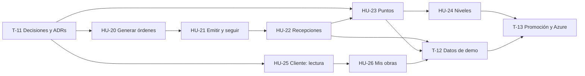

# Historias de Usuario — Sprint 4

**Materia:** Proyecto Integral de Desarrollo — UCAio
**Duración del sprint:** 2 semanas
**Equipo:** 3 personas (fullstack)

> **Estado de este documento:** las historias están firmes. HU-20 a HU-22 las define [ADR-011](../adr/0011-purchase-orders.md); HU-23 y HU-24, [ADR-012](../adr/0012-supplier-loyalty-points.md); HU-25 y HU-26, [ADR-013](../adr/0013-client-read-access.md). Las tres están en estado Propuesta y pasan a Aceptada al implementarse. Los **[D-n]** remiten a las [preguntas de diseño](#preguntas-de-diseño-abiertas), ya cerradas.

## Requerimientos de la cátedra

Texto recibido para este sprint, sin editar:

> Agregar Gamification.
> Generar órdenes de compra a proveedores a partir de la comparación de alternativas. La orden pasa por los estados borrador, emitida, recibida parcialmente y recibida, registrando las cantidades recibidas y su costo real.
> Agregar el rol Cliente, con acceso de solo lectura a sus obras: avance, cronograma y versiones de presupuesto.

## Qué ya está cubierto y qué es nuevo

**La gamificación la definimos nosotros.** El pedido no dice qué premiar. Elegimos premiar la **recurrencia de compra a un mismo proveedor**: el estudio sube de nivel cuando le vuelve a comprar a un proveedor, y suma más cuando repite el mismo material en una cantidad parecida. Así la gamificación queda atada a las órdenes de compra, que es lo nuevo del sprint, en vez de ser un agregado suelto. Se confirma con la cátedra.

| Requerimiento | Dónde se resuelve | Estado |
|---|---|---|
| Agregar gamificación | **HU-23** (puntos) y **HU-24** (niveles) | Nuevo. Definición del equipo: recurrencia de compra a un proveedor. Pendiente de confirmar con la cátedra |
| Generar órdenes de compra a partir de la comparación | **HU-20** | Nuevo. Sale de la comparación por obra de HU-18 |
| Estados borrador, emitida, recibida parcialmente y recibida | **HU-21** y **HU-22** | Nuevo. Se agrega **anulada** para una orden que no sigue |
| Registrar cantidades recibidas y costo real | **HU-22** | Nuevo |
| Rol Cliente | — | **Ya existe** (ADR-002): `client` en el estudio y en la obra |
| Solo lectura de avance y cronograma | **HU-25** | **Ya lo ve:** `project.task.view` le abre Planificación (con el Gantt de HU-15) y Avance (HU-16). Se verifica que no haya controles de edición |
| Solo lectura de versiones de presupuesto | **HU-25** | Nuevo. Hoy no las ve porque piden `project.cost.view`. Se abre una excepción acotada (ADR-013) |
| Acceso del cliente "a sus obras" | **HU-26** | Nuevo: la vista "Mis obras" |

Lo que ya existe y este sprint usa (ver [der.md](../der.md)):

- **Los proveedores y sus listas** (`supplier`, `supplier_price`, [ADR-010](../adr/0010-suppliers-price-lists.md)): de donde sale el precio que congela una orden.
- **La comparación de compras** (HU-18, `services/purchasing.py`): el más económico por material, con la cantidad del cómputo. Es el punto de partida de una orden.
- **Las versiones del presupuesto** (`budget_version`, [ADR-007](../adr/0007-budget-versions.md)): lo que el cliente pasa a ver.
- **El avance y el Gantt** ([ADR-009](../adr/0009-project-planning.md) §12 y §13): lo que el cliente ya ve.

## Reglas heredadas

No son decisiones de este sprint: son lo que los sprints anteriores dejaron fijado, y toda historia de acá las cumple.

- Plataforma **multi-estudio**; un recurso de otro estudio responde **404**.
- Los endpoints chequean **permisos y nunca roles** ([ADR-002](../adr/0002-authorization-model.md)). Un permiso nuevo es una fila, no código.
- **Baja lógica** en todo; nada se borra.
- Importes en **ARS**, con `currency` modelado.
- El `client` de una obra **no ve costos** (`project.cost.view`), **con una sola excepción desde este sprint**: las versiones guardadas del presupuesto (HU-25, ADR-013). Sigue sin ver el presupuesto vivo, el costo de las tareas, el dashboard, las compras, los proveedores, las órdenes y los puntos.
- Toda pantalla se usa bien a **375px**.
- Toda tabla nueva pasa por una **ADR antes que por el código**, y `der.md` se regenera con el modelo.

---

## T-11 — Decisiones de diseño y ADRs del sprint

*Tarea de equipo, no historia de usuario. Va primero: órdenes y puntos agregan tablas, y el cliente cambia una regla de permisos.*

- **Hecho:** [ADR-011](../adr/0011-purchase-orders.md), [ADR-012](../adr/0012-supplier-loyalty-points.md) y [ADR-013](../adr/0013-client-read-access.md), el 2026-10-25. Cierran D-19 a D-22.
- **ADR-011 — Órdenes de compra.**
  - **Tablas:**
    - `purchase_order`: del estudio, de una obra y de un proveedor, con un número legible [D-21] y su estado.
    - `purchase_order_line`: el material, la cantidad pedida, y el precio unitario y el envío **congelados** al generar la orden.
    - `purchase_order_receipt` y sus líneas: la fecha, la cantidad recibida y el costo real de cada renglón.
  - **Estados y transiciones:** borrador → emitida → recibida parcialmente → recibida; anulada desde borrador o desde emitida. Las dos recibidas no se eligen: salen de lo acumulado en las recepciones.
  - **Permisos de estudio:** `purchase_order.view` y `purchase_order.manage`, para `owner` y `architect`. Cubren al líder de cada obra, porque un cliente del estudio no puede liderar una. El `client` no recibe ninguno.
- **ADR-012 — Gamificación por recurrencia de compra.**
  - Las reglas de puntos por renglón (HU-23).
  - Los puntos se guardan como **asientos** (por ejemplo, en `firm_points_entry`) con la orden, el renglón, el proveedor, el material, la regla aplicada y los puntos.
  - Los niveles fijos y el permiso para verlos [D-22].
  - Los puntos, el ±50% y los umbrales quedan como constantes en un solo lugar.
- **ADR-013 — Acceso del cliente a sus obras.** Es un cambio de fondo sobre [ADR-003](../adr/0003-recipe-catalog.md) §8 ("el cliente no ve costos"), así que va en una ADR nueva para no perder por qué se había decidido lo anterior.
  - Un permiso nuevo, `project.budget_version.view`, para `client`, `lead` y `collaborator`. El guard de las versiones pide ese permiso o `project.view_all`, en vez de `project.cost.view`.
  - Qué pestañas ve el cliente.
  - La vista "Mis obras".

**Depende de:** nada.
**Estimación:** 1,5 días, de a tres.

---

## HU-20 — Generar órdenes de compra desde la comparación

> Como **arquitecto**, quiero generar las órdenes de compra de mi obra a partir de la comparación de proveedores, para pedirle a cada uno lo que conviene sin volver a cargarlo a mano.

**Criterios de aceptación**

- En la pestaña **Compras** de la obra se eligen uno o varios materiales y se toca **"Generar órdenes"**.
- Se arma **un borrador por proveedor**: cada material va con el **más económico** para la cantidad del cómputo (HU-18). Si hay empate, se usa el primero por nombre y se puede cambiar.
- Antes de generar se puede **elegir otro proveedor** para cada material, entre los que lo ofrecen. El más económico viene elegido, y cada opción muestra su total para lo que falta pedir. *(Sumado al implementar HU-21.)*
- En borrador se puede, por renglón, cambiar de proveedor (entre los que ofrecen ese material, y el renglón pasa a la orden de ese proveedor), cambiar la cantidad, quitarlo, y agregar materiales del cómputo.
- La cantidad es mayor que cero, con hasta 3 decimales, en la unidad del catálogo.
- El **precio unitario y el envío se congelan** al generar el renglón. Si el proveedor cambia su lista después, la orden no cambia. La pantalla muestra el total estimado de cada renglón y de la orden: `precio × cantidad + envío`, la misma fórmula de ADR-010 §4.
- Un material **"sin proveedor"** no se puede pedir.
- Un borrador se puede **descartar** (baja lógica).
- La orden pertenece a la obra y al estudio. Una de otro estudio da **404**.
- Gestionar exige `purchase_order.manage` (owner y architect). **El `client` no ve órdenes.**
- El presupuesto no cambia (ADR-010 §5).
- Se usa bien a 375px.

**Fuera de alcance:** enviar la orden al proveedor por mail, PDF o integración; juntar envíos entre materiales; pedir mano de obra o equipo; órdenes sin obra; generar una orden desde Proveedores → Comparar.
**Depende de:** T-11 (ADR-011) y HU-18.
**Estimación:** 3 días.
**Definida por:** ADR-011.

---

## HU-21 — Emitir, anular y seguir las órdenes

> Como **arquitecto**, quiero emitir las órdenes, anular las que no van y ver en qué estado está cada una, para saber qué falta llegar a la obra.

**Criterios de aceptación**

- Un borrador con al menos un renglón se **emite**. Emitida, la orden **ya no se edita**: ni proveedor, ni cantidades, ni precios.
- Una orden en borrador o emitida se puede **anular**. Si ya tiene algo recibido no se anula, y una anulada no vuelve a ningún estado.
- Las transiciones que el estado no permite responden **409** con un mensaje claro. La pantalla solo ofrece las válidas.
- **Listado de la obra:** dentro de Compras, las órdenes de la obra con número, proveedor, estado, fecha y total estimado.
- **Listado del estudio:** una sección "Órdenes de compra" con todas las órdenes del estudio, filtrables por obra, proveedor y estado. Desde ahí las gestiona un arquitecto que no está en el equipo de la obra.
- **Detalle de una orden:** estado, proveedor, obra, renglones con precio congelado, total estimado, y el historial de cambios de estado (quién y cuándo).
- Leer exige `purchase_order.view`; emitir y anular, `purchase_order.manage`.
- Estado vacío con un llamado a generar la primera orden desde Compras.
- Se usa bien a 375px.

**Fuera de alcance:** aprobaciones en varios niveles; notificaciones; reabrir una orden anulada; editar una orden emitida.
**Depende de:** HU-20.
**Estimación:** 2 días.
**Definida por:** ADR-011.

---

## HU-22 — Registrar las recepciones

> Como **arquitecto**, quiero registrar lo que llega de cada orden y lo que realmente pagué, para saber qué falta recibir y cuánto se desvió el costo.

**Criterios de aceptación**

- Sobre una orden **emitida** o **recibida parcialmente** se registra una **recepción**. Tiene fecha y, por cada renglón que llegó, la **cantidad recibida** y el **costo real** pagado por esa entrega.
- Una orden puede tener **varias recepciones**.
- No se puede recibir **más de lo pedido** en ningún renglón, contando lo ya recibido.
- La orden pasa **sola** a **recibida parcialmente** cuando llegó algo pero no todo, y a **recibida** cuando llegó todo lo pedido de todos los renglones.
- El detalle de la orden muestra, por renglón: pedido, recibido, pendiente, costo estimado, costo real y la diferencia. También muestra el total real de la orden.
- Las recepciones se listan con su fecha y quién las cargó. **No se editan** [D-20].
- Registrar exige `purchase_order.manage`.
- Se usa bien a 375px.

**Fuera de alcance:** stock e inventario de obra; devoluciones; facturas, remitos y pagos; que el costo real entre al dashboard como gasto ejecutado [D-19].
**Depende de:** HU-21.
**Estimación:** 2,5 días.
**Definida por:** ADR-011.

---

## HU-23 — Puntos por comprarle otra vez a un proveedor

> Como **estudio**, quiero sumar puntos cada vez que le vuelvo a comprar a un proveedor, y más si repito el mismo material en una cantidad parecida, para que la relación sostenida con un proveedor quede reconocida.

**Criterios de aceptación**

- Una orden suma puntos cuando pasa a **recibida**. Una orden anulada no suma nunca. Una recibida parcialmente suma recién cuando se completa.
- Cada renglón de la orden suma según la primera regla que cumpla, comparando contra las órdenes **ya recibidas** del estudio con ese proveedor, de cualquier obra:

  | Caso | Puntos |
  |---|---|
  | Mismo proveedor, **mismo material** y cantidad **similar**: dentro de ±50% de la última compra recibida de ese material a ese proveedor | **10** |
  | Mismo proveedor, mismo material, otra cantidad | **6** |
  | Mismo proveedor, material que nunca le había comprado | **3** |
  | Primera compra del estudio a ese proveedor | **0** |

- La cantidad que se compara es la recibida.
- Cada asiento guarda **por qué sumó**: la orden, el renglón, el proveedor, el material, la regla y los puntos. Si después cambian los valores, los asientos anteriores no se recalculan.
- Los puntos son **del estudio** y además se acumulan **por proveedor**.
- La regla es una función pura, testeada sin base de datos: cada caso de la tabla, los bordes del ±50%, la primera compra y una orden con renglones de distintos casos.

**Fuera de alcance:** puntos por otras acciones (cargar cómputos, terminar tareas); puntos por usuario; canjes, descuentos o premios reales; restar puntos.
**Depende de:** T-11 (ADR-012) y HU-22 para el enganche. La función de puntos se puede hacer desde que esté la ADR.
**Estimación:** 2,5 días.
**Definida por:** ADR-012.

---

## HU-24 — Nivel del estudio y nivel con cada proveedor

> Como **arquitecto**, quiero ver en qué nivel está mi estudio y con qué proveedores tenemos más relación, para saber cuánto falta para el próximo nivel.

**Criterios de aceptación**

- Hay cuatro niveles fijos, iguales para el estudio y para cada proveedor:

  | Nivel | Desde |
  |---|---|
  | Bronce | 0 puntos |
  | Plata | 50 puntos |
  | Oro | 150 puntos |
  | Platino | 400 puntos |

- Una sección del estudio ("Nivel") muestra el **nivel actual**, los puntos, y una **barra de progreso** con cuánto falta para el siguiente. En Platino dice que es el máximo.
- Debajo, el **historial de puntos**: cada asiento con fecha, orden, obra, proveedor, material, la regla en palabras ("mismo material, cantidad similar") y los puntos.
- En la ficha de cada proveedor, el **nivel con ese proveedor**, sus puntos y la barra.
- La ven `owner` y `architect` [D-22]. **El `client` no la ve.**
- Estado vacío: "Todavía no recibiste ninguna orden", con un link a Compras o a Órdenes.
- Se usa bien a 375px.

**Fuera de alcance:** ranking entre estudios o entre arquitectos; insignias o logros; notificaciones al subir de nivel; niveles configurables desde una pantalla.
**Depende de:** HU-23.
**Estimación:** 2 días.
**Definida por:** ADR-012.

---

## HU-25 — El cliente lee avance, cronograma y versiones del presupuesto

> Como **cliente** de una obra, quiero ver su avance, su cronograma y las versiones del presupuesto que me presentó el estudio, para seguir mi obra sin tener que preguntar.

**Criterios de aceptación**

- Permiso nuevo `project.budget_version.view`, para `client`, `lead` y `collaborator`. Leer las versiones pasa a pedir ese permiso o `project.view_all`. Guardar una versión sigue pidiendo lo mismo que hoy.
- El `client` de la obra ve la pestaña **Presupuestos**: la lista de versiones y cada una completa, con importes, **solo lectura**.
- Ve **Avance** y **Cronograma** (el Gantt de HU-15) **sin ningún control** de edición: ni estados, ni avance, ni fijar la planificación.
- Sigue **sin** ver el presupuesto vivo, el costo de las tareas, el Dashboard, Compras, órdenes, proveedores ni puntos. Cada una de esas puertas tiene su test (403 o la pestaña oculta).
- El test de RBAC que hoy fija "el cliente no tiene `project.cost.view`" se mantiene, y se agrega uno que fija la excepción.
- Un cliente solo ve **sus** obras. Una obra en la que no está da 404.

**Fuera de alcance:** que el cliente comente, apruebe o descargue versiones; que vea el presupuesto vivo; ver costos de tareas.
**Depende de:** T-11 (ADR-013).
**Estimación:** 1,5 días.
**Definida por:** ADR-013.

---

## HU-26 — "Mis obras" para el cliente

> Como **cliente**, quiero entrar y ver mis obras de un vistazo, para saber cómo viene cada una sin recorrer pantallas pensadas para el estudio.

**Criterios de aceptación**

- Un usuario que en el estudio es `client` entra a **"Mis obras"**: las obras en las que es cliente.
- Cada obra muestra el **avance real contra el planificado**, el **fin previsto** y la **última versión del presupuesto** (fecha y total).
- Dentro de una obra ve solo sus pestañas de lectura: Datos, Cómputo (cantidades, como ya veía), Planificación con su Gantt (el cronograma), Avance y Presupuestos. Ninguna tiene botones de edición (ADR-013 §2).
- El menú del estudio, para el `client`, muestra solo lo que puede ver.
- Estado vacío: "Todavía no tenés obras asignadas".
- Se usa bien a 375px.

**Fuera de alcance:** mensajes o comentarios con el estudio; notificaciones; un dominio o portal aparte del de la aplicación.
**Depende de:** HU-25.
**Estimación:** 2 días.
**Definida por:** ADR-013.

---

## T-12 — Datos de demo

*Habilitadora: sin datos, las pantallas nuevas se muestran vacías en la defensa.*

- Casa Rodríguez suma órdenes en todos los estados: un borrador, una emitida, una recibida parcialmente, varias recibidas y una anulada.
- Las recibidas muestran las tres reglas de puntos y dejan a Estudio Norte en **Plata**, con algún proveedor en **Oro**.
- carla (cliente de Casa Rodríguez) queda lista para recorrer "Mis obras".
- Como en T-04, T-06 y T-09, el seed **no pisa** lo editado por pantalla.

**Depende de:** HU-22, HU-23 y HU-26.
**Estimación:** 1 día.

---

## T-13 — Promoción `dev → main` y verificación en Azure

*Cierra la Definition of Done de todas las historias del sprint ([reglas-de-trabajo §3](../reglas-de-trabajo.md)).*

- PR `dev → main` con merge commit, que dispara `deploy.yml`.
- Recorrida de las siete historias en el ambiente de Azure, con las cuentas de demo.

**Depende de:** todas las historias.
**Estimación:** 0,5 día.

---

## Preguntas de diseño abiertas

Cada pregunta se cierra **al arrancar la historia que la necesita**, no antes.

**Se deciden al llegar**

Ninguna: D-19 a D-22 se cerraron en T-11.

**Pendiente de la cátedra**

- **Gamificación.** Confirmar que definirla como recurrencia de compra a proveedores cumple el pedido.
- **Cliente e importes.** Confirmar que el cliente ve los importes de las versiones. El pedido dice "versiones de presupuesto", y en el Sprint 2 fijamos que el cliente no ve costos.

**Cerradas** (se registran en ADR-011, ADR-012 y ADR-013)

- **D-19**, en [ADR-011](../adr/0011-purchase-orders.md) (pendientes): el costo real **no** entra al dashboard en este sprint. HU-19 sigue comparando presupuestos.
- **D-20**, en ADR-011 §3: se corrige **anulando la última recepción** (baja lógica) mientras la orden no esté recibida. Una orden recibida queda cerrada porque ya sumó puntos.
- **D-21**, en ADR-011 §4: número **correlativo por estudio**, mostrado como `OC-0001`.
- **D-22**, en [ADR-012](../adr/0012-supplier-loyalty-points.md) §6: el nivel se lee con **`purchase_order.view`**, sin permiso propio.

- Gamificación:
  - El perfil que sube de nivel es **el estudio**, con un nivel general y uno por proveedor.
  - Suma cuando la orden queda **recibida**.
  - "Similar cantidad" es **±50%** de la última compra recibida.
  - Puntos por renglón: **10 / 6 / 3 / 0**.
  - Cuatro **niveles fijos**.
  - Se muestran el nivel con su barra, el historial y el nivel por proveedor.
- Órdenes:
  - Se generan desde **Compras de la obra**, con **un borrador por proveedor**.
  - Hay un estado **anulada**, posible desde borrador o emitida.
  - Las recepciones son **varias, con fecha**, y no se recibe más de lo pedido.
  - Las gestionan la **propietaria y los arquitectos** del estudio, lo que incluye al líder de la obra.
- Cliente:
  - Ve las **versiones completas, con importes**.
  - Tiene una vista propia, **"Mis obras"**.

---

## Orden de ejecución

Qué depende de qué. Las historias no tienen persona asignada: se toman del frente de las que quedaron liberadas.

- **Tres frentes** después de T-11:
  - **órdenes**: HU-20 → HU-21 → HU-22;
  - **gamificación**: HU-23 → HU-24;
  - **cliente**: HU-25 → HU-26, que no comparte tablas ni pantallas con los otros dos.
- **Camino crítico: T-11 → HU-20 → HU-21 → HU-22 → HU-23 → HU-24 → T-13.** Suma **14 días de trabajo en un sprint de 10 hábiles.**
- **Cómo entra igual:**
  - Partiendo las historias de órdenes en backend y frontend, como en los sprints anteriores.
  - Adelantando la función de puntos de HU-23 y sus tests apenas esté ADR-012: lo único que espera a HU-22 es engancharla al paso a "recibida".

**Carga total:** 21,5 días-persona estimados sobre 30 disponibles: 17 de historias y tareas, más los 4,5 de T-11, que es de a tres. Queda margen para QA cruzado, tests de aislamiento y responsive.

**Qué se recorta si el sprint se aprieta**, en este orden:

1. **El listado de órdenes del estudio** de HU-21: queda el de la obra.
2. **El nivel por proveedor** de HU-24: queda el nivel del estudio con su historial.
3. **El resumen por obra** de "Mis obras" (HU-26): queda la lista de obras con sus pestañas de lectura.

Lo que no se recorta: los cuatro estados con las recepciones y el costo real, los puntos por recurrencia con su nivel, y la lectura del cliente de avance, cronograma y versiones. Es el pedido.

---

### Dónde estamos

**2026-10-23.** Backlog en borrador, con las decisiones de gamificación, órdenes y cliente ya tomadas por el equipo. Queda liberada **T-11**.

**2026-10-25.** **T-11 terminada.** Escritas [ADR-011](../adr/0011-purchase-orders.md) (órdenes de compra), [ADR-012](../adr/0012-supplier-loyalty-points.md) (gamificación) y [ADR-013](../adr/0013-client-read-access.md) (acceso del cliente). Cierran D-19 a D-22. ADR-003 §8 y ADR-007 §4 llevan una nota que remite a ADR-013.

Dos precisiones respecto del backlog:

- **Las órdenes se gestionan desde el estudio.** Los permisos son de estudio (`purchase_order.*` para owner y architect), así que las rutas de editar, emitir, anular y recibir viven bajo `/firms/{id}/purchase-orders`. Bajo la obra quedan generar y listar.
- **El cliente sigue viendo el Cómputo** (las cantidades, sin importes), además de lo que pide el enunciado. HU-26 lo lista entre sus pestañas.

**Quedan liberados los tres frentes:** órdenes (HU-20), gamificación (la función de puntos de HU-23) y cliente (HU-25).

**2026-10-25 (tarde).** **HU-20 implementada** en una sola rama, `feat/hu20-purchase-orders`.

- **Esquema:** `purchase_order` y `purchase_order_line` (ADR-011 §1), con el estado y sus fechas atados por `CHECK`, el número único por estudio y las FKs compuestas contra la obra y el proveedor. Permisos `purchase_order.view` y `purchase_order.manage` para owner y architect. Las tablas de recepción quedan para HU-22.
- **Generar:** en Compras se eligen materiales y "Generar órdenes" arma un borrador por proveedor con el más económico, por **lo que falta pedir** (el cómputo menos lo que ya está en órdenes de la obra, borradores incluidos). Si la obra ya tiene borrador de ese proveedor, se completa ese. Lo que no se puede pedir vuelve explicado: "ya estaba todo pedido" o "sin proveedor".
- **Editar el borrador**, en `/firms/:id/purchase-orders/:orderId`: cambiar la cantidad, pasar un renglón a otro proveedor (va al borrador de la obra para ese proveedor, con su precio de hoy), quitar y agregar materiales del cómputo, descartar el borrador. El precio y el envío quedan congelados al generar.
- **Compras muestra "Ya pedido"** debajo de cada cantidad, y los borradores de la obra debajo de la comparación.
- Las gestionan owner y architect del estudio, estén o no en la obra, desde la página de la orden. El `client` recibe 403.

El detalle de lo que se precisó está en ADR-011 §8.

**Falta para cerrar HU-20:** la revisión visual de los criterios y de 375px, y el PR a `dev`. **Queda liberada HU-21** (emitir, anular y el listado del estudio).

**2026-10-25 (noche).** HU-20 mergeada a `dev` (PR #53). **HU-21 implementada** en `feat/hu21-issue-orders`, junto con un cambio pedido sobre HU-20.

- **Elegir el proveedor en Compras:** cada material que se puede pedir tiene un selector con sus proveedores, el más económico ya elegido y el total de cada uno para lo que falta pedir. "Generar órdenes" respeta lo elegido.
- **Emitir y anular** desde la página de la orden, con una confirmación que explica la consecuencia. Una emitida queda de solo lectura; una anulada es final y devuelve sus cantidades a "sin pedir". El backend responde 409 a cualquier otra transición, y la pantalla solo ofrece las válidas.
- **Historial** en el detalle: creada, emitida y anulada, con quién y cuándo, leído de las columnas de la orden (sin migración).
- **Listados:** Compras muestra las órdenes de la obra en todos los estados; la nueva sección **"Órdenes de compra"** del estudio las muestra todas, filtrables por obra, proveedor y estado, con estado vacío. Tabla desde `sm`, tarjetas debajo.

El detalle está en ADR-011 §8. **Queda liberada HU-22** (recepciones).

**2026-10-26 (HU-22).** **HU-22 implementada** en una sola rama, `feat/hu22-receptions`. **ADR-011 queda Aceptada**: entran sus dos tablas que faltaban, y con eso rige completa.

- **Recepciones:** sobre una orden emitida o recibida parcialmente se registra una entrega con su fecha, su nota y, por cada renglón que llegó, la cantidad y el costo real. Una orden puede tener varias. No se recibe más de lo pedido, contando lo que ya trajeron las recepciones activas.
- **El estado no se elige, se deriva:** la orden pasa sola a *recibida parcialmente* cuando llegó algo y a *recibida* cuando llegó todo. Una sola función lo decide, después de registrar y después de anular, y es donde HU-23 va a enganchar los puntos.
- **El envío real cambió de lugar respecto del backlog:** va en la recepción y no en el renglón, porque el remito lo cobra una sola vez para toda la entrega. Así la diferencia por material compara materiales contra materiales y no muestra un sobrecosto que es flete. El total real de la orden sí lo incluye.
- **La diferencia es sobre lo recibido:** precio congelado por la cantidad que llegó, contra lo facturado por esa cantidad. Mientras no llegó nada va un guion y no un cero.
- **Fechas:** ni futura ni anterior al día de emisión, las dos medidas en hora argentina.
- **Corregir:** no se editan. Se anula la última cargada, con una confirmación que explica la consecuencia, y vuelve a quedar pendiente. Una orden recibida queda cerrada. El backend devuelve `can_cancel` por recepción, así la pantalla no deduce la regla de nuevo.
- **En la pantalla de la orden:** botón "Registrar recepción", el total real al lado del estimado, la tabla de renglones con pedido/recibido/pendiente/estimado/real/diferencia desde que la orden está emitida, la sección "Recepciones" con fecha, quién la cargó y la nota, y el historial con un evento por entrega. Tabla desde `sm`, tarjetas debajo.

El detalle de lo que se precisó está en ADR-011 §8.

**Falta para cerrar HU-22:** correr migración y tests, la revisión visual de los criterios y de 375px, y el PR a `dev`. **Queda liberada HU-23** (puntos).
