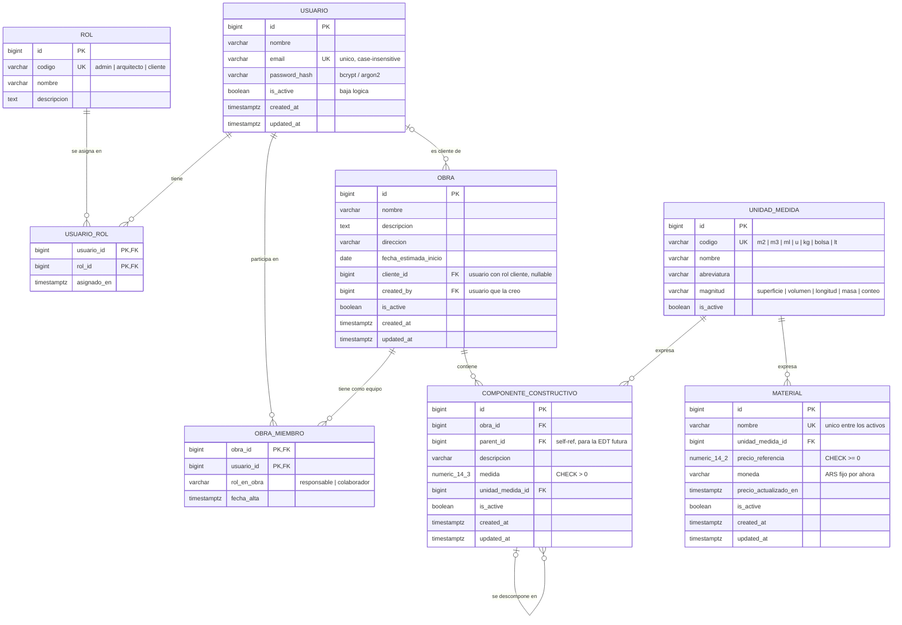

# Modelo de datos — Sprint 1

**Proyecto:** Proyecto Integral de Desarrollo — UCAio
**Alcance:** historias HU-0 a HU-5 del Sprint 1. Nada más.
**Base:** PostgreSQL 15+ / SQLAlchemy 2.0 / Alembic (ver [ADR-001](adr-001-stack.md))
**Estado:** propuesta para revisión del equipo
**Fecha:** 2026-09-03

Archivos que acompañan a este documento:

- [`ddl-sprint-1.sql`](ddl-sprint-1.sql) — el esquema completo en SQL, como especificación exacta.
- [`models_sprint_1.py`](models_sprint_1.py) — los modelos SQLAlchemy 2.0 listos para el repo.
- [`pruebas-invariantes.sql`](pruebas-invariantes.sql) — script que intenta romper cada regla del modelo, para comprobar que la base las rechaza.

> **Verificado.** El DDL corre limpio sobre PostgreSQL 16; los modelos SQLAlchemy generan un esquema **idéntico** al del DDL (mismas columnas, tipos, índices y constraints, comparados con `pg_dump`); y las 13 pruebas de `pruebas-invariantes.sql` dan el resultado esperado.

---

## 1. Criterio de diseño

Tres reglas ordenan todo lo que sigue. Si aparece una discusión durante el sprint, se resuelve volviendo acá.

1. **Se modela lo que las historias piden.** No hay tablas de proveedores, recetas constructivas, tareas ni presupuestos. Están en el documento de propuesta, no en el Sprint 1, y una tabla vacía que nadie usa igual hay que mantenerla, migrarla y explicarla en la defensa.

2. **Salvo cuando agregarlo después sale caro.** Agregar una columna nullable a una tabla es barato en cualquier momento. Partir una tabla en dos, o convertir una FK 1:N en una relación N:M cuando ya hay datos cargados y código consultándola, es caro: migración de datos + reescritura de queries + retoque del front. Por eso entran ahora `componente_constructivo.parent_id`, la tabla `obra_miembro` y el campo `moneda`, aunque el sprint no los ejercite.

3. **La base defiende sus propios invariantes.** Todo lo que se pueda expresar como `NOT NULL`, `CHECK`, `UNIQUE` o `FOREIGN KEY` va en el esquema, no solamente en el validador de Pydantic. El backend no es el único que va a escribir en esa base: también lo van a hacer los seeds, las migraciones y ustedes mismos desde `psql` a las 2 de la mañana antes de la demo.

---

## 2. Diagrama entidad-relación



**Cómo leer las cardinalidades:** `||` es exactamente uno, `o{` es cero o muchos, `|o` es cero o uno. Entonces `USUARIO |o--o{ OBRA` se lee: una obra tiene como cliente a cero o un usuario, y un usuario puede ser cliente de muchas obras.

**Sobre `MATERIAL`, que parece aislado:** no es un error del diagrama. En el Sprint 1 el catálogo de materiales es global y todavía no está vinculado a las obras — el puente entre un componente constructivo y los materiales que consume es la *receta constructiva*, que es el corazón del Módulo 2 y no entra acá. Que hoy sea una isla es correcto y esperado.

---

## 3. Decisiones de modelado

Cada decisión anota la alternativa que se descartó, para que dentro de dos meses nadie tenga que reconstruir el razonamiento.

### 3.1 Roles: tabla `rol` + `usuario_rol` (N:M)

Un usuario puede tener más de un rol. En una PyME de arquitectura el mismo tipo que administra el sistema es también el arquitecto que carga las obras, y un arquitecto puede ser el cliente de la obra de un colega. Con un enum en `usuario.rol` eso obliga a crear dos cuentas para la misma persona.

*Alternativa descartada:* enum en `usuario`. Es una línea de código menos hoy, pero sumar `proveedor` o `capataz` en el Módulo 2 implica `ALTER TYPE` (que en Postgres no se puede revertir dentro de una transacción, así que la migración de Alembic no tiene downgrade limpio) y el paso de 1 a N roles es una migración de datos, no una columna nueva.

*Costo que asumimos:* el chequeo de permisos hace un JOIN. Se resuelve una vez, cargando los códigos de rol del usuario dentro del token JWT al hacer login, y el resto de los endpoints leen del token.

### 3.2 Vínculo usuario–obra: `obra_miembro` (N:M) + `obra.cliente_id`

Son dos relaciones distintas que solo por casualidad apuntan a la misma tabla:

- **`obra_miembro`** responde *"¿quién puede ver y editar esta obra?"*. Es la que implementa el criterio de HU-3 ("solo veo las obras donde soy miembro"). Es N:M porque un estudio con dos arquitectos comparte obras desde el día uno.
- **`obra.cliente_id`** responde *"¿para quién es esta obra?"*. Es un dato del negocio: aparece en el listado, es único por obra y es opcional. Como FK directa se resuelve con un JOIN trivial y la base garantiza que hay a lo sumo un cliente.

*Alternativa descartada:* meter también al cliente en `obra_miembro` con `rol_en_obra = 'cliente'`. Es más uniforme, pero "un solo cliente por obra" pasa a depender de un índice parcial en lugar de ser evidente en el esquema, y cada listado de obras necesita un JOIN filtrado por un valor mágico. Mezcla un permiso de acceso con un atributo del dominio.

`obra_miembro.rol_en_obra` distingue `responsable` (quien creó la obra o quien la lidera) de `colaborador`. Hoy los dos ven y editan igual; existe para que el Sprint N no tenga que agregar la columna con datos ya cargados. Un índice parcial garantiza un solo responsable por obra.

### 3.3 Claves primarias: `BIGINT GENERATED ALWAYS AS IDENTITY`

Índices más chicos, URLs legibles (`/obras/12`), debug cómodo. `IDENTITY` en lugar de `SERIAL` porque es el estándar SQL y evita que alguien inserte un `id` a mano y desincronice la secuencia.

*Riesgo conocido:* los IDs son enumerables — cualquiera puede probar `/obras/13`. Se mitiga con el chequeo de membresía que HU-3 ya exige, devolviendo **404 y no 403** para no revelar que la obra existe. Ese chequeo hay que hacerlo igual con UUIDs; el UUID solo esconde el problema.

### 3.4 Baja lógica con `is_active`

Ya decidido por el equipo. Dos consecuencias que hay que tener presentes desde el primer endpoint:

- Todo listado filtra `WHERE is_active = TRUE`. Conviene resolverlo en una función/repositorio compartido y no repetir el `where` en 20 lugares, porque el día que se olviden en uno solo aparece un material dado de baja en un desplegable.
- Las FKs **nunca** llevan `ON DELETE CASCADE` hacia datos de negocio, porque no borramos. Los `CASCADE` del DDL están solo donde el borrado físico sí tiene sentido (`usuario_rol`, `obra_miembro`: son vínculos, no entidades).

### 3.5 Unicidad conviviendo con baja lógica

Acá hay una trampa clásica y la resolvemos distinto según el campo:

- **`usuario.email`: único global**, incluyendo los inactivos. El email es la identidad de login. Si se permitiera reusar el email de un usuario dado de baja, dos filas distintas competirían por la misma credencial y el reingreso del usuario original sería ambiguo. Al reactivar, se reactiva la fila existente.
- **`material.nombre`: único solo entre los activos** (índice parcial `WHERE is_active`). El nombre es una etiqueta, no una identidad: si dieron de baja "Cemento Loma Negra 50kg" por error y lo quieren volver a cargar, la base no tiene por qué impedirlo.

Ambos comparan en minúsculas (`lower(...)`) para que "Cemento" y "cemento" no convivan.

### 3.6 Dinero: `NUMERIC`, jamás `float`

`precio_referencia NUMERIC(14,2)`. Un `float` acumula error de redondeo y en un presupuesto de obra eso se nota. En Python el tipo es `Decimal`; en el JSON de FastAPI se serializa como string o número según configuren Pydantic — definirlo una vez y que el front lo respete.

`moneda VARCHAR(3)` con código ISO 4217, fijo en `'ARS'` por ahora. Está la columna, no está la lógica: no hay tabla de cotizaciones ni conversión. Cuando se necesite, el precio ya sabe en qué moneda está expresado y no hay que reinterpretar datos históricos.

### 3.7 Fechas: `TIMESTAMPTZ` para eventos, `DATE` para fechas de calendario

`created_at`, `updated_at`, `fecha_alta` son instantes → `TIMESTAMPTZ` (nunca `TIMESTAMP` a secas: el día que el server esté en UTC y ustedes en UTC-3, los timestamps sin zona mienten).
`fecha_estimada_inicio` es una fecha de calendario → `DATE`. "La obra arranca el 15 de octubre" no tiene hora ni zona horaria.

### 3.8 Estados y enumerados: `VARCHAR` + `CHECK`, no `ENUM` nativo

Aplica a `obra_miembro.rol_en_obra` y `unidad_medida.magnitud`. Un `CHECK` se modifica con un `ALTER TABLE` reversible; un tipo `ENUM` de Postgres no se puede alterar dentro de una transacción y complica el downgrade de Alembic. (`rol` es distinto: es una tabla porque tiene datos propios y una relación N:M.)

### 3.9 Jerarquía de componentes: lista de adyacencia + FK compuesta

`componente_constructivo.parent_id` es una FK a la propia tabla (*adjacency list*): simple, suficiente para una EDT de obra y consultable con `WITH RECURSIVE` cuando llegue el momento.

El detalle fino: un componente y su padre **tienen que pertenecer a la misma obra**. Eso se garantiza en la base con un truco estándar — se declara `UNIQUE (id, obra_id)` en la tabla y la FK del padre se hace compuesta, `(parent_id, obra_id) → (id, obra_id)`. Como `parent_id` es nullable, la restricción no se evalúa en los componentes raíz. Resultado: es *imposible* colgar un componente de una obra bajo el padre de otra obra, sin escribir una sola validación en Python.

Lo que la FK no puede evitar son los ciclos largos (A → B → A). El `CHECK` cubre el autopadre; el resto queda para cuando se implemente la EDT.

*Alternativas descartadas:* `ltree` o *nested sets*. Consultas más rápidas para árboles grandes y profundos, a cambio de mantener el path o los índices izquierda/derecha en cada movimiento. Una obra tiene decenas de componentes, no millones.

---

## 4. Diccionario de datos

### `rol` — catálogo cerrado de roles

| Columna | Tipo | Nulo | Notas |
|---|---|---|---|
| `id` | `BIGINT` identity | no | PK |
| `codigo` | `VARCHAR(30)` | no | UNIQUE. `admin`, `arquitecto`, `cliente`. Es el valor que usa el código; nunca se traduce ni se muestra crudo |
| `nombre` | `VARCHAR(60)` | no | Etiqueta para la UI ("Administrador") |
| `descripcion` | `TEXT` | sí | Qué puede hacer el rol |

Se carga por migración de datos, no por pantalla. Sin `is_active`: si un rol deja de usarse se borran sus asignaciones, no el rol.

### `usuario` — HU-1, HU-2

| Columna | Tipo | Nulo | Notas |
|---|---|---|---|
| `id` | `BIGINT` identity | no | PK |
| `nombre` | `VARCHAR(120)` | no | Nombre y apellido en un solo campo: no hay ningún requerimiento que los necesite separados |
| `email` | `VARCHAR(255)` | no | UNIQUE sobre `lower(email)`. Se normaliza a minúsculas antes de guardar |
| `password_hash` | `VARCHAR(255)` | no | bcrypt (~60 chars) o argon2 (~97). Nunca el password en claro, nunca este campo en un response de FastAPI |
| `is_active` | `BOOLEAN` | no | Default `TRUE`. En `FALSE` no puede loguearse (HU-2) |
| `created_at` / `updated_at` | `TIMESTAMPTZ` | no | Default `now()`; `updated_at` lo mantiene un trigger |

### `usuario_rol` — asignación N:M

| Columna | Tipo | Nulo | Notas |
|---|---|---|---|
| `usuario_id` | `BIGINT` | no | PK compuesta, FK → `usuario` `ON DELETE CASCADE` |
| `rol_id` | `BIGINT` | no | PK compuesta, FK → `rol` `ON DELETE RESTRICT` |
| `asignado_en` | `TIMESTAMPTZ` | no | Default `now()` |

### `obra` — HU-3

| Columna | Tipo | Nulo | Notas |
|---|---|---|---|
| `id` | `BIGINT` identity | no | PK |
| `nombre` | `VARCHAR(150)` | no | Obligatorio por HU-3. **No** único: dos clientes distintos pueden tener una "Casa Pérez" |
| `descripcion` | `TEXT` | sí | |
| `direccion` | `VARCHAR(255)` | sí | Texto libre. Cuando haga falta geolocalizar se agregan `lat`/`lng`, no se parte esto en calle/número |
| `fecha_estimada_inicio` | `DATE` | sí | |
| `cliente_id` | `BIGINT` | sí | FK → `usuario` `ON DELETE RESTRICT`. Debe tener rol `cliente` (validación de servicio, ver §5) |
| `created_by` | `BIGINT` | no | FK → `usuario`. Quién la creó. Barato ahora, imposible de reconstruir después |
| `is_active` | `BOOLEAN` | no | Baja lógica |
| `created_at` / `updated_at` | `TIMESTAMPTZ` | no | |

### `obra_miembro` — control de acceso de HU-3

| Columna | Tipo | Nulo | Notas |
|---|---|---|---|
| `obra_id` | `BIGINT` | no | PK compuesta, FK → `obra` `ON DELETE CASCADE` |
| `usuario_id` | `BIGINT` | no | PK compuesta, FK → `usuario` `ON DELETE RESTRICT` |
| `rol_en_obra` | `VARCHAR(20)` | no | `CHECK IN ('responsable','colaborador')`, default `colaborador`. Índice parcial: un solo `responsable` por obra |
| `fecha_alta` | `TIMESTAMPTZ` | no | Default `now()` |

Al crear una obra, el backend inserta en la misma transacción la fila del creador como `responsable`. Si eso no pasa, el arquitecto crea una obra que después no puede ver.

### `unidad_medida` — HU-0

| Columna | Tipo | Nulo | Notas |
|---|---|---|---|
| `id` | `BIGINT` identity | no | PK |
| `codigo` | `VARCHAR(10)` | no | UNIQUE. `m2`, `m3`, `ml`, `u`, `kg`, `bolsa`, `lt` |
| `nombre` | `VARCHAR(60)` | no | "Metro cuadrado" |
| `abreviatura` | `VARCHAR(10)` | no | Lo que se muestra al lado del número: "m²" |
| `magnitud` | `VARCHAR(20)` | no | `superficie`, `volumen`, `longitud`, `masa`, `conteo`. **No lo pide el sprint**; entra porque el seed lo llena gratis y sin él, el día que se implementen las recetas, no hay forma de saber que convertir m² a bolsas necesita un factor y m² a m³ no tiene sentido |
| `is_active` | `BOOLEAN` | no | Permite retirar una unidad sin romper los registros que la usan |

### `material` — HU-4

| Columna | Tipo | Nulo | Notas |
|---|---|---|---|
| `id` | `BIGINT` identity | no | PK |
| `nombre` | `VARCHAR(200)` | no | Único entre activos, comparando en minúsculas |
| `unidad_medida_id` | `BIGINT` | no | FK → `unidad_medida` `ON DELETE RESTRICT` |
| `precio_referencia` | `NUMERIC(14,2)` | no | `CHECK >= 0` |
| `moneda` | `VARCHAR(3)` | no | Default `'ARS'`, `CHECK` de 3 letras mayúsculas |
| `precio_actualizado_en` | `TIMESTAMPTZ` | sí | Cuándo se tocó el precio por última vez. Con inflación, un precio sin fecha no significa nada — y es el gancho natural de la tabla de histórico del Módulo 2 |
| `is_active` | `BOOLEAN` | no | |
| `created_at` / `updated_at` | `TIMESTAMPTZ` | no | |

Catálogo **global**, no por obra (criterio explícito de HU-4).

### `componente_constructivo` — HU-5

| Columna | Tipo | Nulo | Notas |
|---|---|---|---|
| `id` | `BIGINT` identity | no | PK |
| `obra_id` | `BIGINT` | no | FK → `obra` `ON DELETE CASCADE`. Un componente no existe fuera de su obra |
| `parent_id` | `BIGINT` | sí | FK compuesta `(parent_id, obra_id)` → `(id, obra_id)`. `NULL` = componente raíz |
| `descripcion` | `VARCHAR(255)` | no | "Contrapiso planta baja" |
| `medida` | `NUMERIC(14,3)` | no | `CHECK > 0`. Tres decimales: 12,5 m² y 0,375 m³ tienen que entrar sin redondeo |
| `unidad_medida_id` | `BIGINT` | no | FK → `unidad_medida` `ON DELETE RESTRICT` |
| `is_active` | `BOOLEAN` | no | |
| `created_at` / `updated_at` | `TIMESTAMPTZ` | no | |

---

## 5. Reglas que la base **no** puede garantizar

Estas van sí o sí en la capa de servicio del backend. Conviene que cada una tenga un test.

1. **`obra.cliente_id` debe apuntar a un usuario con rol `cliente`.** Es el precio de haber elegido roles N:M: una FK no puede mirar otra tabla. Se valida en el servicio de obras y el desplegable de HU-3 ya filtra por rol. (Si más adelante quieren blindarlo en la base, se hace con un trigger `BEFORE INSERT OR UPDATE`.)
2. **Filtrado por membresía en *todas* las lecturas de obra y de componentes.** El `WHERE` va en el repositorio, no en el front. Obra ajena → **404**, no 403.
3. **Un usuario no puede desactivarse a sí mismo** (HU-2).
4. **Un usuario inactivo no puede loguearse**, aunque las credenciales sean correctas. El mensaje de error es el mismo genérico de HU-1, para no filtrar información.
5. **El email se normaliza a minúsculas y sin espacios** antes de tocar la base; si no, el índice `lower(email)` rechaza duplicados que la app creía distintos y el error sale feo.
6. **Al crear una obra se inserta al creador en `obra_miembro`** en la misma transacción.
7. **Ciclos en la jerarquía de componentes** (A → B → A) cuando se implemente la EDT.
8. **`password_hash` nunca sale en un response.** Modelos de respuesta Pydantic explícitos, nunca `from_orm` sobre el modelo completo sin filtrar campos.

---

## 6. Índices

Además de los que crean solos las PKs y los UNIQUE:

| Índice | Sobre | Para qué |
|---|---|---|
| `uq_usuario_email_lower` | `usuario (lower(email))` | Login y unicidad case-insensitive |
| `ix_obra_miembro_usuario` | `obra_miembro (usuario_id)` | "Mis obras" — la query más frecuente de la app |
| `ix_obra_cliente` | `obra (cliente_id)` | Listado con JOIN al cliente |
| `uq_material_nombre_activo` | `material (lower(nombre)) WHERE is_active` | Unicidad de HU-4 conviviendo con la baja lógica |
| `ix_componente_obra` | `componente_constructivo (obra_id)` | Listado de componentes de una obra |
| `ix_componente_parent` | `componente_constructivo (parent_id)` | Recorrido del árbol (EDT futura) |
| `uq_obra_responsable` | `obra_miembro (obra_id) WHERE rol_en_obra='responsable'` | Un solo responsable por obra |

**Lo que no hacemos:** el buscador por nombre de HU-4 usa `ILIKE '%texto%'`, que no aprovecha un índice B-tree. Con un catálogo de cientos de materiales, un *seq scan* tarda menos de un milisegundo. Si algún día son decenas de miles, ahí se evalúa `pg_trgm` con un índice GIN. Hoy sería optimización prematura.

---

## 7. Convenciones

- **Nombres:** `snake_case`, tablas en **singular** (`usuario`, no `usuarios`), en español; columnas técnicas de infraestructura en inglés (`is_active`, `created_at`) porque son parte del vocabulario del framework. FKs siempre `<tabla>_id`, PK siempre `id`.
- **Constraints con nombre explícito:** `pk_`, `fk_`, `uq_`, `ck_`, `ix_`. Nunca dejar que Postgres los nombre solo. En SQLAlchemy esto se configura una vez con `naming_convention` en el `MetaData` — está en `models_sprint_1.py` y **tiene que estar antes de la primera migración autogenerada**, porque si no Alembic no puede referenciar constraints anónimas para modificarlas después.
- **`updated_at` lo mantiene un trigger de Postgres**, no el ORM. Así vale también para los `UPDATE` hechos a mano o desde una migración.
- **Migraciones:** una migración inicial que crea todo el esquema, y una segunda, separada, con los datos semilla (`rol`, `unidad_medida`, usuario admin). Separarlas permite recrear el esquema sin arrastrar seeds y hace obvio en el historial qué cambió estructura y qué cambió datos.

---

## 8. Lo que queda preparado (y lo que no está)

Este esquema es el núcleo. Los módulos siguientes se enganchan **sin migraciones destructivas**:

| Módulo futuro | Cómo entra | Qué le dejamos servido |
|---|---|---|
| EDT jerárquica | Ya está: `parent_id` + FK compuesta | Solo falta la UI y la query recursiva |
| Recetas constructivas | Tablas `tipo_componente` y `receta_item` (componente tipo → material + coeficiente) | `componente_constructivo` gana un `tipo_componente_id` nullable; `unidad_medida.magnitud` habilita validar conversiones |
| Histórico de precios | Tabla `material_precio (material_id, precio, moneda, vigente_desde)` | `material.precio_referencia` queda como caché del último precio; `precio_actualizado_en` ya marca la fecha |
| Corralones / proveedores | `proveedor` + `proveedor_material_precio` | El catálogo global de `material` es el destino de la normalización — se cruza con el proyecto de la materia de IA |
| Planificación (Gantt / CPM) | `tarea` + `tarea_dependencia`, colgando de `componente_constructivo` | Nada que migrar: son tablas nuevas |
| Presupuestos y cashflow | `presupuesto` + `presupuesto_item`, versionados | `moneda` y `NUMERIC` ya están donde tienen que estar |

**Explícitamente fuera:** roles con permisos granulares, auditoría de cambios (tabla de log), adjuntos/planos, estados de obra, notificaciones, multi-tenant por estudio.

---

## 9. Cómo verificar esto ustedes mismos

```bash
# con el Postgres del docker-compose levantado
createdb pid_sprint1
psql -d pid_sprint1 -v ON_ERROR_STOP=1 -f docs/ddl-sprint-1.sql
psql -d pid_sprint1 -f docs/pruebas-invariantes.sql
```

Las 10 operaciones marcadas `[DEBE FALLAR]` tienen que dar error de constraint, y las 3 marcadas `[DEBE PASAR]` tienen que insertar. Si alguna se comporta al revés, el esquema no está haciendo lo que este documento dice.

Para comprobar que los modelos y el DDL no se desincronizaron, crear dos bases —una con el DDL y otra con `Base.metadata.create_all()`— y comparar columnas, índices y constraints. Cuando el repo tenga Alembic, el equivalente es `alembic check` (no debe detectar diferencias entre los modelos y la última migración).

---

## 10. Checklist antes de escribir la primera migración

- [ ] El nombre de la app está definido (T-01) — condiciona el nombre de la base y del esquema.
- [ ] `naming_convention` configurada en el `MetaData` **antes** del primer `alembic revision --autogenerate`.
- [ ] Una migración de esquema + una migración de seeds, separadas.
- [ ] Seeds: 3 roles, 7 unidades de medida, 1 usuario admin (con la contraseña inicial fuera del repo, en `.env`).
- [ ] `alembic downgrade base` seguido de `alembic upgrade head` corre limpio sobre una base vacía. Probarlo el día 2, no el día 12.
- [ ] El trigger de `updated_at` está creado en la misma migración que las tablas.
- [ ] `docker compose up` levanta Postgres y las migraciones corren solas contra ese contenedor.
